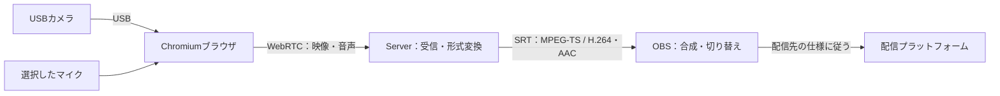
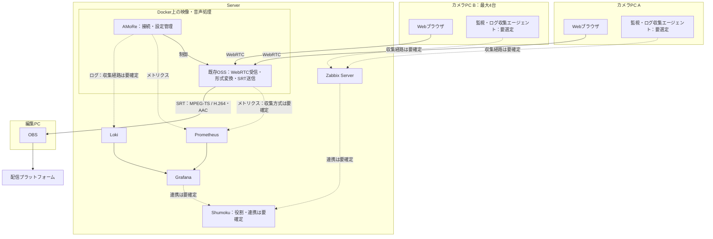

# AMoRe要件定義書 v2

- 更新日：2026-10-09
- 元文書：`requirements definition.md`
- 本書は元文書の要件を整理し、伝送経路と構成図の不一致を修正した版である。
- 「暫定」と記載した数値・動作条件は追加提案であり、試作・評価後に確定する。未決定の仕様は「要確定事項」に記載する。

## 正式名称

Aketi MoIP on Rust engine

## Mission

- 可能な限り既存OSSを活用して構築する。
- 複数のカメラ映像をOBSへ取り込み、OBSで合成・切り替え・配信できるようにする。
- 低遅延・高画質な映像・音声伝送を行う。
- ブラウザ側はJavaScript、Server側の接続・設定管理などの自作部分はRustで実装する。既存OSSの実装言語は制限しない。
- Server側の設定は`AMoRe.yaml`で管理する。対象には録画保存先、接続上限、映像・音声品質、接続先、SRTの遅延設定を含める。
- ブラウザの機器利用許可とOBS・監視製品側の設定方法は、それぞれの製品仕様に従う。

## 目的・利用場面

- 複数のカメラを使用し、簡易的なMoIP環境を構築する。
- 小規模イベントで、1人の操作者が複数台のカメラ映像を切り替えて配信する。

## 開発範囲・優先順位

| 段階 | 対応内容 | 範囲・確定状況 |
| --- | --- | --- |
| 1：初期版 | フルHD品質でカメラ→Server→OBSを接続 | カメラ最大4台を同時送信し、編集PC1台のOBSで全4映像を同時受信する。音声入力、送信画面、自動再接続、帯域不足時の品質調整を含む。 |
| 2 | 監視体制の導入 | Zabbix、Prometheus、Loki、Grafanaを用いた監視を整備する。監視の分担・通知条件は要確定。 |
| 3 | 4K対応 | 3840×2160を暫定の解像度とする。FPS、ビットレート、同時送信数、対応機器、遅延目標は別途確定する。 |
| 4 | 最大カメラ数を100台へ拡張 | 100台が登録数・同時送信数・OBS同時受信数のどれを指すかを確定してから、構成・必要資源・性能目標を定める。 |

- 初期版の性能目標を4K・100台対応へそのまま適用しない。
- OBSプラグインは接続先の選択・状態表示を簡略化するために実装する。初期版の映像受信はOBS標準機能を使用する。
- 自動録画の実装時期は要確定とし、初期版の必須機能への採否も併せて決定する。

## 映像・音声伝送の経路

- カメラPC→ServerはWebRTC、Server→OBSはSRTを使用する。
- Serverは各カメラから映像・音声を受信し、カメラごとに独立したストリームとしてOBSへ提供する。
- 映像の合成・切り替えと配信プラットフォームへの送信はOBSが担当する。
- Server→OBSは、映像H.264と音声AACを格納したMPEG-TSをSRTで伝送する。SRTは伝送方式、MPEG-TSはコンテナ形式、H.264・AACはコーデックとして区別する。
- Serverは受信データをOBSで扱える形式へ変換する。H.264のプロファイルなどが受信側に適合する場合は、映像を再エンコードせずにMPEG-TSへ格納して中継する。
- VP8で受信した映像はH.264へ変換する。ブラウザからOpusで受信した音声はAACへ変換する。
- SRT接続はServerをListener、OBSをCallerとし、OBSからServerへ接続する。
- 各カメラのSRT接続先を識別できるようにする。カメラ別ポートまたはStream IDによる識別方式は、採用OSSに合わせて確定する。
- 初期版はOBS標準の「メディアソース」でSRTを受信する。具体的な接続URLと入力形式は導入手順に記載する。[OBS公式ガイド](https://obsproject.com/kb/srt-protocol-streaming-guide)
- OBS→配信プラットフォームの送信方式は配信先の仕様に従う。

## ブラウザからの送信方式

- カメラPCはHTTPSで公開したAMoReの送信画面にアクセスする。映像送信のための専用アプリのインストールは不要とする。
- 利用者はカメラとマイクを選択し、ブラウザの機器利用許可を与える。
- `getUserMedia()`で映像・音声を取得し、`RTCPeerConnection`でServerへ送信する。[Media Capture仕様](https://www.w3.org/TR/mediacapture-streams/)、[WebRTC仕様](https://www.w3.org/TR/webrtc/)
- 接続確立に必要な情報はHTTPSのAPIで交換する。APIのパス・データ形式・認証方式は別途定義する。
- 映像コーデックはH.264を優先する。利用環境で使用できない場合はVP8で送信し、ServerでH.264へ変換する。
- NATなどにより直接接続できない環境ではSTUN／TURNを利用する。TURN経由の試験結果は直接接続と分けて記録する。
- 送信画面には映像プレビュー、カメラ・マイク選択、音声の有効・無効、送信開始・停止、接続状態、実際の解像度・FPS・ビットレートを表示する。
- カメラ未接続・権限不足など、自動復旧できない原因は画面に表示する。
- 音声を無効にした場合は映像のみを送信する。音声取得に失敗した場合は、その原因を表示して利用者が映像のみの送信を選択できるようにする（暫定案）。
- 切断時は自動再接続する。再試行間隔は1秒、2秒、4秒、以降4秒を上限とする暫定案とし、停止操作時は再試行を終了する。
- 初期版は1つの送信画面につき1カメラを扱う。バックグラウンド化、画面ロック、スリープ時の送信継続可否は対応環境で検証する。

## 音声仕様

以下は暫定仕様とする。

| 項目 | 暫定仕様 |
| --- | --- |
| 入力機器 | カメラ内蔵マイク、または利用者が選択した別のマイク |
| カメラPC→Server | Opusを使用する。[WebRTC音声仕様](https://www.rfc-editor.org/info/rfc7874/) |
| Server→OBS | AAC-LC、48kHz、最大2チャンネル、目標128kbps |
| チャンネル数 | 入力機器に応じてモノラルまたはステレオ。モノラルを無理にステレオ化しない。 |
| 同期 | 同一カメラの音声・映像のタイムスタンプ関係を維持してOBSへ提供する。 |
| 許容同期ずれ | OBS受信時の音声・映像のずれの絶対値を80ms以内とする。 |

- 異なるカメラ間のフレーム同期は初期版では保証しない。
- 複数マイクの同時利用による重複音声・エコーを避けるため、配信に使用する音声ソースはOBSで選択する。
- エコーキャンセル・ノイズ抑制・自動音量調整の有効・無効と操作方法は要確定とする。

## 性能目標

初期版の暫定目標とする。試作・評価により、達成できる基準機の仕様と設定を確定する。

| 項目 | 暫定目標 |
| --- | --- |
| 標準映像品質 | 1920×1080、30fps |
| 映像ビットレート | 1カメラあたり目標6Mbps、設定上限8Mbps。音声・通信ヘッダー・再送分は含めない。 |
| 同時接続 | カメラ4台、編集PC1台で全4映像を同時受信 |
| LANでの映像遅延 | カメラ撮影からOBSプレビュー表示まで、各カメラの95パーセンタイルで500ms以下 |
| WANでの映像遅延 | 同じ測定区間で、各カメラの95パーセンタイルで1,000ms以下 |
| 初回表示 | 利用許可済みの状態で送信開始とOBS接続開始を行い、両操作の遅い方から5秒以内に映像が表示されること |
| 切断からの復旧 | Serverが稼働し利用許可が有効な状態で、ネットワーク復旧後10秒以内にOBSで映像表示を再開 |
| 音声・映像同期 | 同一カメラについて、OBSでの同期ずれの絶対値が80ms以内 |
| 連続稼働 | 4台同時接続で8時間、プロセスの異常終了と想定外のストリーム切断がないこと |
| 帯域不足時 | ビットレートを下げ、必要に応じて1280×720・30fpsへ移行し、送信画面に品質低下を表示 |

- 標準映像品質は十分な帯域と対応カメラを前提とする。品質低下中の映像を1080p目標の達成として扱わない。
- 初回表示・復旧時間にはSRT接続とデコード可能な映像の到着を含める。キーフレーム要求などの具体的な復旧処理は実装時に検証する。
- SRTの遅延設定は撮影からOBS表示までの総遅延とは別に管理する。初期値はLANで120ms、WANで200msとする暫定案とし、OBS側との実際の交渉結果も記録する。[SRTの遅延仕様](https://github.com/Haivision/srt/blob/master/docs/features/latency.md)

## 帯域不足時の品質調整

以下の閾値・待機時間は暫定案とする。

- WebRTCの通信統計から推定利用可能帯域などを取得し、カメラPC→Serverの状態に応じて送信品質を調整する。
- 1080pでは目標6Mbps、上限8Mbpsとし、帯域不足を検出した場合はビットレートを下げる。
- 映像に利用できる推定帯域が4.5Mbps未満の状態が5秒継続した場合、720p・30fps、目標3Mbps・上限4Mbpsへ切り替える。
- 720pでも帯域が不足する場合はビットレートをさらに下げ、画面に帯域不足を表示する。30fpsを維持できない場合もその状態を表示する。
- 推定帯域が8Mbps以上の状態が15秒継続した場合は1080pへ復帰する。復帰後15秒以内の再低下では720pへ戻し、その後30秒は再度の復帰を保留する。
- 解像度の変更に失敗した場合は利用者へ通知する。
- 推定帯域の具体的な取得・算出方法は試作で確定する。取得できない環境では自動切り替えの可否を表示し、手動で品質を変更できるようにする。
- Server→OBSの帯域不足は別に監視する。映像の再エンコードなしで中継している場合も考慮し、送信元への品質変更要求またはServer側の変換処理のどちらを使うかを確定する。

## 性能測定・受け入れ条件

### 共通条件

- 4カメラを同時送信し、OBSで全4映像を同時受信・表示する。
- 各回線は、その区間を通る映像・音声の最大合計ビットレートの2倍以上の実効帯域を確保する。帯域はカメラ個別回線とServer・編集PCの集約回線を区別して記録する。
- カメラPC・Server・編集PCのCPU、GPU、メモリ、カメラ、OS、ブラウザ、OBS、採用OSSのバージョンを記録する。基準機の具体的な仕様は試作後に確定する。
- コーデック、実際の解像度・FPS・ビットレート、再エンコードの有無、TURN経由の有無、SRTの遅延設定を記録する。
- 再エンコードなしの経路とVP8→H.264の経路を分けて検証する。TURN経由も別試験として同じ目標への適否を判定する。
- 基準試験はServer録画を無効として実施する暫定案とする。録画有効時の性能目標・試験条件は録画仕様と併せて確定する。

### ネットワーク条件

| 試験 | 条件 |
| --- | --- |
| LAN | 有線接続。各伝送区間のRTTは5ms以下、試験装置によるパケット損失・遅延の追加なし。 |
| WAN | カメラPC→ServerとServer→OBSの各区間に対して、RTT50msを基準に遅延を付加し、片道遅延の揺らぎを±10ms、メディア送信方向の独立したランダムなパケット損失率を1%として試験する。実測RTTも記録する。 |
| 帯域不足 | カメラPC→Serverの帯域を段階的に下げ、品質低下・復帰を確認する。Server→OBSの制限は別ケースで検証する。 |
| 切断・復旧 | 各伝送区間を個別に10秒間切断し、回線復旧からOBSでの映像再表示までを測定する。 |

- WAN試験の基準RTTは遅延変動前の値とする。上記の損失試験はバースト損失を含めず、バースト損失時の要件は別途定義する。

### 測定方法・判定

- 映像遅延はカメラ撮影、エンコード、Server処理、伝送、OBSでのデコード・表示を含める。OBSから配信プラットフォームまでの遅延は含めない。
- カメラが撮影するタイマーとOBSに表示されたタイマーを同一の記録映像で比較するなど、時計の不一致による誤差を避ける方法を使用する。
- 遅延は30分以上、各カメラ100回以上、時間的に分散させて測定する。各カメラの測定値を昇順に並べ、`ceil(測定数 × 0.95)`番目を95パーセンタイルとして判定する。
- 測定装置の時間分解能・誤差を記録し、目標値付近の結果は測定誤差を考慮して判定する。
- 表示停止・欠損により遅延が測定できない時間を除外して合格としない。停止回数・合計停止時間を別途記録する。
- 初回表示・切断復旧は各カメラについて5回以上試験し、各回が時間目標を満たすことを確認する。
- 音声・映像同期は光と音が同時に発生する共通素材などで測定し、各カメラの同期ずれが目標を満たすことを確認する。
- 高画質の判定には細かな文字・動き・暗部を含む共通素材を使用する。素材、視聴条件、文字の判読性と映像破綻の合否基準は試験前に確定する。
- 8時間連続稼働では映像停止、フレーム欠損、メモリ使用量、再接続回数を記録する。許容停止時間・欠損率・資源使用量の上限は要確定とする。
- ネットワークを意図的に切断する試験は、切断なしの連続稼働試験と分ける。
- 未確定の合否基準が残っている場合は、該当要件を受け入れ完了としない。

## 使用技術

- [Rust](https://rust-lang.org/ja/)：Server側の自作処理。
- JavaScript：ブラウザの送信画面と機器・接続制御。
- [WebRTC](https://www.w3.org/TR/webrtc/)：ブラウザ→Serverの映像・音声伝送。
- [SRT](https://github.com/Haivision/srt)：Server→OBSの伝送。
- [Docker](https://www.docker.com/)：Server上のアプリケーション実行環境。
- [OBS](https://obsproject.com/ja)：映像受信・合成・切り替え・配信。
- [Zabbix](https://www.zabbix.com/jp)：監視。具体的な担当は要確定。
- [Prometheus](https://prometheus.io/)：メトリクス収集。
- [Loki](https://grafana.com/oss/loki/)：ログ収集・保存。
- [Grafana](https://grafana.com/)：メトリクス・ログの表示。
- WebRTC受信、MPEG-TSへの格納、コーデック変換、SRT送信に使用するOSSは、機能・性能・ライセンスを比較して選定する。

## 想定動作環境

### カメラPC

- Chromium系Webブラウザ、USB Webカメラ、必要に応じてマイクを使用する。
- 1080p・30fpsを取得できるカメラと、送信処理を実行できるCPUまたはGPUを必要とする。
- 映像送信用の専用アプリは不要とする。監視エージェントを導入する場合は別途扱う。
- 対応OS、ブラウザの製品名・バージョン、必要資源は要確定とする。

### Server

- Linux Serverを使用し、Rocky Linux／Ubuntuを検証候補とする。
- DockerでAMoReと必要なOSSを実行し、映像・音声処理の役割ごとに構成を定める。1カメラにつき1コンテナとするかは未確定とする。
- Server側の設定は`AMoRe.yaml`で管理する。
- CPU、メモリ、GPU、ネットワーク、録画ストレージの必要量は実測に基づいて確定する。
- 対応ディストリビューションのバージョンとDockerのバージョンは要確定とする。

### 編集PC

- OBSのメディアソースで複数のSRTストリームを取り込む。
- OBSプラグインで接続先選択・状態表示などの操作を簡略化する。
- 対応OS、OBSのバージョン、必要資源は要確定とする。

## 構成案

以下は機能上の構成案であり、コンテナ数やプロセス配置を確定する図ではない。監視系は開発段階2で整備する。

- 元文書の`DLoki Agent`は製品・役割が不明なため、ログ収集エージェントとして要選定事項へ整理する。
- カメラPCのメトリクス・ログをPrometheus・Lokiへ送る具体的な経路は、エージェント選定後に追記する。
- `Shumoku`の定義、Zabbix・Grafanaとの連携、通知・操作の担当範囲は要確定とする。

## 要確定事項

| 項目 | 確定すべき内容 |
| --- | --- |
| 認証・アクセス制御 | カメラ・操作者の認証、送信・受信権限、SRT接続の保護、外部公開範囲、認証情報の管理。インターネット公開前に確定する。 |
| HTTPS・ネットワーク | 証明書管理、使用ポート、ファイアウォール、STUN／TURNの運用・認証、必要帯域。 |
| 自動録画 | 実装時期、開始・停止条件、映像・音声形式、ファイル分割、保存期間、容量上限、容量不足時の動作、録画有効時の性能。 |
| AMoRe.yaml | 項目名、型、既定値、必須項目、値の検証、秘密情報の参照方式、設定変更の反映方法、再起動の要否。 |
| 接続・API | カメラID、登録・解除、上限超過時の動作、SRTのカメラ識別方式、接続確立API、重複接続の扱い。 |
| 障害復旧 | Server・処理OSSの再起動、カメラ切断、OBS切断、録画失敗時の動作と復旧範囲。 |
| 監視 | 各製品の担当、収集指標・間隔、保存期間、アラート条件、通知先、Shumokuの役割。 |
| 品質制御 | 推定帯域の算出方法、Server→OBSの帯域不足への対応、閾値・待機時間、手動操作と自動制御の優先関係。 |
| 対応環境・基準機 | 各PCのOS・製品バージョン、CPU・GPU・メモリ、対応カメラ・マイク、必要なストレージ・回線。 |
| 受け入れ基準 | 高画質の判定素材と基準、許容映像停止時間・欠損率、CPU・メモリ上限、録画を含む条件、対応するWAN条件の範囲。 |
| 将来拡張 | 4KのFPS・接続数・性能、100台の数え方と同時送信・受信数、カメラ間の同期が必要か。 |
| 導入・保守 | 起動・停止、更新、バックアップ・復元、ログ調査、障害対応、運用担当。 |
| OSS選定 | 採用製品とバージョン、ライセンス条件、Rustで自作する範囲、OBSプラグインの実装時期。 |

