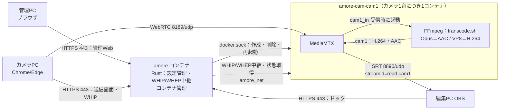

# ■ [AMoRe v0.1 Server 構築]
([2026/10/10])

# 概要
- **目的**: [カメラPCからWebRTCで受信した映像・音声を、カメラごとのSRTストリーム（MPEG-TS / H.264・AAC）としてOBSへ提供するServerを構築する]
- **理由・背景**: [AMoRe要件定義書 v2 の開発段階1（初期版）。カメラ最大4台・1080p30を、編集PC1台のOBSで同時受信する]
- **前提条件**:
  - 構築先
    - CoreServer（PRIMERGY RX100 S8 / Proxmox VE 9.2）`https://10.40.0.10:8006/`
      - Xeon E3-1220v3（4コア4スレッド）、RAM 16GB
      - `vmbr0` は VLAN対応ブリッジ、`bridge-vids 40`（[RX100 S8 セットアップ]・[AT-x530L-28GTX 26ポートルーティング設定] で構築済み）
    - x530L `port1.0.9`：tagged VLAN40
  - 作成するVM
    - Rocky Linux 9（Minimal）
    - 4 vCPU（CPU種別 `host`）/ メモリ 8GB / ディスク 64GB
    - Docker CE ＋ Docker Compose
  - 使用ソフトウェア
    - AMoRe v0.1（本リポジトリ `v0.1/Server`。Rust製、Docker上でビルド。Docker CLI 29 を同梱）
    - [MediaMTX](https://github.com/bluenviron/mediamtx) v1.21.1（FFmpeg同梱イメージ `bluenviron/mediamtx:1.21.1-ffmpeg`）。カメラごとにAMoReが自動で起動する
  - ip
    - AMoRe Server VM：`10.40.0.20/16`（GW `10.40.0.1`、DNS `1.1.1.1`、VLAN40）
    - 編集PC（OBS）：`10.30.0.10/16`（VLAN30）→ x530L のVLAN間ルーティングで到達
    - `10.40.0.20` が未使用であることを台帳等で確認してから使用する。別のIPにする場合は本書と `config/AMoRe.yaml` の `server.public_host` を読み替える
    - Docker内部ネットワーク `amore_net`：`172.30.40.0/24`（VM内のみ。既存のアドレス計画と重ならないこと）
  - 公開ポート（カメラごとにポートが分かれる。範囲は `AMoRe.yaml` の `media.*_ports`）

    | ポート | 用途 | 接続元 |
    | --- | --- | --- |
    | 443/tcp | 送信画面・OBSドック・管理Web・API（HTTPS） | カメラPC・編集PC・管理PC |
    | 8189-8192/udp | WebRTC（cam1=8189, cam2=8190 … の順に割当） | カメラPC・管理PC（映像確認） |
    | 8890-8893/udp | SRT（cam1=8890, cam2=8891 … の順に割当。Server=Listener） | 編集PC |

  - **将来性**
    - 開発段階2：Zabbix・Prometheus・Loki・Grafanaによる監視（同じProxmox上に別VMで構築予定）。カメラ単位のコンテナに分けたため、コンテナごとの資源使用量を監視できる
    - 開発段階3・4：4K対応、カメラ台数拡張（v0.1の性能目標・構成をそのまま適用しない）

## 構成



- **1カメラ＝1コンテナ**：管理Webでカメラを追加すると、AMoReが `config/AMoRe.yaml` にカメラを保存し、専用コンテナ `amore-cam-<カメラID>` を自動で作成・起動する。削除するとコンテナも削除する。
- 各コンテナは `<id>_in`（WebRTC受信）と `<id>`（OBS向け）の2つのパスを持つ。映像がH.264の場合は再エンコードせずにコピーし、VP8の場合はH.264へ変換する（CPU負荷が高い）。音声は常にOpus→AAC-LCへ変換する。
- カメラごとの `mediamtx.yml` と変換スクリプトは、AMoReが共有ボリューム `amore-shared` へ自動生成する。直接編集しない。
- AMoReは起動時と変更時に `AMoRe.yaml` とコンテナをそろえる（不足を作成、設定が変わったものを再作成、登録外を削除）。AMoReが停止していても、カメラのコンテナは送受信を続ける。
- **注意**：AMoReはDockerソケットを使うため、ホストの管理者権限に相当する操作ができる。v0.1の管理Webは認証なし（LAN内での利用が前提）のため、Server（443/tcp）へ到達できる範囲を信頼できる端末に限ること。

## ファイル構成

| パス | 内容 |
| --- | --- |
| `v0.1/Server/AMoRe.example.yaml` | 設定例（Git管理） |
| `v0.1/Server/config/AMoRe.yaml` | 稼働中の設定（設定例をコピーして作成。管理Webが `cameras` を書き換える。Git管理外） |
| `v0.1/Server/compose.yaml` | Docker Compose 定義（amore のみ。カメラのコンテナはAMoReが作成） |
| `v0.1/Server/amore/` | AMoRe本体（Rust）、Dockerfile、変換スクリプト `assets/transcode.sh` |
| `v0.1/Server/admin/` | 管理Web（amore が `/admin/` で配信） |
| `v0.1/Server/scripts/gen-cert.sh` | 自己署名証明書の作成 |
| `v0.1/Server/certs/` | 証明書・秘密鍵の配置先（Git管理外） |
| `v0.1/Camera/www/` | 送信画面（amore が `/` で配信） |
| `v0.1/OBS/dock/` | OBSドック（amore が `/obs/` で配信） |

# 参考資料
- [Rocky Linux ダウンロード](https://rockylinux.org/download)
- [Docker Engine install on RHEL](https://docs.docker.com/engine/install/rhel/)
- [MediaMTX README](https://github.com/bluenviron/mediamtx)
- [Proxmox VE Administration Guide – Qemu/KVM Virtual Machines](https://pve.proxmox.com/pve-docs/chapter-qm.html)
- [OBS SRT Protocol Streaming Guide](https://obsproject.com/kb/srt-protocol-streaming-guide)

# 構築手順

## 1. VMを作成する（Proxmox）

### [isoダウンロード]
  - Proxmox WebGUI `https://10.40.0.10:8006/` へrootでログインする（認証情報は管理台帳を参照。本書には記載しない）
  - `Datacenter` → `CoreServer` → `local` → `ISO Images` → `Download from URL`
    ```text
    URL       : https://download.rockylinux.org/pub/rocky/9/isos/x86_64/Rocky-9-latest-x86_64-minimal.iso
    File name : Rocky-9-latest-x86_64-minimal.iso
    Hash algorithm : SHA-256
    Checksum  : 同じディレクトリの CHECKSUM ファイルに記載された minimal.iso の値
    ```
  - `Query URL` → `Download`。タスクログに `OK` とチェックサム一致が表示されることを確認する
    - 取得時点で9系の最新版を使う。ダウンロードしたファイル名（版数）を作業記録に残す

### [VM作成]
  `Create VM` で以下を設定する。記載のない項目は既定値。

  | タブ | 項目 | 設定値 |
  | --- | --- | --- |
  | General | VM ID / Name | `140` / `amore01`（VM IDは空き番号でよい） |
  | OS | ISO image | `Rocky-9-latest-x86_64-minimal.iso`、Guest OS: Linux 6.x - 2.6 Kernel |
  | System | Machine / Qemu Agent | `q35` / ✔ |
  | Disks | Bus / Size / Storage | `SCSI`（VirtIO SCSI single）/ `64` GiB / インストール時に作成した `local-lvm` または `local-zfs`、Discard ✔ |
  | CPU | Sockets / Cores / Type | `1` / `4` / **`host`** |
  | Memory | Memory | `8192` MiB |
  | Network | Bridge / VLAN Tag / Model | `vmbr0` / **`40`** / `VirtIO (paravirtualized)` |

  - CPU種別を`host`にし、映像変換（FFmpeg）でCPUの拡張命令を使えるようにする
  - ホストは4コアのため、4 vCPUを割り当てると他VMとCPUを取り合う。v0.1の試験中は他の負荷の高いVMを同時に動かさない
  - `Confirm` で内容を確認し、`Start after created` は外して `Finish`
  - 新規VMのため、この段階の切り戻しはVM削除で行う。スナップショットはDocker導入後（手順4）に取得する

## 2. Rocky Linux をインストールする

### [インストーラーの実行]
  1. `amore01` → `Start` → `Console`
  1. `Install Rocky Linux 9.x`
  1. 言語：日本語
  1. `ネットワークとホスト名`
      ```text
      ホスト名     : amore01
      イーサネット : ens18（オン）→ 設定 → IPv4設定
      方式         : 手動
      アドレス     : 10.40.0.20
      ネットマスク : 16（255.255.0.0）
      ゲートウェイ : 10.40.0.1
      DNSサーバー  : 1.1.1.1
      IPv6設定     : 無視する（v0.1はIPv4のみ）
      ```
      - VLANタグはProxmox側（VLAN Tag 40）で付与するため、OS側ではVLANを設定しない
  1. `時刻と日付`：アジア/東京、ネットワーク時刻 オン
  1. `インストール先`：64GBのディスク、ストレージの構成は自動
  1. `ソフトウェアの選択`：最小限のインストール
  1. `rootパスワード`：設定する（**SSHでのrootログインは許可しない**）。値は管理台帳で管理し、本書・リポジトリに記載しない
  1. `ユーザーの作成`
      ```text
      ユーザー名 : amore
      このユーザーを管理者にする : ✔（wheel）
      パスワード : 管理台帳で管理する値
      ```
  1. `インストールの開始` → 完了後 `システムの再起動`

### [再起動後の確認]
  Proxmoxのコンソールで `amore` でログインし、確認する。
  ```bash
  ip -br addr
  ip route
  ping -c 3 10.40.0.1
  ping -c 3 1.1.1.1
  ```
  - `ens18` に `10.40.0.20/16`、デフォルト経路が `10.40.0.1` であること
  - 編集PC（VLAN30）のPowerShellから到達を確認する
    ```powershell
    Test-NetConnection 10.40.0.20 -Port 22
    ```
  - 以降はSSH（`ssh amore@10.40.0.20`）で作業してよい

## 3. OSの初期設定

### [パッケージ更新・ゲストエージェント]
  ```bash
  sudo dnf -y update
  sudo dnf -y install qemu-guest-agent git
  sudo systemctl enable --now qemu-guest-agent
  sudo reboot
  ```
  - 再起動後、Proxmoxの `amore01` → `Summary` にIPアドレスが表示されることを確認する（ゲストエージェント動作確認）

### [SELinux・時刻の確認]
  ```bash
  getenforce
  timedatectl
  ```
  - `Enforcing` のまま運用する。amore コンテナだけは Dockerソケットへ接続するため `compose.yaml` で `label=disable`（SELinuxのラベル分離を無効）にしている。カメラのコンテナは通常どおり分離される
  - `System clock synchronized: yes` であること（遅延測定・ログ照合のため）

### [firewalld]
  ```bash
  sudo firewall-cmd --permanent --add-service=https
  sudo firewall-cmd --permanent --add-port=8189-8192/udp
  sudo firewall-cmd --permanent --add-port=8890-8893/udp
  sudo firewall-cmd --reload
  sudo firewall-cmd --list-all
  ```
  - `services` に `https`、`ports` に `8189-8192/udp 8890-8893/udp` があること
  - `AMoRe.yaml` の `media.webrtc_udp_ports`・`media.srt_ports` を変えた場合は、ここで開ける範囲も合わせる
  - Dockerは公開ポートの通信規則を自身で追加するため、firewalldの許可を外してもコンテナの公開ポートは閉じない場合がある。公開範囲の制限は要確定事項（認証・アクセス制御）と併せて設計する

## 4. Docker を導入する

### [Docker CE]
  ```bash
  sudo dnf -y install dnf-plugins-core
  sudo dnf config-manager --add-repo https://download.docker.com/linux/rhel/docker-ce.repo
  sudo dnf -y install docker-ce docker-ce-cli containerd.io docker-buildx-plugin docker-compose-plugin
  sudo systemctl enable --now docker
  sudo usermod -aG docker amore
  ```
  - 一度ログアウトして再ログインし、`sudo`なしで実行できることを確認する
    ```bash
    docker version
    docker compose version
    docker run --rm hello-world
    ```
  - 表示されたDocker・Composeのバージョンを作業記録に残す（要件：採用OSSのバージョン記録）

### [スナップショット取得]
  Proxmoxで `amore01` → `Snapshots` → `Take Snapshot`
  ```text
  Name        : os-docker-ready
  Description : Rocky Linux 9 + Docker 導入直後（AMoRe未導入）
  ```

## 5. AMoRe を配置する

### [リポジトリ取得]
  ```bash
  sudo mkdir -p /opt/AMoRe
  sudo chown amore: /opt/AMoRe
  git clone https://github.com/Aketi-Maika/AMoRe.git /opt/AMoRe
  cd /opt/AMoRe/v0.1/Server
  git log --oneline -1
  ```
  - 取得したコミットIDを作業記録に残す

### [Dockerネットワークの作成]
  AMoRe とカメラのコンテナをつなぐネットワークを作成する（初回のみ）。
  ```bash
  docker network create --subnet 172.30.40.0/24 amore_net
  docker network inspect amore_net --format '{{range .IPAM.Config}}{{.Subnet}}{{end}}'
  ```
  - `172.30.40.0/24` と表示されること
  - サブネットを変える場合は `config/AMoRe.yaml` の `media.docker_subnet` も同じ値にする（カメラのコンテナがAMoReからの中継を許可するために使う）

### [TLS証明書の作成]
  ブラウザはHTTPSでなければカメラ・マイクを利用できないため、自己署名証明書を作成する。
  ```bash
  cd /opt/AMoRe/v0.1/Server
  sh scripts/gen-cert.sh 10.40.0.20
  ls -l certs/
  ```
  - `certs/server.crt`（配布用）と `certs/server.key`（Server外へ出さない）が作成される
  - 表示された **SHA256フィンガープリント** を記録する。カメラPC・編集PCへ配布した証明書と照合する
  - 有効期限は825日。期限前に作り直し、配布先の証明書も入れ替える

### [AMoRe.yaml の作成・確認]
  設定例をコピーして稼働用の設定を作る。`config/` はGit管理外のため、`git pull` で上書きされない。
  ```bash
  cd /opt/AMoRe/v0.1/Server
  cp AMoRe.example.yaml config/AMoRe.yaml
  vi config/AMoRe.yaml
  ```

  | 項目 | 確認内容 |
  | --- | --- |
  | `server.public_host` | VMのIP `10.40.0.20`（変えた場合は合わせる） |
  | `media.image` | `bluenviron/mediamtx:1.21.1-ffmpeg`（カメラのコンテナのイメージ） |
  | `media.docker_subnet` | `amore_net` のサブネット `172.30.40.0/24` |
  | `media.webrtc_udp_ports` / `media.srt_ports` | `8189-8192` / `8890-8893`（firewalldで開けた範囲） |
  | `cameras` | `[]` のままでよい（管理Webで追加する） |
  | `srt.latency_ms` | LAN：`120` / WAN試験：`200`（暫定） |
  | `ice_servers` | LAN内では `[]`。NAT越えが必要な場合のみSTUN/TURNを指定 |
  | `recording.enabled` | `false`（基準試験は録画無効） |

  ビルドして検証する（エラーがあれば項目名と理由が表示される）。
  ```bash
  docker compose build
  docker compose run --rm --no-deps amore check
  ```
  - 初回ビルドはRustのコンパイルに数分～十数分かかる。**v0.1のRustコードは本手順で初めてコンパイルされる**ため、ビルドエラーが出た場合はエラー全文を記録して開発側へ連絡する
  - `OK: /config/AMoRe.yaml（カメラ 0 台 / 上限 4 台）` と表示されること

## 6. 起動する

### [コンテナ起動]
  ```bash
  cd /opt/AMoRe/v0.1/Server
  docker compose up -d
  docker compose ps
  docker compose logs --tail 50 amore
  ```
  - `amore` が `healthy` であること
  - ログに `AMoRe v0.1.0 を https://0.0.0.0:8443 で起動します`、`管理Web: https://10.40.0.20/admin/`
  - 初回はカメラ用イメージ `bluenviron/mediamtx:1.21.1-ffmpeg` の取得が行われ、`イメージを取得しました` と表示される
  - `restart: unless-stopped` のため、VM再起動後も自動で起動する。カメラのコンテナも同じ設定で作成される

### [Server内での確認]
  ```bash
  curl -sk https://127.0.0.1/healthz; echo
  curl -sk https://127.0.0.1/api/v1/admin/overview; echo
  ```
  - `ok` が返ること
  - overview の `runtime.docker_version` にDockerのバージョン、`runtime.image_ready` が `true`、`runtime.docker_error` が `null` であること

### [編集PC・カメラPCからの確認]
  PowerShellで実行する。
  ```powershell
  Test-NetConnection 10.40.0.20 -Port 443
  ```
  - `TcpTestSucceeded : True` であること。`SourceAddress` が有線（例：`10.30.0.10`）であること
  - UDP（WebRTC・SRT）は `Test-NetConnection` で確認できないため、管理Webの映像確認、Camera・OBSの手順書で実際の送受信により確認する
  - 証明書の信頼設定は Camera 手順書の「証明書の信頼登録」と同じ手順で、管理に使うPCにも行う

## 7. 管理Webでカメラを追加する

### [管理Webを開く]
  管理PC（例：編集PC）のブラウザで次を開く。
  ```text
  https://10.40.0.20/admin/
  ```
  - 右上が `Docker 29.x.x`（緑）であること
  - 「カメラが登録されていません」と表示されること

### [カメラの追加]
  1. `＋ カメラを追加`
  1. 入力する

      | 項目 | 入力例 | 備考 |
      | --- | --- | --- |
      | カメラID | （空欄） | 空欄なら `cam1`、`cam2` … を自動で割り当てる。後から変更できない |
      | 表示名 | `ステージ正面` | 後から変更できる |

  1. `追加` → `コンテナ作成中…` の後、カードが表示される
  1. カードを確認する

      | 表示 | 期待値 |
      | --- | --- |
      | 右上のバッジ | `稼働中`（緑） |
      | 見出しの下 | `cam1　/　amore-cam-cam1` |
      | ポート | `WebRTC 8189/udp　SRT 8890/udp`（追加順に割当） |
      | SRT URL | `srt://10.40.0.20:8890?streamid=read:cam1&latency=120000`（OBSに入力する値） |
      | 受信 | `未送信` |

  1. Serverでコンテナと設定を確認する
      ```bash
      docker ps --filter label=amore.managed=true
      grep -A4 '^cameras:' config/AMoRe.yaml
      ```
      - `amore-cam-cam1` が `Up` で、`0.0.0.0:8189->8189/udp` と `0.0.0.0:8890->8890/udp` が公開されていること
      - `config/AMoRe.yaml` の `cameras:` に追加したカメラが保存されていること（直前の内容は `config/AMoRe.yaml.bak`）
  1. 使用する台数（最大4台）まで繰り返す

### [映像の確認]
  1. カメラPCで送信を開始する（Camera手順書）。カードの `送信画面` リンクを開くと、そのカメラIDが選択された状態で送信画面が開く
  1. カードの `受信` が `受信中　H264 / Opus → H264 / AAC（再エンコードなし）` になること
  1. `映像確認` を押すと、カードに映像が表示され、右下に解像度（例：`1920×1080`）が出ること
      - 音声は初期状態でミュート。`音声をオン` で確認できる
      - 映像確認はServerからWebRTCで受信するため、管理PCからそのカメラのWebRTCポート（例：`8189/udp`）へ到達できる必要がある
      - 映像確認中はServerの送信帯域を使う。確認が終わったら `停止` を押す
  1. 送信されていないカメラで `映像確認` を押すと「このカメラは送信されていないため表示できません」と表示される

### [その他の操作]

| 操作 | 内容 |
| --- | --- |
| 名前変更 | 表示名だけを変更する。コンテナは再作成しない |
| 再起動 | そのカメラのコンテナだけを再起動する。送信・OBS受信は一時的に切断され、自動で再接続する |
| ログ | そのカメラのコンテナ（MediaMTX・FFmpeg）のログ直近300行を表示する |
| 削除 | カメラを `AMoRe.yaml` から削除し、コンテナも削除する。割り当てていたポートは次の追加で再利用される |
| 再適用 | `AMoRe.yaml` とコンテナをそろえ直す（手動で消したコンテナの再作成、登録外のコンテナの削除） |

### [スナップショット取得]
  ```text
  Name        : amore-v0.1
  Description : AMoRe v0.1 起動確認済み（コミットID: <記録した値>、カメラ: <登録したID>）
  ```

# 運用

### [設定変更の反映]
  カメラの追加・削除・名前変更は管理Webで行う（再起動不要）。それ以外の項目を変更する場合:
  ```bash
  cd /opt/AMoRe/v0.1/Server
  vi config/AMoRe.yaml
  docker compose run --rm --no-deps amore check
  docker compose up -d --force-recreate
  ```
  - AMoReの再起動時、カメラのコンテナの設定（映像・音声・SRT・ポート等）が変わっていれば、そのコンテナを自動で作り直す（送信中のカメラ・OBSの接続は一度切断され、自動再接続する）
  - `config/AMoRe.yaml` を手で編集している間に管理Webでカメラを操作すると、`cameras:` 以外の未反映の変更もファイル上は残るが、反映は再起動時になる

### [更新]
  ```bash
  cd /opt/AMoRe
  git pull
  cd v0.1/Server
  diff AMoRe.example.yaml config/AMoRe.yaml   # 設定例に追加された項目がないか確認する
  docker compose up -d --build
  ```

### [停止・ログ]
  ```bash
  docker compose stop                                  # AMoRe（管理Web・送信画面）を停止。カメラのコンテナは動き続ける
  docker stop $(docker ps -q --filter label=amore.managed=true)   # カメラのコンテナも停止する
  docker compose logs -f amore                         # 接続・WHIP・コンテナ管理のログ
  docker logs -f amore-cam-cam1                        # カメラ1の受信・SRT・FFmpegのログ（管理Webの「ログ」と同じ）
  docker stats                                         # コンテナごとのCPU・メモリ使用量（試験時の記録に使う）
  ```
  - 停止したカメラのコンテナは、管理Webの `再起動` または `再適用`、AMoReの再起動で起動する

# 確認項目（受け入れ試験の前提）

| 確認 | 期待値 |
| --- | --- |
| `docker compose ps` | amore healthy |
| `docker ps --filter label=amore.managed=true` | 登録したカメラの数だけ `amore-cam-<ID>` が `Up` |
| 管理Web | 各カメラのバッジが `稼働中` |
| カメラ送信後 | 該当カメラの `受信` が `受信中`、入力に `H264` |
| 映像確認 | 管理Webで各カメラの映像・音声が表示される |
| OBS受信後 | `OBS接続` が1以上 |
| 記録 | Rocky Linux・Docker・MediaMTXのバージョン、AMoReのコミットID、証明書フィンガープリント、カメラIDとポートの対応 |

- 性能目標（遅延・同期・連続稼働など）の測定方法は要件定義書 v2「性能測定・受け入れ条件」に従う。基準試験中は管理Webの映像確認を停止する（Serverの負荷・帯域に影響するため）。

# 切り戻し手順

1. カメラを個別に外す場合は、管理Webで `削除`（コンテナも削除される）。
1. AMoReとカメラのコンテナをすべて停止・削除する（設定・証明書は残る）。
    ```bash
    cd /opt/AMoRe/v0.1/Server
    docker rm -f $(docker ps -aq --filter label=amore.managed=true)
    docker compose down
    docker network rm amore_net
    docker volume rm amore-shared amore-recordings
    ```
    - `amore-recordings` は録画を有効にしていた場合に録画ファイルを含む。必要なら先に退避する
1. OS・Dockerの状態まで戻す場合は、Proxmoxで `amore01` → `Snapshots` → `os-docker-ready` → `Rollback`。
1. VMごと不要な場合は `amore01` を停止して `Remove`（`10.40.0.20` は台帳上で解放する）。
1. firewalldの許可を戻す場合
    ```bash
    sudo firewall-cmd --permanent --remove-service=https
    sudo firewall-cmd --permanent --remove-port=8189-8192/udp
    sudo firewall-cmd --permanent --remove-port=8890-8893/udp
    sudo firewall-cmd --reload
    ```
- x530L・Proxmoxホストのネットワーク設定は本手順で変更しないため、切り戻し対象外。

# トラブルシューティング

| 症状 | 確認・対処 |
| --- | --- |
| VMから `10.40.0.1` へpingできない | ProxmoxのVM NICの VLAN Tag が `40` か。ホストの `vmbr0` が `bridge-vids 40` を含むか。x530L `port1.0.9` が VLAN40 tagged か（[AT-x530L-28GTX 26ポートルーティング設定] 参照） |
| `docker compose up` で `network amore_net declared as external, but could not be found` | 手順5「Dockerネットワークの作成」を実施する |
| `check` で検証エラー | 表示された項目名を修正する。未知のキーは誤記としてエラーになる |
| amore が起動しない（`TLS証明書を読み込めません`） | `certs/server.crt`・`server.key` があるか。`gen-cert.sh` を実行したか |
| amore が起動しない（`設定ファイルを読み込めません: /config/AMoRe.yaml`） | `config/AMoRe.yaml` を作成したか（手順5） |
| 管理Webに「Dockerに接続できません」 | `compose.yaml` の `/var/run/docker.sock` のマウントと `label=disable` を外していないか。`sudo ausearch -m avc -ts recent` でSELinuxの拒否を確認 |
| 管理Webに「イメージを取得できません」 | VMからインターネット（Docker Hub）へ到達できるか。`docker pull bluenviron/mediamtx:1.21.1-ffmpeg` を手動で実行して結果を確認。取得後は30秒以内に自動で再試行される |
| カメラ追加でエラー「AMoRe.yaml の cameras を正しく書き換えられませんでした」 | `config/AMoRe.yaml` の `cameras:` を手で編集している場合、行頭（字下げなし）のコメントを `cameras:` の中に入れない |
| カメラ追加でエラー（書き込めません） | `config/` ディレクトリの権限。`ls -la config/` |
| カードのバッジが `停止` / `異常終了` | `ログ` で原因を確認（設定エラー・ポート使用中など）。`再起動` を押す |
| コンテナ作成で `port is already allocated` | 割り当てたUDPポートを他のプロセス・コンテナが使用中。`sudo ss -lunp` で確認する |
| 送信画面で「Server に接続できません」 | `curl -sk https://127.0.0.1/healthz`。firewalldの `https` 許可 |
| 送信画面で「カメラが登録されていません」 | 管理Webでカメラを追加してから送信画面を再読み込みする |
| 送信画面が「接続中」から進まない（ICE失敗） | `server.public_host` がVMの実IPか。カメラPCから、そのカメラのWebRTCポート（例：`8189/udp`）が通るか。カメラPCがVPN・別経路を使っていないか |
| 409「別の送信画面から送信中」 | 同じカメラIDを別の画面で使っている。別IDを選ぶか、もう一方を停止する。直前に閉じた画面の場合は約15秒～30秒待つ |
| 管理Webで受信中なのに映像確認が表示されない | 管理PCからそのカメラのWebRTCポートへ到達できるか。ブラウザが証明書を信頼しているか |
| OBSで映らない | 管理Webで `受信中` と `再エンコードなし`/`H.264へ変換中` の表示を確認。`受信中・変換準備中` のままなら `ログ` でFFmpegのエラーを確認。OBSのURLのポート（カメラごとに異なる）を確認 |
| VP8受信時に映像が遅れる・止まる | `docker stats` で該当コンテナのCPU使用率を確認。VP8→H.264変換は1台あたりの負荷が大きい。カメラPCのブラウザでH.264が使えるか（Camera手順書）を確認する |
