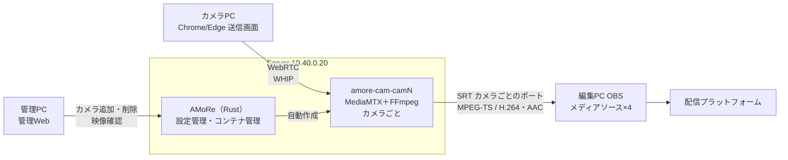

# AMoRe v0.2

Aketi MoIP on Rust engine — 開発段階1（初期版）。要件は [`requirements definition_v2.md`](../requirements%20definition_v2.md) を参照。

カメラPCのブラウザからWebRTCで送った映像・音声を、ServerがカメラごとのSRTストリーム（MPEG-TS / H.264・AAC）に変換し、編集PCのOBSで最大4台同時に受信する。
Serverの管理Webでカメラを追加すると、そのカメラ専用のメディア処理コンテナ（MediaMTX＋FFmpeg）が自動で作成される（**1カメラ＝1コンテナ**）。

## v0.1 からの変更点

v0.1 の実機試験で、パケット損失により映像が乱れ、OBSへ出力されない（`no stream is available on path`）問題が出たため、損失に強くした。

- **UDP受信バッファの拡大**：カメラのコンテナに `udpReadBufferSize`（`AMoRe.yaml` の `media.udp_read_buffer_bytes`、既定8MB）を設定。ホストの sysctl 設定手順を追加。
- **変換開始の高速化**：H.264のSPS/PPSを受信してからFFmpegを起動し、入力の探索時間を短縮。壊れたフレームは破棄する。
- **再接続の抑制**：送信画面は通信が一時的に不安定（ICE `disconnected`）になっても10秒は再接続せず回復を待つ（v0.1は3秒）。再接続のたびに変換が再起動してOBSの映像が途切れるのを防ぐ。
- **パケット損失の表示**：送信画面に損失率・再送要求・再送数を表示（2%超で警告）。
- 切り分け手順をServer手順書のトラブルシューティングに追加。

v0.1 で稼働中の Server を更新する手順は、Server手順書の「[v0.1 から v0.2 への更新](Server/AMoRe-Server_構築手順書.md#v01-から-v02-への更新)」を参照（登録済みカメラ・ポート・証明書は引き継ぐため、OBS とカメラPCの設定変更は不要）。



## 構成

| フォルダ | 内容 | 構築手順書 |
| --- | --- | --- |
| [`Server/`](Server/) | AMoRe本体（Rust）、管理Web、Docker Compose、`AMoRe.example.yaml` | [AMoRe-Server_構築手順書.md](Server/AMoRe-Server_構築手順書.md) |
| [`Camera/`](Camera/) | ブラウザ送信画面（JavaScript）。Serverが `https://<Server>/` で配信 | [AMoRe-Camera_構築手順書.md](Camera/AMoRe-Camera_構築手順書.md) |
| [`OBS/`](OBS/) | シーンコレクション、状態表示ドック。ドックはServerが `https://<Server>/obs/` で配信 | [AMoRe-OBS_構築手順書.md](OBS/AMoRe-OBS_構築手順書.md) |
| [`VPN/`](VPN/) | 遠隔拠点（IX2215）へ VLAN40 を L2 延伸する SoftEther VPN Server（EtherIP over IPsec）、IX2215 設定例 | [AMoRe-VPN_構築手順書.md](VPN/AMoRe-VPN_構築手順書.md) |

構築順序：**Server（管理Webでカメラ追加まで）→ Camera → OBS**（遠隔拠点のカメラPCを使う場合は Camera の前に VPN）

## ネットワーク

| 機器 | IP / VLAN | 備考 |
| --- | --- | --- |
| CoreServer（Proxmox） | `10.40.0.10/16` / VLAN40 | Server VMのホスト |
| AMoRe Server VM `amore01` | `10.40.0.20/16` / VLAN40 | Rocky Linux 9 + Docker |
| 編集PC（OBS） | `10.30.0.10/16` / VLAN30 | x530LでVLAN間ルーティング |
| SoftEther VPN Server VM `sevpn01` | `10.40.0.30/16` / VLAN40 | 任意（遠隔拠点を使う場合）。UDP 500/4500 を本拠点ルーターから転送 |
| 遠隔拠点 IX2215 `BVI1` | `10.40.0.31/16` / VLAN40（L2延伸） | 任意（遠隔拠点を使う場合） |

| ポート | 用途 |
| --- | --- |
| 443/tcp | 送信画面・OBSドック・管理Web・API |
| 8189-8192/udp | WebRTC（カメラPC→Server、管理Webの映像確認）。カメラごとに1つ |
| 8890-8893/udp | SRT（Server→OBS）。カメラごとに1つ |

## API（AMoRe）

| メソッド・パス | 内容 |
| --- | --- |
| `GET /healthz` | 稼働確認 |
| `GET /api/v1/config` | 送信画面向け設定（カメラ一覧・映像/音声・品質制御・再接続・ICE） |
| `GET /api/v1/status` | カメラごとの受信・出力・コンテナ状態、OBS接続数、SRT URL |
| `POST /api/v1/cameras/{id}/whip` | WHIP（SDP offer → answer）。未登録ID=404、他の画面が送信中=409 |
| `PATCH` / `DELETE /api/v1/cameras/{id}/whip/{session}` | WHIPセッションの更新・終了 |
| `GET /api/v1/admin/overview` | 管理Web：Docker・イメージ・全カメラの状態 |
| `POST /api/v1/admin/cameras` | 管理Web：カメラ追加（`{"name": "...", "id": "任意"}`）。AMoRe.yamlへ保存しコンテナを作成 |
| `PATCH` / `DELETE /api/v1/admin/cameras/{id}` | 管理Web：表示名の変更 / カメラとコンテナの削除 |
| `POST /api/v1/admin/cameras/{id}/restart` | 管理Web：コンテナの再起動 |
| `GET /api/v1/admin/cameras/{id}/logs` | 管理Web：コンテナのログ |
| `POST /api/v1/admin/cameras/{id}/whep` | 管理Web：映像確認（WHEP） |
| `POST /api/v1/admin/reconcile` | 管理Web：AMoRe.yaml とコンテナをそろえ直す |

## v0.2 の範囲と制限

- カメラ最大4台、1080p30（帯域不足時720p30）、H.264優先・VP8はServerでH.264へ変換、音声はOpus→AAC-LC。
- **認証なし**（管理Webを含む）。LAN内（VLAN間ルーティング）での利用を前提とする。AMoReはDockerソケットを操作するため、管理WebへのアクセスはServerの管理者権限に相当する。インターネット公開前に要件定義書の「認証・アクセス制御」を確定すること。各カメラのコンテナは、OBS（任意のアドレス）には出力ストリームの読み取りだけを許可している。
- HTTPSは自己署名証明書（各PCで信頼登録が必要）。
- 監視（開発段階2）、OBSプラグイン、自動録画（`AMoRe.yaml` の `recording.enabled` で有効化可能だが仕様は要確定）は対象外。
- 音声のチャンネル数：ブラウザのOpusは2chで届くため、モノラルマイクでも2chのAACになる場合がある（`audio.max_channels: 1` で1ch固定可）。要件「モノラルを無理にステレオ化しない」への対応は試作で確認する。
- 720pへ下げた後、ブラウザの推定帯域が送信上限に引きずられて低く出ると1080pへ復帰しにくい可能性がある。復帰条件は試作で確認する。

## 開発

```bash
cd v0.2/Server/amore
cargo fmt --check
cargo clippy --all-targets
cargo test
cp ../AMoRe.example.yaml /tmp/AMoRe.yaml
cargo run -- --config /tmp/AMoRe.yaml check
cargo run -- --config /tmp/AMoRe.yaml render-mediamtx
```
