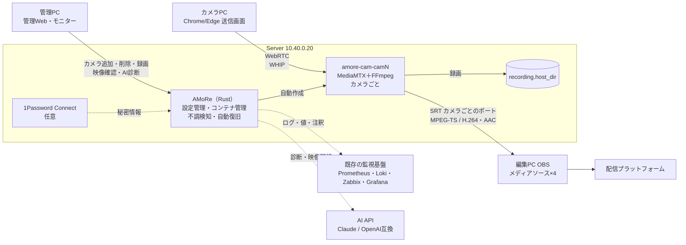

# AMoRe v0.3

Aketi MoIP on Rust engine — 開発段階1（初期版）。要件は [`requirements definition_v2.md`](../requirements%20definition_v2.md) を参照。

カメラPCのブラウザからWebRTCで送った映像・音声を、ServerがカメラごとのSRTストリーム（MPEG-TS / H.264・AAC）に変換し、編集PCのOBSで最大4台同時に受信する。
Serverの管理Webでカメラを追加すると、そのカメラ専用のメディア処理コンテナ（MediaMTX＋FFmpeg）が自動で作成される（**1カメラ＝1コンテナ**）。

## v0.2 からの変更点

| 項目 | 内容 |
| --- | --- |
| コンテナの不調検知・自動復旧 | v0.2 で「3台目のカメラを追加するとコンテナが起動できず `dns error` と表示される」事象があった。コンテナが再起動を繰り返す・停止する・ネットワークから外れると AMoRe から名前で接続できずこの表示になるため、`docker inspect` の情報（再起動回数・終了コード・メモリ不足・起動エラー・接続ネットワーク）から不調を判定し、**理由と直近ログを管理Web・モニター・OBSドックに表示**する。ネットワーク未接続は自動で接続し直し、それ以外は自動で作り直す（最大3回。直らなければ止めて警告し、無限に再起動させない） |
| 録画 | 保存先（`recording.host_dir`：ホストのディレクトリ・NAS）と形式（`segment_format` で記録し、区切りごとに `output_format`＝MP4・MKV・MOV へ再エンコードなしで変換）・保存期間を yaml で指定。カメラごとの開始・停止は管理Webから |
| モニター画面 | `https://<Server>/admin/monitor.html`。全カメラを1画面に自動レイアウトで表示（クリックで拡大、音声は1台を選んで再生、全画面表示） |
| パスワードマネージャー連携 | yaml の API キー・パスワードを `op://保管庫/アイテム/項目`（1Password Connect）・`env:`・`file:` で参照。`amore check` で取得できるか確認できる（値は表示しない） |
| 監視基盤との連携 | `/metrics`（Prometheus 形式）、Loki へのログ・出来事の送信、Zabbix sender（trapper・カメラの自動検出）、Grafana の注釈。Zabbix テンプレートと Grafana ダッシュボードを同梱 |
| AI API 連携 | 障害診断（管理Webの `AIで診断`）、映像解析（静止画から内容・異常を判定）、配信操作支援（推奨カメラの提示。OBS は操作しない）。Claude（既定 `claude-opus-5-5`）または OpenAI互換 API |
| 表示の修正 | 送信画面・管理Webで、映像の上に案内文が重なったままになる不具合（CSS の `display` が `hidden` 属性より優先されていた）を修正 |

v0.2 で稼働中の Server を更新する手順は、Server手順書の「[v0.2 から v0.3 への更新](Server/AMoRe-Server_構築手順書.md#v02-から-v03-への更新)」を参照（登録済みカメラ・ポート・証明書は引き継ぐため、OBS とカメラPCの設定変更は不要）。



## 構成

| フォルダ | 内容 | 構築手順書 |
| --- | --- | --- |
| [`Server/`](Server/) | AMoRe本体（Rust）、管理Web・モニター、Docker Compose、`AMoRe.example.yaml`、監視用テンプレート（`monitoring/`） | [AMoRe-Server_構築手順書.md](Server/AMoRe-Server_構築手順書.md) |
| [`Camera/`](Camera/) | ブラウザ送信画面（JavaScript）。Serverが `https://<Server>/` で配信 | [AMoRe-Camera_構築手順書.md](Camera/AMoRe-Camera_構築手順書.md) |
| [`OBS/`](OBS/) | シーンコレクション、状態表示ドック。ドックはServerが `https://<Server>/obs/` で配信 | [AMoRe-OBS_構築手順書.md](OBS/AMoRe-OBS_構築手順書.md) |
| [`VPN/`](VPN/) | 遠隔拠点（IX2215）へ VLAN40 を L2 延伸する SoftEther VPN Server（EtherIP over IPsec）、IX2215 設定例 | [AMoRe-VPN_構築手順書.md](VPN/AMoRe-VPN_構築手順書.md) |

構築順序：**Server（管理Webでカメラ追加まで）→ Camera → OBS**（遠隔拠点のカメラPCを使う場合は Camera の前に VPN）。録画・連携は Server 手順書の手順8〜12で必要なものだけ設定する。

## ネットワーク

| 機器 | IP / VLAN | 備考 |
| --- | --- | --- |
| CoreServer（Proxmox） | `10.40.0.10/16` / VLAN40 | Server VMのホスト |
| AMoRe Server VM `amore01` | `10.40.0.20/16` / VLAN40 | Rocky Linux 9 + Docker |
| 編集PC（OBS） | `10.30.0.10/16` / VLAN30 | x530LでVLAN間ルーティング |
| SoftEther VPN Server VM `sevpn01` | `10.40.0.30/16` / VLAN40 | 任意（遠隔拠点を使う場合）。UDP 500/4500 を本拠点ルーターから転送 |
| 遠隔拠点 IX2215 `BVI1` | `10.40.0.31/16` / VLAN40（L2延伸） | 任意（遠隔拠点を使う場合） |
| 監視基盤 | 例: `10.20.0.20` / VLAN20 | 任意（既存の Loki・Zabbix・Grafana・Prometheus） |

| ポート | 用途 |
| --- | --- |
| 443/tcp | 送信画面・OBSドック・管理Web・モニター・API・`/metrics` |
| 8189-8192/udp | WebRTC（カメラPC→Server、管理Webの映像確認・モニター）。カメラごとに1つ |
| 8890-8893/udp | SRT（Server→OBS）。カメラごとに1つ |

## API（AMoRe）

| メソッド・パス | 内容 |
| --- | --- |
| `GET /healthz` | 稼働確認 |
| `GET /api/v1/config` | 送信画面向け設定（カメラ一覧・映像/音声・品質制御・再接続・ICE） |
| `GET /api/v1/status` | カメラごとの受信・出力・コンテナ状態・不調・録画・AI解析、OBS接続数、SRT URL、AIの推奨カメラ |
| `GET /api/v1/ai` | AIの映像解析・推奨カメラ・直近のエラー |
| `GET /metrics` | Prometheus 形式のメトリクス（`monitoring.prometheus`） |
| `POST /api/v1/cameras/{id}/whip` | WHIP（SDP offer → answer）。未登録ID=404、他の画面が送信中=409 |
| `PATCH` / `DELETE /api/v1/cameras/{id}/whip/{session}` | WHIPセッションの更新・終了 |
| `GET /api/v1/admin/overview` | 管理Web：Docker・イメージ・全カメラの状態・最近の出来事 |
| `POST /api/v1/admin/cameras` | 管理Web：カメラ追加（`{"name": "...", "id": "任意"}`）。AMoRe.yamlへ保存しコンテナを作成 |
| `PATCH` / `DELETE /api/v1/admin/cameras/{id}` | 管理Web：表示名の変更 / カメラとコンテナの削除 |
| `POST /api/v1/admin/cameras/{id}/restart` | 管理Web：コンテナの再起動（不調時は作り直し） |
| `POST /api/v1/admin/cameras/{id}/record` | 管理Web：録画の有効・無効（`{"enabled": true}`） |
| `POST /api/v1/admin/cameras/{id}/diagnose` | 管理Web：AIによる障害診断 |
| `GET /api/v1/admin/cameras/{id}/logs` | 管理Web：コンテナのログ |
| `POST /api/v1/admin/cameras/{id}/whep` | 管理Web・モニター：映像確認（WHEP） |
| `POST /api/v1/admin/reconcile` | 管理Web：AMoRe.yaml とコンテナをそろえ直す |

## v0.3 の範囲と制限

- カメラ最大4台、1080p30（帯域不足時720p30）、H.264優先・VP8はServerでH.264へ変換、音声はOpus→AAC-LC。
- **認証なし**（管理Web・モニターを含む）。LAN内（VLAN間ルーティング）での利用を前提とする。AMoReはDockerソケットを操作するため、管理WebへのアクセスはServerの管理者権限に相当する。インターネット公開前に要件定義書の「認証・アクセス制御」を確定すること。
- HTTPSは自己署名証明書（各PCで信頼登録が必要）。
- 録画の切替はそのカメラのコンテナを作り直すため、送信・受信が数秒途切れる。録画の仕様（開始・停止条件、容量不足時の動作など）は要件定義書で要確定。
- AI 連携は外部の API へログ・静止画を送る（既定で無効）。AI の診断・提案は参考情報であり、OBS は自動で操作しない。
- 3台目のコンテナが起動できなかった事象の根本原因は実機のログで確定する（v0.3 は原因を画面に表示し、自動復旧を試みる）。
- 音声のチャンネル数・720pからの復帰条件は v0.2 と同じく試作で確認する。

## 開発

```bash
cd v0.3/Server/amore
cargo fmt --check
cargo clippy --all-targets
cargo test
cp ../AMoRe.example.yaml /tmp/AMoRe.yaml
cargo run -- --config /tmp/AMoRe.yaml check
cargo run -- --config /tmp/AMoRe.yaml render-mediamtx
```
