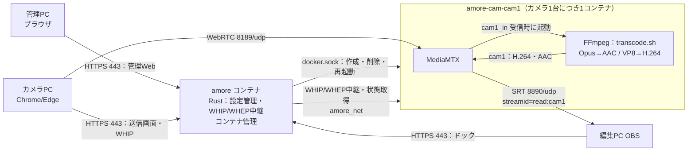

# ■ [AMoRe v0.3 Server 構築]
([2026/10/14])

# 概要
- **目的**: [カメラPCからWebRTCで受信した映像・音声を、カメラごとのSRTストリーム（MPEG-TS / H.264・AAC）としてOBSへ提供するServerを構築する]
- **理由・背景**: [AMoRe要件定義書 v2 の開発段階1（初期版）。カメラ最大4台・1080p30を、編集PC1台のOBSで同時受信する]
- **前提条件**:
  - 構築先
    - CoreServer（PRIMERGY RX100 S8 / Proxmox VE 9.2）`https://10.40.0.10:8006/`
      - Xeon E3-1220v3（4コア4スレッド）、RAM 16GB
      - `vmbr0` は VLAN対応ブリッジ、`bridge-vids 40`（[RX100 S8 セットアップ]・[AT-x530L-28GTX 26ポートルーティング設定] で構築済み）
    - x530L `port1.0.9`：tagged VLAN40
  - 作成するVM
    - Rocky Linux 9（Minimal）
    - 4 vCPU（CPU種別 `host`）/ メモリ 8GB / ディスク 64GB
    - Docker CE ＋ Docker Compose
  - 使用ソフトウェア
    - AMoRe v0.3（本リポジトリ `v0.3/Server`。Rust製、Docker上でビルド。Docker CLI 29 を同梱）
    - [MediaMTX](https://github.com/bluenviron/mediamtx) v1.21.1（FFmpeg同梱イメージ `bluenviron/mediamtx:1.21.1-ffmpeg`）。カメラごとにAMoReが自動で起動する
  - ip
    - AMoRe Server VM：`10.40.0.20/16`（GW `10.40.0.1`、DNS `1.1.1.1`、VLAN40）
    - 編集PC（OBS）：`10.30.0.10/16`（VLAN30）→ x530L のVLAN間ルーティングで到達
    - `10.40.0.20` が未使用であることを台帳等で確認してから使用する。別のIPにする場合は本書と `config/AMoRe.yaml` の `server.public_host` を読み替える
    - Docker内部ネットワーク `amore_net`：`172.30.40.0/24`（VM内のみ。既存のアドレス計画と重ならないこと）
  - 公開ポート（カメラごとにポートが分かれる。範囲は `AMoRe.yaml` の `media.*_ports`）

    | ポート | 用途 | 接続元 |
    | --- | --- | --- |
    | 443/tcp | 送信画面・OBSドック・管理Web・API（HTTPS） | カメラPC・編集PC・管理PC |
    | 8189-8192/udp | WebRTC（cam1=8189, cam2=8190 … の順に割当） | カメラPC・管理PC（映像確認） |
    | 8890-8893/udp | SRT（cam1=8890, cam2=8891 … の順に割当。Server=Listener） | 編集PC |

  - v0.3 で追加した機能（設定はすべて `config/AMoRe.yaml`）

    | 機能 | 内容 | 手順 |
    | --- | --- | --- |
    | コンテナの不調検知・自動復旧 | 再起動の繰り返し・停止・ネットワーク未接続を検知し、理由と直近ログを管理Webに表示。自動で作り直す（最大3回） | 手順7・トラブルシューティング |
    | 録画 | 保存先（ホストのディレクトリ・NAS）と形式（fMP4/MPEG-TS で記録し MP4・MKV・MOV へ変換）を指定 | 手順8 |
    | モニター画面 | 1つの画面に全カメラの映像を表示 | 手順9 |
    | パスワードマネージャー連携 | API キー・パスワードを 1Password Connect から取得（yaml に直接書かない） | 手順10 |
    | 監視基盤との連携 | Prometheus（メトリクス）・Loki（ログ）・Zabbix（値・トリガー）・Grafana（ダッシュボード・注釈） | 手順11 |
    | AI 連携 | 障害診断・映像解析・配信操作支援（Claude または OpenAI互換 API） | 手順12 |

  - 外向きの通信（使う機能だけ）

    | 宛先 | 用途 |
    | --- | --- |
    | 監視基盤（例: `10.20.0.20`）の Loki `3100/tcp`・Zabbix `10051/tcp`・Grafana `3000/tcp` | ログ・値・注釈の送信 |
    | Prometheus → Server `443/tcp` | メトリクスの取得（Prometheus から Server へ） |
    | `api.anthropic.com:443` または OpenAI互換 API | AI 連携 |
    | 1Password（インターネット） | Connect サーバーの同期 |

  - **将来性**
    - 開発段階3・4：4K対応、カメラ台数拡張（v0.3の性能目標・構成をそのまま適用しない）

## 構成



- **1カメラ＝1コンテナ**：管理Webでカメラを追加すると、AMoReが `config/AMoRe.yaml` にカメラを保存し、専用コンテナ `amore-cam-<カメラID>` を自動で作成・起動する。削除するとコンテナも削除する。
- 各コンテナは `<id>_in`（WebRTC受信）と `<id>`（OBS向け）の2つのパスを持つ。映像がH.264の場合は再エンコードせずにコピーし、VP8の場合はH.264へ変換する（CPU負荷が高い）。音声は常にOpus→AAC-LCへ変換する。
- カメラごとの `mediamtx.yml` と変換スクリプトは、AMoReが共有ボリューム `amore-shared` へ自動生成する。直接編集しない。
- AMoReは起動時と変更時に `AMoRe.yaml` とコンテナをそろえる（不足を作成、設定が変わったものを再作成、登録外を削除）。AMoReが停止していても、カメラのコンテナは送受信を続ける。
- **注意**：AMoReはDockerソケットを使うため、ホストの管理者権限に相当する操作ができる。v0.3の管理Webは認証なし（LAN内での利用が前提）のため、Server（443/tcp）へ到達できる範囲を信頼できる端末に限ること。

## ファイル構成

| パス | 内容 |
| --- | --- |
| `v0.3/Server/AMoRe.example.yaml` | 設定例（Git管理） |
| `v0.3/Server/config/AMoRe.yaml` | 稼働中の設定（設定例をコピーして作成。管理Webが `cameras` を書き換える。Git管理外） |
| `v0.3/Server/compose.yaml` | Docker Compose 定義（amore のみ。カメラのコンテナはAMoReが作成） |
| `v0.3/Server/amore/` | AMoRe本体（Rust）、Dockerfile、変換スクリプト `assets/transcode.sh`・録画変換 `assets/convert.sh` |
| `v0.3/Server/admin/` | 管理Web（`/admin/`）・モニター画面（`/admin/monitor.html`） |
| `v0.3/Server/monitoring/` | Zabbix テンプレート・Grafana ダッシュボード |
| `config/op-connect-token`・`config/1password-credentials.json` | 1Password Connect の認証情報（使う場合のみ。Git管理外） |
| `/srv/amore/recordings/<カメラID>/` | 録画ファイル（`recording.host_dir`） |
| `v0.3/Server/scripts/gen-cert.sh` | 自己署名証明書の作成 |
| `v0.3/Server/certs/` | 証明書・秘密鍵の配置先（Git管理外） |
| `v0.3/Camera/www/` | 送信画面（amore が `/` で配信） |
| `v0.3/OBS/dock/` | OBSドック（amore が `/obs/` で配信） |

# 参考資料
- [Rocky Linux ダウンロード](https://rockylinux.org/download)
- [Docker Engine install on RHEL](https://docs.docker.com/engine/install/rhel/)
- [MediaMTX README](https://github.com/bluenviron/mediamtx)
- [Proxmox VE Administration Guide – Qemu/KVM Virtual Machines](https://pve.proxmox.com/pve-docs/chapter-qm.html)
- [OBS SRT Protocol Streaming Guide](https://obsproject.com/kb/srt-protocol-streaming-guide)

# 構築手順

## 1. VMを作成する（Proxmox）

### [isoダウンロード]
  - Proxmox WebGUI `https://10.40.0.10:8006/` へrootでログインする（認証情報は管理台帳を参照。本書には記載しない）
  - `Datacenter` → `CoreServer` → `local` → `ISO Images` → `Download from URL`
    ```text
    URL       : https://download.rockylinux.org/pub/rocky/9/isos/x86_64/Rocky-9-latest-x86_64-minimal.iso
    File name : Rocky-9-latest-x86_64-minimal.iso
    Hash algorithm : SHA-256
    Checksum  : 同じディレクトリの CHECKSUM ファイルに記載された minimal.iso の値
    ```
  - `Query URL` → `Download`。タスクログに `OK` とチェックサム一致が表示されることを確認する
    - 取得時点で9系の最新版を使う。ダウンロードしたファイル名（版数）を作業記録に残す

### [VM作成]
  `Create VM` で以下を設定する。記載のない項目は既定値。

  | タブ | 項目 | 設定値 |
  | --- | --- | --- |
  | General | VM ID / Name | `140` / `amore01`（VM IDは空き番号でよい） |
  | OS | ISO image | `Rocky-9-latest-x86_64-minimal.iso`、Guest OS: Linux 6.x - 2.6 Kernel |
  | System | Machine / Qemu Agent | `q35` / ✔ |
  | Disks | Bus / Size / Storage | `SCSI`（VirtIO SCSI single）/ `64` GiB / インストール時に作成した `local-lvm` または `local-zfs`、Discard ✔ |
  | CPU | Sockets / Cores / Type | `1` / `4` / **`host`** |
  | Memory | Memory | `8192` MiB |
  | Network | Bridge / VLAN Tag / Model | `vmbr0` / **`40`** / `VirtIO (paravirtualized)` |

  - CPU種別を`host`にし、映像変換（FFmpeg）でCPUの拡張命令を使えるようにする
  - ホストは4コアのため、4 vCPUを割り当てると他VMとCPUを取り合う。v0.3の試験中は他の負荷の高いVMを同時に動かさない
  - `Confirm` で内容を確認し、`Start after created` は外して `Finish`
  - 新規VMのため、この段階の切り戻しはVM削除で行う。スナップショットはDocker導入後（手順4）に取得する

## 2. Rocky Linux をインストールする

### [インストーラーの実行]
  1. `amore01` → `Start` → `Console`
  1. `Install Rocky Linux 9.x`
  1. 言語：日本語
  1. `ネットワークとホスト名`
      ```text
      ホスト名     : amore01
      イーサネット : ens18（オン）→ 設定 → IPv4設定
      方式         : 手動
      アドレス     : 10.40.0.20
      ネットマスク : 16（255.255.0.0）
      ゲートウェイ : 10.40.0.1
      DNSサーバー  : 1.1.1.1
      IPv6設定     : 無視する（v0.3はIPv4のみ）
      ```
      - VLANタグはProxmox側（VLAN Tag 40）で付与するため、OS側ではVLANを設定しない
  1. `時刻と日付`：アジア/東京、ネットワーク時刻 オン
  1. `インストール先`：64GBのディスク、ストレージの構成は自動
  1. `ソフトウェアの選択`：最小限のインストール
  1. `rootパスワード`：設定する（**SSHでのrootログインは許可しない**）。値は管理台帳で管理し、本書・リポジトリに記載しない
  1. `ユーザーの作成`
      ```text
      ユーザー名 : amore
      このユーザーを管理者にする : ✔（wheel）
      パスワード : 管理台帳で管理する値
      ```
  1. `インストールの開始` → 完了後 `システムの再起動`

### [再起動後の確認]
  Proxmoxのコンソールで `amore` でログインし、確認する。
  ```bash
  ip -br addr
  ip route
  ping -c 3 10.40.0.1
  ping -c 3 1.1.1.1
  ```
  - `ens18` に `10.40.0.20/16`、デフォルト経路が `10.40.0.1` であること
  - 編集PC（VLAN30）のPowerShellから到達を確認する
    ```powershell
    Test-NetConnection 10.40.0.20 -Port 22
    ```
  - 以降はSSH（`ssh amore@10.40.0.20`）で作業してよい

## 3. OSの初期設定

### [パッケージ更新・ゲストエージェント]
  ```bash
  sudo dnf -y update
  sudo dnf -y install qemu-guest-agent git
  sudo systemctl enable --now qemu-guest-agent
  sudo reboot
  ```
  - 再起動後、Proxmoxの `amore01` → `Summary` にIPアドレスが表示されることを確認する（ゲストエージェント動作確認）

### [SELinux・時刻の確認]
  ```bash
  getenforce
  timedatectl
  ```
  - `Enforcing` のまま運用する。amore コンテナだけは Dockerソケットへ接続するため `compose.yaml` で `label=disable`（SELinuxのラベル分離を無効）にしている。カメラのコンテナは通常どおり分離される
  - `System clock synchronized: yes` であること（遅延測定・ログ照合のため）

### [firewalld]
  ```bash
  sudo firewall-cmd --permanent --add-service=https
  sudo firewall-cmd --permanent --add-port=8189-8192/udp
  sudo firewall-cmd --permanent --add-port=8890-8893/udp
  sudo firewall-cmd --reload
  sudo firewall-cmd --list-all
  ```
  - `services` に `https`、`ports` に `8189-8192/udp 8890-8893/udp` があること
  - `AMoRe.yaml` の `media.webrtc_udp_ports`・`media.srt_ports` を変えた場合は、ここで開ける範囲も合わせる
  - Dockerは公開ポートの通信規則を自身で追加するため、firewalldの許可を外してもコンテナの公開ポートは閉じない場合がある。公開範囲の制限は要確定事項（認証・アクセス制御）と併せて設計する

### [UDP受信バッファ（sysctl）]
  1080pのキーフレームは短時間に多数のUDPパケットで届く。OS既定の受信バッファ（約208KB）では溢れて映像が欠けるため、上限を上げる。
  ```bash
  printf 'net.core.rmem_max=16777216\nnet.core.rmem_default=8388608\n' | sudo tee /etc/sysctl.d/90-amore.conf
  sudo sysctl --system
  sysctl net.core.rmem_max net.core.rmem_default
  ```
  - `net.core.rmem_max = 16777216`、`net.core.rmem_default = 8388608` と表示されること
  - カメラのコンテナは `AMoRe.yaml` の `media.udp_read_buffer_bytes`（既定 8MB）で受信バッファを要求する。`net.core.rmem_max` より大きい値は上限で切り詰められるため、変更する場合は両方を合わせる
  - 再起動後も `/etc/sysctl.d/90-amore.conf` により有効になる

## 4. Docker を導入する

### [Docker CE]
  ```bash
  sudo dnf -y install dnf-plugins-core
  sudo dnf config-manager --add-repo https://download.docker.com/linux/rhel/docker-ce.repo
  sudo dnf -y install docker-ce docker-ce-cli containerd.io docker-buildx-plugin docker-compose-plugin
  sudo systemctl enable --now docker
  sudo usermod -aG docker amore
  ```
  - 一度ログアウトして再ログインし、`sudo`なしで実行できることを確認する
    ```bash
    docker version
    docker compose version
    docker run --rm hello-world
    ```
  - 表示されたDocker・Composeのバージョンを作業記録に残す（要件：採用OSSのバージョン記録）

### [スナップショット取得]
  Proxmoxで `amore01` → `Snapshots` → `Take Snapshot`
  ```text
  Name        : os-docker-ready
  Description : Rocky Linux 9 + Docker 導入直後（AMoRe未導入）
  ```

## 5. AMoRe を配置する

### [リポジトリ取得]
  ```bash
  sudo mkdir -p /opt/AMoRe
  sudo chown amore: /opt/AMoRe
  git clone https://github.com/Aketi-Maika/AMoRe.git /opt/AMoRe
  cd /opt/AMoRe/v0.3/Server
  git log --oneline -1
  ```
  - 取得したコミットIDを作業記録に残す

### [Dockerネットワークの作成]
  AMoRe とカメラのコンテナをつなぐネットワークを作成する（初回のみ）。
  ```bash
  docker network create --subnet 172.30.40.0/24 amore_net
  docker network inspect amore_net --format '{{range .IPAM.Config}}{{.Subnet}}{{end}}'
  ```
  - `172.30.40.0/24` と表示されること
  - サブネットを変える場合は `config/AMoRe.yaml` の `media.docker_subnet` も同じ値にする（カメラのコンテナがAMoReからの中継を許可するために使う）

### [TLS証明書の作成]
  ブラウザはHTTPSでなければカメラ・マイクを利用できないため、自己署名証明書を作成する。
  ```bash
  cd /opt/AMoRe/v0.3/Server
  sh scripts/gen-cert.sh 10.40.0.20
  ls -l certs/
  ```
  - `certs/server.crt`（配布用）と `certs/server.key`（Server外へ出さない）が作成される
  - 表示された **SHA256フィンガープリント** を記録する。カメラPC・編集PCへ配布した証明書と照合する
  - 有効期限は825日。期限前に作り直し、配布先の証明書も入れ替える

### [AMoRe.yaml の作成・確認]
  設定例をコピーして稼働用の設定を作る。`config/` はGit管理外のため、`git pull` で上書きされない。
  ```bash
  cd /opt/AMoRe/v0.3/Server
  cp AMoRe.example.yaml config/AMoRe.yaml
  vi config/AMoRe.yaml
  ```

  | 項目 | 確認内容 |
  | --- | --- |
  | `server.public_host` | VMのIP `10.40.0.20`（変えた場合は合わせる） |
  | `media.image` | `bluenviron/mediamtx:1.21.1-ffmpeg`（カメラのコンテナのイメージ） |
  | `media.docker_subnet` | `amore_net` のサブネット `172.30.40.0/24` |
  | `media.webrtc_udp_ports` / `media.srt_ports` | `8189-8192` / `8890-8893`（firewalldで開けた範囲） |
  | `media.udp_read_buffer_bytes` | `8388608`（sysctlの `net.core.rmem_max` 以下） |
  | `cameras` | `[]` のままでよい（管理Webで追加する） |
  | `srt.latency_ms` | LAN：`120` / WAN試験：`200`（暫定） |
  | `ice_servers` | LAN内では `[]`。NAT越えが必要な場合のみSTUN/TURNを指定 |
  | `recording.enabled` | `false`（基準試験は録画無効） |

  ビルドして検証する（エラーがあれば項目名と理由が表示される）。
  ```bash
  docker compose build
  docker compose run --rm --no-deps amore check
  ```
  - 初回ビルドはRustのコンパイルに数分～十数分かかる。**v0.3のRustコードは本手順で初めてコンパイルされる**ため、ビルドエラーが出た場合はエラー全文を記録して開発側へ連絡する
  - `OK: /config/AMoRe.yaml（カメラ 0 台 / 上限 4 台）` と表示されること

## 6. 起動する

### [コンテナ起動]
  ```bash
  cd /opt/AMoRe/v0.3/Server
  docker compose up -d
  docker compose ps
  docker compose logs --tail 50 amore
  ```
  - `amore` が `healthy` であること
  - ログに `AMoRe v0.3.0 を https://0.0.0.0:8443 で起動します`、`管理Web: https://10.40.0.20/admin/`
  - 初回はカメラ用イメージ `bluenviron/mediamtx:1.21.1-ffmpeg` の取得が行われ、`イメージを取得しました` と表示される
  - `restart: unless-stopped` のため、VM再起動後も自動で起動する。カメラのコンテナも同じ設定で作成される

### [Server内での確認]
  ```bash
  curl -sk https://127.0.0.1/healthz; echo
  curl -sk https://127.0.0.1/api/v1/admin/overview; echo
  ```
  - `ok` が返ること
  - overview の `runtime.docker_version` にDockerのバージョン、`runtime.image_ready` が `true`、`runtime.docker_error` が `null` であること
  - `curl -sk https://127.0.0.1/metrics | head` で `amore_info{version="0.3.0"} 1` 等のメトリクスが返ること

### [編集PC・カメラPCからの確認]
  PowerShellで実行する。
  ```powershell
  Test-NetConnection 10.40.0.20 -Port 443
  ```
  - `TcpTestSucceeded : True` であること。`SourceAddress` が有線（例：`10.30.0.10`）であること
  - UDP（WebRTC・SRT）は `Test-NetConnection` で確認できないため、管理Webの映像確認、Camera・OBSの手順書で実際の送受信により確認する
  - 証明書の信頼設定は Camera 手順書の「証明書の信頼登録」と同じ手順で、管理に使うPCにも行う

## 7. 管理Webでカメラを追加する

### [管理Webを開く]
  管理PC（例：編集PC）のブラウザで次を開く。
  ```text
  https://10.40.0.20/admin/
  ```
  - 右上が `Docker 29.x.x`（緑）であること
  - 「カメラが登録されていません」と表示されること

### [カメラの追加]
  1. `＋ カメラを追加`
  1. 入力する

      | 項目 | 入力例 | 備考 |
      | --- | --- | --- |
      | カメラID | （空欄） | 空欄なら `cam1`、`cam2` … を自動で割り当てる。後から変更できない |
      | 表示名 | `ステージ正面` | 後から変更できる |

  1. `追加` → `コンテナ作成中…` の後、カードが表示される
  1. カードを確認する

      | 表示 | 期待値 |
      | --- | --- |
      | 右上のバッジ | `稼働中`（緑） |
      | 見出しの下 | `cam1　/　amore-cam-cam1` |
      | ポート | `WebRTC 8189/udp　SRT 8890/udp`（追加順に割当） |
      | SRT URL | `srt://10.40.0.20:8890?streamid=read:cam1&latency=120000`（OBSに入力する値） |
      | 受信 | `未送信` |

  1. Serverでコンテナと設定を確認する
      ```bash
      docker ps --filter label=amore.managed=true
      grep -A4 '^cameras:' config/AMoRe.yaml
      ```
      - `amore-cam-cam1` が `Up` で、`0.0.0.0:8189->8189/udp` と `0.0.0.0:8890->8890/udp` が公開されていること
      - `config/AMoRe.yaml` の `cameras:` に追加したカメラが保存されていること（直前の内容は `config/AMoRe.yaml.bak`）
  1. 使用する台数（最大4台）まで繰り返す

### [映像の確認]
  1. カメラPCで送信を開始する（Camera手順書）。カードの `送信画面` リンクを開くと、そのカメラIDが選択された状態で送信画面が開く
  1. カードの `受信` が `受信中　H264 / Opus → H264 / AAC（再エンコードなし）` になること
  1. `映像確認` を押すと、カードに映像が表示され、右下に解像度（例：`1920×1080`）が出ること
      - 音声は初期状態でミュート。`音声をオン` で確認できる
      - 映像確認はServerからWebRTCで受信するため、管理PCからそのカメラのWebRTCポート（例：`8189/udp`）へ到達できる必要がある
      - 映像確認中はServerの送信帯域を使う。確認が終わったら `停止` を押す
  1. 送信されていないカメラで `映像確認` を押すと「このカメラは送信されていないため表示できません」と表示される

### [その他の操作]

| 操作 | 内容 |
| --- | --- |
| 名前変更 | 表示名だけを変更する。コンテナは再作成しない |
| 再起動 | そのカメラのコンテナだけを再起動する。送信・OBS受信は一時的に切断され、自動で再接続する |
| ログ | そのカメラのコンテナ（MediaMTX・FFmpeg）のログ直近300行を表示する |
| 削除 | カメラを `AMoRe.yaml` から削除し、コンテナも削除する。割り当てていたポートは次の追加で再利用される |
| 再適用 | `AMoRe.yaml` とコンテナをそろえ直す（手動で消したコンテナの再作成、登録外のコンテナの削除）。自動復旧の記録も消す |
| 録画する／録画を止める | そのカメラの録画を切り替える（手順8）。コンテナを作り直すため数秒途切れる |
| AIで診断 | AI 連携が有効な場合に表示。コンテナの状態・ログを AI に送り、原因と対処を表示する（手順12） |
| 不調の表示 | コンテナが不調になるとカードが赤枠になり、理由・自動復旧の状況・直近ログが表示される。画面下の「最近の出来事」にも残る |

## 8. 録画を設定する

録画はカメラのコンテナが OBS 向けの出力（H.264・AAC）を区切りごとに保存し、区切りが閉じるたびに再エンコードなしで MP4 等へ変換する。

### [保存先の用意]
  1080p・6Mbps で **1台あたり約2.7GB/時**（4台で約11GB/時）。VM のディスク（64GB）では足りないため、録画用のディスクか NAS を用意する。

  **(a) VM に録画用ディスクを追加する場合**（例: 500GB）
  1. Proxmox で `amore01` → `Hardware` → `Add` → `Hard Disk`（SCSI / 500 GiB / Discard ✔）
  1. VM でフォーマットしてマウントする（`/dev/sdb` は `lsblk` で確認した名前に読み替える）
      ```bash
      lsblk
      sudo mkfs.xfs /dev/sdb
      sudo mkdir -p /srv/amore/recordings
      echo "UUID=$(sudo blkid -s UUID -o value /dev/sdb) /srv/amore/recordings xfs defaults 0 0" | sudo tee -a /etc/fstab
      sudo systemctl daemon-reload
      sudo mount -a
      df -h /srv/amore/recordings
      ```

  **(b) NAS（NFS）を使う場合**
  ```bash
  sudo dnf -y install nfs-utils
  sudo mkdir -p /srv/amore/recordings
  echo '<NASのIP>:/<共有パス> /srv/amore/recordings nfs defaults,_netdev 0 0' | sudo tee -a /etc/fstab
  sudo mount -a
  sudo setsebool -P virt_use_nfs 1
  df -h /srv/amore/recordings
  ```
  - NFS は SELinux のラベル付けができないため、`AMoRe.yaml` の `recording.selinux_relabel` を `false` にする（代わりに `virt_use_nfs` でコンテナからの書き込みを許可する）

### [AMoRe.yaml の設定]
  ```bash
  vi /opt/AMoRe/v0.3/Server/config/AMoRe.yaml
  ```

  | 項目 | 設定値の例 | 内容 |
  | --- | --- | --- |
  | `recording.enabled` | `false` | 全カメラの既定。カメラごとの有効・無効は管理Webで切り替える |
  | `recording.host_dir` | `/srv/amore/recordings` | 保存先（ホスト上の絶対パス）。`<カメラID>/` の下に保存される |
  | `recording.selinux_relabel` | `true`（NFS は `false`） | SELinux のラベル付け |
  | `recording.segment_format` | `fmp4` | 録画中の形式（`fmp4` / `mpegts`）。停電・異常終了でも途中まで再生できる |
  | `recording.segment_duration` | `1h` | 1ファイルの長さ（60s 以上） |
  | `recording.output_format` | `mp4` | 区切りごとの変換先（`none` / `mp4` / `mkv` / `mov`） |
  | `recording.keep_segments` | `false` | 変換後に録画中の形式のファイルも残すか |
  | `recording.retention` | `7d` | 保存期間（`0` で自動削除しない） |

  変更後は検証して反映する（全カメラのコンテナが作り直され、送信・受信が数秒途切れる）。
  ```bash
  cd /opt/AMoRe/v0.3/Server
  docker compose run --rm --no-deps amore check
  docker compose up -d --force-recreate amore
  ```
  - `check` の出力に `録画: 保存先 /srv/amore/recordings / fmp4 で記録し mp4 へ変換 / 保存期間 7d` と表示される

### [録画の開始・停止]
  管理Webのカメラのカードで `録画する` / `録画を止める` を押す。
  - そのカメラのコンテナだけを作り直す（送信・受信が数秒途切れ、自動で再接続する）。配信中に切り替える場合は注意する
  - 録画中はカードに `● 録画`、モニター画面に `● REC`、OBSドックに `● 録画` が表示される
  - 設定は `config/AMoRe.yaml` の `cameras[].record` に保存される

### [確認]
  ```bash
  ls -lh /srv/amore/recordings/cam1/
  docker logs amore-cam-cam1 2>&1 | grep 'convert'
  ```
  - 録画中のファイル（`2026-10-14_10-00-00-000000.mp4` 等）が増えていくこと
  - 区切り（`segment_duration`）ごとに `[amore] convert: 変換しました: …` が出て、変換後のファイルができること
  - 動作確認だけなら `segment_duration` を一時的に `1m` にすると早く確認できる

## 9. モニター画面（全カメラを1画面に表示）

### [開く]
  ```text
  https://10.40.0.20/admin/monitor.html
  ```
  管理Webの見出しの `モニター` からも開ける。

| 操作・表示 | 内容 |
| --- | --- |
| 自動表示 | 送信が始まったカメラは自動で表示され、途切れると自動で再接続する |
| レイアウト | 1台：全面、2台：左右、3〜4台：2×2（縦長の画面では上下） |
| 拡大 | 映像をクリックするとそのカメラだけを大きく表示、もう一度クリックで戻る |
| 音声 | 右下の 🔇 を押したカメラの音声だけを鳴らす（同時に鳴らすのは1台） |
| 全画面 | 右上の `全画面`（Esc で戻る） |
| 枠の色 | 緑：AIの推奨カメラ、橙：AIが映像の異常を検知、赤：コンテナが不調 |

- モニター画面は全カメラの映像を Server から受信する（最大 約4×6Mbps）。モニターを開くPCから各カメラの WebRTC ポート（`8189-8192/udp`）へ到達できること
- 証明書の信頼設定は Camera 手順書と同じ手順で行う

## 10. パスワードマネージャー連携（1Password Connect）

`AMoRe.yaml` には API キー・パスワードを直接書かず、`op://保管庫/アイテム/項目` で参照し、Server 内の 1Password Connect サーバーから取得する。

### [1Password 側の準備]
  1. 1Password で保管庫 `AMoRe` を作成し、使う秘密情報をアイテムとして登録する（例）

      | アイテム | 項目 | 用途 | yaml での参照 |
      | --- | --- | --- | --- |
      | `Claude API` | `credential` | ai.anthropic.api_key | `op://AMoRe/Claude API/credential` |
      | `Grafana` | `credential` | monitoring.grafana.api_token | `op://AMoRe/Grafana/credential` |
      | `Loki` | `password` | monitoring.loki.password | `op://AMoRe/Loki/password` |

  1. 1Password の管理画面で Connect サーバーを作成し、保管庫 `AMoRe` への読み取りを許可する
  1. `1password-credentials.json` をダウンロードし、アクセストークンを発行する（どちらも管理台帳で管理し、リポジトリに入れない）

### [Server への配置]
  `1password-credentials.json` を scp 等で Server の `config/` へ置き、トークンをファイルに書く。
  ```bash
  cd /opt/AMoRe/v0.3/Server
  ls -l config/1password-credentials.json
  chmod 644 config/1password-credentials.json
  vi config/op-connect-token
  chmod 600 config/op-connect-token
  ```
  - `chmod 644` は Connect のコンテナ（一般ユーザーで動く）が読めるようにするため。VM に他の利用者がいない前提
  - トークンはコマンドラインに書かず、エディターで貼り付ける（シェルの履歴に残さない）
  - `config/` は Git 管理外

### [AMoRe.yaml の設定・起動]
  `config/AMoRe.yaml` の `secrets.onepassword_connect.enabled` を `true` にし、秘密情報の項目を `op://…` で書く。
  ```bash
  cd /opt/AMoRe/v0.3/Server
  docker compose --profile op-connect up -d
  docker compose --profile op-connect ps
  docker compose run --rm --no-deps amore check
  docker compose up -d --force-recreate amore
  ```
  - `op-connect-api`・`op-connect-sync` が `running` であること
  - `check` の出力が `OK ai.anthropic.api_key（参照・解決済み）` のようになること（値は表示されない）
  - 以降 `docker compose up` するときは `--profile op-connect` を付ける
  - 1Password 側で値を変えた場合、AMoRe は `cache_ttl`（既定5分）以内に新しい値を使う

## 11. 監視基盤との連携（Zabbix / Grafana / Loki）

既存の監視基盤（例: VLAN20 `10.20.0.20`）へ送る。Server（`10.40.0.20`）から各監視サーバーへ到達できること（x530L のVLAN間ルーティング）。

### [Prometheus（Grafana でメトリクスを表示）]
  AMoRe は `https://10.40.0.20/metrics` でメトリクスを公開する（`monitoring.prometheus`）。既存の Prometheus の `prometheus.yml` に追加する。
  ```yaml
  scrape_configs:
    - job_name: amore
      scheme: https
      tls_config:
        insecure_skip_verify: true   # 自己署名証明書のため（ca_file に server.crt を指定してもよい）
      static_configs:
        - targets: ['10.40.0.20:443']
  ```
  - Prometheus を再読み込みし、Targets で `amore` が `UP` であること

### [Loki（ログ・出来事）]
  `config/AMoRe.yaml` の `monitoring.loki` を `enabled: true`、`url: http://<Loki>:3100` にして AMoRe を再作成する（`docker compose up -d --force-recreate amore`）。
  - Grafana の Explore で `{app="amore"}` を検索し、AMoRe（`source="amore"`）・カメラのコンテナ（`source="camera"`）・出来事（`source="event"`）のログが出ること
  - 認証がある場合は `username` と `password`（`op://…`）、マルチテナントの場合は `tenant` を指定する

### [Zabbix（値・トリガー）]
  1. Zabbix の `データ収集` → `テンプレート` → `インポート` で `v0.3/Server/monitoring/zabbix_template_amore.yaml` を取り込む（Zabbix 7.0 形式）
  1. `データ収集` → `ホスト` → `ホストの作成`：ホスト名 `amore01`（`monitoring.zabbix.host` と同じ）、テンプレート `AMoRe` をリンク（インターフェースは不要）
  1. `config/AMoRe.yaml` の `monitoring.zabbix` を `enabled: true`、`server: <Zabbix Server の IP>` にして AMoRe を再作成する
  1. Zabbix Server 側のファイアウォールで `10051/tcp` を `10.40.0.20` から受け付けること
  - 30秒以内に `最新データ` に `AMoRe: Docker 接続` 等の値が入り、カメラが「AMoRe: カメラの検出」で自動登録されること
  - トリガー：Docker 接続不可、値が5分届かない、コンテナ停止・再起動・不調、AIの映像異常

### [Grafana（ダッシュボード・注釈）]
  1. Grafana の `Administration` → `Service accounts` でサービスアカウントを作成し（ロール `Editor`）、トークンを発行して 1Password の `Grafana` アイテムに保存する
  1. `config/AMoRe.yaml` の `monitoring.grafana` を `enabled: true`、`url`・`api_token: op://AMoRe/Grafana/credential` にして AMoRe を再作成する
  1. `Dashboards` → `New` → `Import` で `v0.3/Server/monitoring/grafana_dashboard_amore.json` を取り込み、Prometheus・Loki のデータソースを選ぶ
  - カメラの追加・削除・不調・復旧・録画切替・AIの異常検知が、グラフ上の注釈（タグ `amore`）として表示されること

## 12. AI 連携（障害診断・映像解析・配信操作支援）

| 機能 | 内容 | 設定 |
| --- | --- | --- |
| 障害診断 | 管理Webのカードの `AIで診断` で、そのカメラのコンテナの状態・直近ログ・出来事を AI に送り、原因と対処を表示する | `ai.diagnosis` |
| 映像解析 | 受信中のカメラの静止画を定期的に AI に送り、映っている内容と異常（真っ暗・覆われている・傾き・ピンぼけ等）を判定する。異常は Loki・Zabbix・Grafana へも送る | `ai.vision` |
| 配信操作支援 | 映像解析の結果から「今使うと良いカメラ」と理由をモニター画面・OBSドックに表示する（OBS は操作しない） | `ai.director`（vision が必要） |

- **外部の API を使う場合、ログ（IPアドレス等を含む）とカメラの静止画が送信される。** 社内規程・出演者の同意を確認してから有効にする
- Server から AI API（`https://api.anthropic.com` 等）へ HTTPS で到達できること

### [Claude（Anthropic）を使う]
  1. Anthropic Console で API キーを発行し、1Password の `Claude API` アイテムに保存する
  1. `config/AMoRe.yaml` を設定する
      ```yaml
      ai:
        enabled: true
        provider: anthropic
        anthropic:
          api_key: op://AMoRe/Claude API/credential
          model: claude-opus-5-5
          vision_model: claude-opus-5-5
        vision:
          enabled: true
          interval_sec: 120
        director:
          enabled: true
      ```
  1. `docker compose run --rm --no-deps amore check` → `docker compose up -d --force-recreate amore`
  - 映像解析は `interval_sec` ごと・受信中のカメラごとに AI を呼ぶため費用がかかる。費用を抑える場合は `vision_model` を安価なモデル（例: `claude-haiku-5-5`）に変える、`interval_sec` を長くする
  - `effort`（low〜max）は AI の思考の深さ。障害診断は `high`、映像解析・配信操作支援は `low` を既定にしている

### [OpenAI互換 API（ローカルLLM等）を使う]
  ```yaml
  ai:
    enabled: true
    provider: openai_compatible
    openai_compatible:
      base_url: http://<LLMサーバー>:8000/v1
      api_key: ""                # 不要なら空
      model: <モデル名>
      vision_model: <画像入力に対応したモデル名>
  ```
  - 映像解析には画像入力に対応したモデルが必要。応答の JSON 形式（`response_format: json_schema`）に対応していないサーバーでは、映像解析・配信操作支援が失敗することがある（管理Web・`/api/v1/ai` の `last_error` に表示）

### [確認]
  - 管理Webのカードに `AIで診断` ボタンが表示され、押すと数十秒で診断結果が表示されること
  - 映像解析を有効にした場合、カードの `AI解析` に内容と品質が表示されること。モニター画面の推奨カメラが緑の枠になること
  - 失敗する場合は `curl -sk https://127.0.0.1/api/v1/ai; echo` の `last_error` を確認する

### [スナップショット取得]
  ```text
  Name        : amore-v0.3
  Description : AMoRe v0.3 起動確認済み（コミットID: <記録した値>、カメラ: <登録したID>、録画・連携の設定）
  ```

# v0.2 から v0.3 への更新

v0.2 を構築済みの Server（`/opt/AMoRe/v0.2/Server` で稼働中）を v0.3 へ更新する手順。新規に構築する場合は不要。

- **変わるもの**：AMoRe本体（`amore:0.3.0`）、カメラのコンテナ（録画の保存先・変換スクリプト・不調検知）、管理Web・モニター画面・OBSドック。
- **引き継ぐもの**：`config/AMoRe.yaml`（登録済みカメラ・ポート）、証明書、Dockerネットワーク `amore_net`、共有ボリューム。カメラID・ポート・SRT URL は変わらないため、OBS の設定とカメラPCの証明書はそのまま使える。
- **録画の保存先が変わる**：v0.2 の Docker ボリューム `amore-recordings` から、ホストのディレクトリ `recording.host_dir`（既定 `/srv/amore/recordings`）へ。v0.2 の `recording` の書き方（`path`・`format`・`delete_after`、`media.recordings_volume`）はそのまま読める。
- **影響**：更新中、送信と OBS の受信が数十秒途切れる。配信中には行わない。

### [事前準備]
  1. Proxmox で `amore01` のスナップショット `before-v0.3` を取得する
  1. 現在の状態を記録する
      ```bash
      cd /opt/AMoRe/v0.2/Server
      git -C /opt/AMoRe log --oneline -1
      docker ps --filter label=amore.managed=true --format '{{.Names}}\t{{.Status}}\t{{.Ports}}'
      grep -A30 '^cameras:' config/AMoRe.yaml
      ```

### [v0.3 の取得]
  ```bash
  cd /opt/AMoRe
  git fetch origin
  git switch v0.3          # main へ取り込み済みの場合は git switch main
  git pull
  ls v0.3/Server
  ```

### [設定・証明書の引き継ぎ]
  ```bash
  cd /opt/AMoRe/v0.3/Server
  cp -a ../../v0.2/Server/config/AMoRe.yaml config/AMoRe.yaml
  cp -a ../../v0.2/Server/certs/server.crt ../../v0.2/Server/certs/server.key certs/
  diff AMoRe.example.yaml config/AMoRe.yaml
  ```
  - `diff` で設定例との差を確認する。v0.3 で追加された `secrets`・`monitoring`・`ai` は書かなければ無効（Prometheus のメトリクス公開だけ既定で有効）
  - 録画を使う場合は手順8で保存先を用意し、`recording.host_dir` を確認する

### [録画の保存先の用意・移行]
  ```bash
  sudo mkdir -p /srv/amore/recordings
  docker volume ls --filter name=amore-recordings
  ```
  v0.2 で録画していた場合は、ファイルを新しい保存先へ移す。
  ```bash
  docker run --rm -v amore-recordings:/from:ro -v /srv/amore/recordings:/to:z bluenviron/mediamtx:1.21.1-ffmpeg sh -c 'cp -a /from/. /to/'
  ls -lR /srv/amore/recordings | head
  ```
  - 上のコマンドはカメラ用イメージに含まれる `sh`・`cp` を使う（追加のイメージ取得は不要）

### [ビルド・検証]
  ```bash
  cd /opt/AMoRe/v0.3/Server
  docker compose build
  docker compose run --rm --no-deps amore check
  ```
  - ビルドエラーが出た場合はここで中止する（v0.2 は稼働したまま）。エラー全文を記録して開発側へ連絡する

### [切り替え]
  ```bash
  cd /opt/AMoRe/v0.2/Server
  docker compose down
  cd /opt/AMoRe/v0.3/Server
  docker compose up -d
  docker compose logs -f amore
  ```
  - 1Password Connect を使う場合は `docker compose --profile op-connect up -d`
  - 起動後、AMoRe が設定の違いを検出してカメラのコンテナを作り直す。ログに `コンテナを確認しました: 再作成: amore-cam-cam1, …` と出れば完了（Ctrl+C で終了）

### [確認]
  ```bash
  docker ps --filter label=amore.managed=true --format '{{.Names}}\t{{.Status}}\t{{.Ports}}'
  docker inspect -f '{{.Name}} {{range .Mounts}}{{.Source}}:{{.Destination}} {{end}}' $(docker ps -q --filter label=amore.managed=true)
  curl -sk https://127.0.0.1/metrics | head -5
  ```
  - カメラのコンテナが `Up` で、`/srv/amore/recordings:/recordings` がマウントされていること
  - 管理Webで全カメラが `稼働中`、見出しに `モニター` のリンクがあること
  - カメラPCの送信画面は再読み込み（F5）する

### [後片付け]
  ```bash
  docker image rm amore:0.2.0
  docker volume rm amore-recordings     # 録画を移行・確認した後
  ```
  Proxmox でスナップショット `amore-v0.3` を取得する。

### [切り戻し]
  ```bash
  cd /opt/AMoRe/v0.3/Server
  docker compose --profile op-connect down
  cd /opt/AMoRe/v0.2/Server
  docker compose up -d
  ```
  - v0.3 で管理Webからカメラを追加・削除・録画切替していた場合は、`v0.3/Server/config/AMoRe.yaml` の `cameras:` を v0.2 側へ反映してから起動する（v0.2 は `cameras[].record` を読めないため、`record:` の行は消す）
  - 戻らない場合は Proxmox のスナップショット `before-v0.3` へ `Rollback` する

# 運用

### [設定変更の反映]
  カメラの追加・削除・名前変更は管理Webで行う（再起動不要）。それ以外の項目を変更する場合:
  ```bash
  cd /opt/AMoRe/v0.3/Server
  vi config/AMoRe.yaml
  docker compose run --rm --no-deps amore check
  docker compose up -d --force-recreate
  ```
  - AMoReの再起動時、カメラのコンテナの設定（映像・音声・SRT・ポート等）が変わっていれば、そのコンテナを自動で作り直す（送信中のカメラ・OBSの接続は一度切断され、自動再接続する）
  - `config/AMoRe.yaml` を手で編集している間に管理Webでカメラを操作すると、`cameras:` 以外の未反映の変更もファイル上は残るが、反映は再起動時になる

### [更新]
  ```bash
  cd /opt/AMoRe
  git pull
  cd v0.3/Server
  diff AMoRe.example.yaml config/AMoRe.yaml   # 設定例に追加された項目がないか確認する
  docker compose up -d --build
  ```

### [停止・ログ]
  ```bash
  docker compose stop                                  # AMoRe（管理Web・送信画面）を停止。カメラのコンテナは動き続ける
  docker stop $(docker ps -q --filter label=amore.managed=true)   # カメラのコンテナも停止する
  docker compose logs -f amore                         # 接続・WHIP・コンテナ管理のログ
  docker logs -f amore-cam-cam1                        # カメラ1の受信・SRT・FFmpegのログ（管理Webの「ログ」と同じ）
  docker stats                                         # コンテナごとのCPU・メモリ使用量（試験時の記録に使う）
  ```
  - 停止したカメラのコンテナは、管理Webの `再起動` または `再適用`、AMoReの再起動で起動する

# 確認項目（受け入れ試験の前提）

| 確認 | 期待値 |
| --- | --- |
| `docker compose ps` | amore healthy |
| `docker ps --filter label=amore.managed=true` | 登録したカメラの数だけ `amore-cam-<ID>` が `Up` |
| 管理Web | 各カメラのバッジが `稼働中` |
| カメラ送信後 | 該当カメラの `受信` が `受信中`、入力に `H264` |
| 映像確認 | 管理Webで各カメラの映像・音声が表示される |
| OBS受信後 | `OBS接続` が1以上 |
| カメラ4台 | 4台まで追加して全カメラが `稼働中`（不調の表示なし）。`docker ps` で4つとも `Up` |
| 不調検知 | 設定を壊す等でコンテナを停止させると、カードに理由・直近ログが出て自動で作り直される（最大3回） |
| 録画（使う場合） | `recording.host_dir/<カメラID>/` に区切りごとのファイルが作られ、`output_format` へ変換される |
| モニター画面 | 送信中の全カメラが1画面に表示される |
| 連携（使う場合） | `check` で秘密情報が「解決済み」。Prometheus の Target が UP、Loki にログ、Zabbix に値、Grafana に注釈 |
| 記録 | Rocky Linux・Docker・MediaMTXのバージョン、AMoReのコミットID、証明書フィンガープリント、カメラIDとポートの対応 |

- 性能目標（遅延・同期・連続稼働など）の測定方法は要件定義書 v2「性能測定・受け入れ条件」に従う。基準試験中は管理Webの映像確認を停止する（Serverの負荷・帯域に影響するため）。

# 切り戻し手順

1. カメラを個別に外す場合は、管理Webで `削除`（コンテナも削除される）。
1. AMoReとカメラのコンテナをすべて停止・削除する（設定・証明書は残る）。
    ```bash
    cd /opt/AMoRe/v0.3/Server
    docker rm -f $(docker ps -aq --filter label=amore.managed=true)
    docker compose --profile op-connect down
    docker network rm amore_net
    docker volume rm amore-shared
    ```
    - 録画ファイル（`recording.host_dir`）は削除しない。不要なら確認してから削除する
    - 1Password Connect のデータボリュームも消す場合は `docker volume rm amore_op-connect-data`
1. OS・Dockerの状態まで戻す場合は、Proxmoxで `amore01` → `Snapshots` → `os-docker-ready` → `Rollback`。
1. VMごと不要な場合は `amore01` を停止して `Remove`（`10.40.0.20` は台帳上で解放する）。
1. firewalldの許可を戻す場合
    ```bash
    sudo firewall-cmd --permanent --remove-service=https
    sudo firewall-cmd --permanent --remove-port=8189-8192/udp
    sudo firewall-cmd --permanent --remove-port=8890-8893/udp
    sudo firewall-cmd --reload
    ```
- x530L・Proxmoxホストのネットワーク設定は本手順で変更しないため、切り戻し対象外。

# トラブルシューティング

| 症状 | 確認・対処 |
| --- | --- |
| VMから `10.40.0.1` へpingできない | ProxmoxのVM NICの VLAN Tag が `40` か。ホストの `vmbr0` が `bridge-vids 40` を含むか。x530L `port1.0.9` が VLAN40 tagged か（[AT-x530L-28GTX 26ポートルーティング設定] 参照） |
| `docker compose up` で `network amore_net declared as external, but could not be found` | 手順5「Dockerネットワークの作成」を実施する |
| `check` で検証エラー | 表示された項目名を修正する。未知のキーは誤記としてエラーになる |
| amore が起動しない（`TLS証明書を読み込めません`） | `certs/server.crt`・`server.key` があるか。`gen-cert.sh` を実行したか |
| amore が起動しない（`設定ファイルを読み込めません: /config/AMoRe.yaml`） | `config/AMoRe.yaml` を作成したか（手順5） |
| 管理Webに「Dockerに接続できません」 | `compose.yaml` の `/var/run/docker.sock` のマウントと `label=disable` を外していないか。`sudo ausearch -m avc -ts recent` でSELinuxの拒否を確認 |
| 管理Webに「イメージを取得できません」 | VMからインターネット（Docker Hub）へ到達できるか。`docker pull bluenviron/mediamtx:1.21.1-ffmpeg` を手動で実行して結果を確認。取得後は30秒以内に自動で再試行される |
| カメラ追加でエラー「AMoRe.yaml の cameras を正しく書き換えられませんでした」 | `config/AMoRe.yaml` の `cameras:` を手で編集している場合、行頭（字下げなし）のコメントを `cameras:` の中に入れない |
| カメラ追加でエラー（書き込めません） | `config/` ディレクトリの権限。`ls -la config/` |
| カードのバッジが `停止` / `異常終了` | `ログ` で原因を確認（設定エラー・ポート使用中など）。`再起動` を押す |
| カードに **不調**（赤枠）と理由が表示される | AMoRe がコンテナの状態から判定した理由と直近ログが表示される。AMoRe は自動で作り直しを最大3回試み、直らなければ止めて警告する。下の「不調の理由」を参照し、原因を取り除いてから `再起動`（作り直し）を押す。AI 連携が有効なら `AIで診断` も使える |
| 不調の理由「起動直後に終了し、再起動を繰り返しています」 | 直近ログを確認する。`unable to set read buffer size`・`read buffer` が出る場合は、手順3「UDP受信バッファ（sysctl）」が未設定か、`media.udp_read_buffer_bytes` が `net.core.rmem_max` を超えている。設定エラー（`ERR`）の場合は `docker compose exec amore amore render-mediamtx` で生成された設定を確認する |
| 不調の理由「ネットワーク amore_net に接続されていません」 | AMoRe が自動で接続し直す。直らない場合は `docker network inspect amore_net` でサブネット・接続中のコンテナを確認し、`再適用` を押す |
| 不調の理由「起動できません: …port is already allocated」 | そのカメラのUDPポートを他のプロセス・コンテナが使用中。`sudo ss -lunp \| grep -E ':(819[0-9]\|889[0-9])'` で確認する |
| 不調の理由に「メモリ不足で強制終了」 | VM のメモリ不足。`free -h`・`docker stats` を確認し、VM のメモリを増やす |
| v0.2 で「3台目のカメラを追加すると `dns error: failed to lookup address information` と表示されコンテナが起動しない」 | コンテナが再起動を繰り返しているか、ネットワークから外れていると、AMoRe から名前で接続できずこの表示になる。v0.3 では原因（再起動回数・終了コード・ログ・ネットワーク）がカードに表示され、自動で復旧を試みる。表示された理由に従って対処する |
| 録画ファイルができない | 管理Webで `● 録画` になっているか。カメラが送信中か（送信していない間は録画しない）。保存先の権限・容量（`df -h`）。SELinux の拒否（`sudo ausearch -m avc -ts recent`）。NFS の場合は `recording.selinux_relabel: false` と `sudo setsebool -P virt_use_nfs 1` |
| 録画が MP4 に変換されない | カメラの `ログ` で `[amore] convert:` の行を確認する。変換は区切り（`segment_duration`）が閉じたときに行われる |
| `check` で「NG …: 1Password Connect に接続できません」 | `docker compose --profile op-connect ps` で Connect が `running` か。`secrets.onepassword_connect.url` |
| `check` で「NG …: 保管庫…が見つかりません」「…にありません」 | 保管庫名・アイテム名・項目名が `op://` の参照と完全に一致しているか。Connect サーバーにその保管庫へのアクセス権があるか |
| Loki・Zabbix・Grafana に届かない | `docker compose logs amore` で「送信できません」の行を確認する。Server から監視サーバーへ到達できるか（`curl -v http://<Loki>:3100/ready` 等）。Zabbix はホスト名とテンプレートのリンク |
| AI 診断・映像解析が失敗する | 管理Webの表示、または `curl -sk https://127.0.0.1/api/v1/ai; echo` の `last_error` を確認する。`HTTP 401` は API キーの誤り、`拒否` は AI が応答を断った場合 |
| コンテナ作成で `port is already allocated` | 割り当てたUDPポートを他のプロセス・コンテナが使用中。`sudo ss -lunp` で確認する |
| 送信画面で「Server に接続できません」 | `curl -sk https://127.0.0.1/healthz`。firewalldの `https` 許可 |
| 送信画面で「カメラが登録されていません」 | 管理Webでカメラを追加してから送信画面を再読み込みする |
| 送信画面が「接続中」から進まない（ICE失敗） | `server.public_host` がVMの実IPか。カメラPCから、そのカメラのWebRTCポート（例：`8189/udp`）が通るか。カメラPCがVPN・別経路を使っていないか |
| 409「別の送信画面から送信中」 | 同じカメラIDを別の画面で使っている。別IDを選ぶか、もう一方を停止する。直前に閉じた画面の場合は約15秒～30秒待つ |
| 管理Webで受信中なのに映像確認が表示されない | 管理PCからそのカメラのWebRTCポートへ到達できるか。ブラウザが証明書を信頼しているか |
| OBSで映らない | 管理Webで `受信中` と `再エンコードなし`/`H.264へ変換中` の表示を確認。`受信中・変換準備中` のままなら `ログ` でFFmpegのエラーを確認。OBSのURLのポート（カメラごとに異なる）を確認 |
| ログに `RTP packets lost`・`invalid FU-A packet`・`non-existing PPS referenced` が多い／OBSで映像が出るまで長い・出ない | カメラPC→Serverでパケットが失われている。次の順に切り分ける。<br>① **経路**：カメラPCで `tracert -d 10.40.0.20` と `route print -4`。Wi-Fi経由、または `192.168.10.1`（IX3015）経由の折り返し経路なら、有線でVLAN30（GW `10.30.0.1`）に接続する<br>② **Serverの受信バッファ**：送信中にVMで `nstat -az UdpRcvbufErrors UdpInErrors` を30秒空けて2回実行し、値が増えていれば「UDP受信バッファ（sysctl）」の設定と `media.udp_read_buffer_bytes` を確認する（設定後は `docker compose up -d --force-recreate` でカメラのコンテナを作り直す）<br>③ **送信画面**の「パケット損失」が2%を超えていないか。Chromeの `chrome://webrtc-internals` で `remote-inbound-rtp` の `fractionLost` も確認できる |
| VP8受信時に映像が遅れる・止まる | `docker stats` で該当コンテナのCPU使用率を確認。VP8→H.264変換は1台あたりの負荷が大きい。カメラPCのブラウザでH.264が使えるか（Camera手順書）を確認する |
