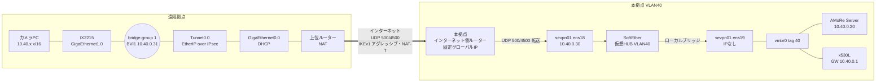

# ■ [AMoRe v0.3 VPN（IX2215 ⇔ SoftEther）構築]
([2026/10/10])

# 概要
- **目的**: [遠隔拠点の NEC UNIVERGE IX2215 を本拠点の SoftEther VPN Server へ EtherIP over IPsec で接続し、本拠点の VLAN40（`10.40.0.0/16`）を遠隔拠点へ L2 で延伸する]
- **理由・背景**: [遠隔拠点のカメラPCを、本拠点のAMoRe Server（`10.40.0.20`）と同じセグメントに参加させる。L2 で延伸するため、AMoRe側（`server.public_host`・ポート・証明書）の設定変更は不要]
- **前提条件**:
  - 構築先
    - 本拠点：CoreServer（PRIMERGY RX100 S8 / Proxmox VE 9.2）`https://10.40.0.10:8006/` に SoftEther 用VMを新規作成する
      - `vmbr0` は VLAN対応ブリッジ、`bridge-vids 40`（[AMoRe-Server_構築手順書](../Server/AMoRe-Server_構築手順書.md) の前提と同じ）
    - 本拠点のインターネット接続：**固定グローバルIP**。インターネット側ルーターで UDP 500・4500 を SoftEther VM へ転送できること
    - 遠隔拠点：IX2215。WAN は拠点の上位ルーター（家庭用ルーター等）配下で **DHCP**（NAT内・動的IP）
  - 作成するVM
    - Rocky Linux 9（Minimal）
    - 2 vCPU / メモリ 2GB / ディスク 16GB / NIC 2枚
  - 使用ソフトウェア
    - [SoftEther VPN Server](https://www.softether.org/) 4.x Stable（RTM版、Linux x64）。「EtherIP / L2TPv3 over IPsec サーバー機能」を使う
    - IX2215 のファームウェアは導入済みの版を使う。版数を作業記録に残す
  - 方式の選定
    - SoftEther 公式に NEC IX（IX2015・IX2105）との **EtherIP over IPsec** 接続手順があるため、これを IX2215 へ読み替えて使う（参考資料）
    - IX は NAT 内・動的IP のため、IKEv1 **アグレッシブモード**＋**keyid**（Phase1 ID）＋**NAT トラバーサル**で接続する。SoftEther は Phase1 ID で接続先の仮想HUB・ユーザーを決める
  - ip・名前（`10.40.0.30`・`10.40.0.31` が未使用であることを台帳等で確認してから使用する。変える場合は本書と `ix2215.config.example` を読み替える）

    | 項目 | 値 |
    | --- | --- |
    | SoftEther VM | `sevpn01`（VM ID `141`） |
    | `ens18`（管理・IPsec受信） | `10.40.0.30/16`、GW `10.40.0.1`、DNS `1.1.1.1`（VLAN40） |
    | `ens19`（ローカルブリッジ専用） | **IPなし**（VLAN40） |
    | 仮想HUB / ユーザー | `VLAN40` / `ix2215` |
    | IKE Phase1 ID（keyid） | `IX2215-SITE1` |
    | IX2215 WAN | `GigaEthernet0.0`（DHCP） |
    | IX2215 LAN（ブリッジ） | `GigaEthernet1.0` |
    | IX2215 `BVI1` | `10.40.0.31/16`（管理・キープアライブ用） |
    | 遠隔拠点のPC | `10.40.0.0/16` の未使用アドレスを静的に設定、GW `10.40.0.1`、DNS `1.1.1.1` |

  - 公開ポート（本拠点のインターネット側ルーターで転送する）

    | ポート | 用途 | 転送先 |
    | --- | --- | --- |
    | 500/udp | IKE | `10.40.0.30` |
    | 4500/udp | IKE・ESP（NAT トラバーサル） | `10.40.0.30` |

  - **注意**
    - VLAN40 には Proxmox の管理画面（`10.40.0.10`）と、認証なしのAMoRe管理Web（`10.40.0.20`）がある。延伸すると遠隔拠点からもこれらへ到達できるため、**遠隔拠点の `GigaEthernet1.0` に接続する機器は信頼できる端末（カメラPC等）に限る**
    - 遠隔拠点のLANを別の経路で本拠点とつながない（L2ループになる）
    - IX2215 の `GigaEthernet1.0` で DHCPサーバーを動かさない（VLAN40 全体へ配布してしまう）
    - VLAN40 のブロードキャストが VPN を越えて流れる
    - 帯域：カメラ1台あたり上り約 9Mbps（1080p30 の `target_bitrate_kbps: 6000`〜`max_bitrate_kbps: 8000`＋VPNのオーバーヘッド）。遠隔拠点の上り回線と本拠点の下り回線が台数分を満たすこと

## 構成



- IX2215 は `GigaEthernet1.0`・`Tunnel0.0`・`BVI1` を `bridge-group 1` でブリッジし、受けたイーサネットフレームを EtherIP に包んで IPsec（ESP トンネル）で SoftEther へ送る。
- SoftEther は IKE の Phase1 ID（`IX2215-SITE1`）から仮想HUB `VLAN40`・ユーザー `ix2215` を決めてセッションを作り、仮想HUB を `ens19` へローカルブリッジする。
- **NICを2枚に分ける理由**：Linux のローカルブリッジでは、ブリッジしたNIC自身のIPへ VPN 側から到達できない。IKE の受信・管理は `ens18`、L2 延伸は IP を持たない `ens19` で行う。
- IX は無通信だと IPsec SA を張らないため、`watch-group` で `BVI1` から `10.40.0.1` へ定期的に ping してトンネルを維持する（SoftEther 公式の IX 設定例と同じ方法）。

## ファイル構成

| パス | 内容 |
| --- | --- |
| `v0.3/VPN/AMoRe-VPN_構築手順書.md` | 本書 |
| `v0.3/VPN/ix2215.config.example` | IX2215 の設定例（グローバルIP・事前共有鍵はプレースホルダー） |
| `/usr/local/vpnserver/`（sevpn01） | SoftEther VPN Server 本体・設定 `vpn_server.config`（Git管理外） |

- 事前共有鍵（PSK）・SoftEther のサーバー管理パスワード・ユーザー `ix2215` のパスワードは管理台帳で管理し、本書・リポジトリに記載しない。

# 参考資料
- [SoftEther：NEC ルータ等からの EtherIP を用いた VPN 接続方法](https://ja.softether.org/4-docs/2-howto/Other_VPN_Appliance_Setup_Guide/7)
- [SoftEther：Cisco L2TPv3/IPsec Edge-VPN Router Setup](https://www.softether.org/4-docs/2-howto/9.L2TPIPsec_Setup_Guide_for_SoftEther_VPN_Server/6.Cisco_IOS_L2TPv3////IPsec_Edge-VPN_Router_Setup)（Phase1 ID と仮想HUBの対応付け）
- [SoftEther：6.3 VPN Server / VPN Bridge 管理コマンドリファレンス（サーバー全体）](https://www.softether.org/4-docs/1-manual/6._Command_Line_Management_Utility_Manual/6.3_VPN_Server_//_VPN_Bridge_Management_Command_Reference_(For_Entire_Server))
- [SoftEther VPN ダウンロードセンター](https://www.softether-download.com/)
- NEC UNIVERGE IX シリーズ 機能説明書・コマンドリファレンス（IKE/IPsec、ブリッジ、ネットワークモニタ）

# 構築手順

## 1. VMを作成する（Proxmox）

### [VM作成]
  ISOは [AMoRe-Server_構築手順書](../Server/AMoRe-Server_構築手順書.md) の「isoダウンロード」で取得した `Rocky-9-latest-x86_64-minimal.iso` を使う。
  `Create VM` で以下を設定する。記載のない項目は既定値。

  | タブ | 項目 | 設定値 |
  | --- | --- | --- |
  | General | VM ID / Name | `141` / `sevpn01`（VM IDは空き番号でよい） |
  | OS | ISO image | `Rocky-9-latest-x86_64-minimal.iso`、Guest OS: Linux 6.x - 2.6 Kernel |
  | System | Machine / Qemu Agent | `q35` / ✔ |
  | Disks | Bus / Size / Storage | `SCSI`（VirtIO SCSI single）/ `16` GiB / `local-lvm` または `local-zfs`、Discard ✔ |
  | CPU | Sockets / Cores / Type | `1` / `2` / `host` |
  | Memory | Memory | `2048` MiB |
  | Network | Bridge / VLAN Tag / Model | `vmbr0` / **`40`** / `VirtIO (paravirtualized)` |

  - `Confirm` で内容を確認し、`Start after created` は外して `Finish`

### [ブリッジ用NICの追加]
  `sevpn01` → `Hardware` → `Add` → `Network Device`

  | 項目 | 設定値 |
  | --- | --- |
  | Bridge | `vmbr0` |
  | VLAN Tag | **`40`** |
  | Model | `VirtIO (paravirtualized)` |
  | Firewall | **✘（外す）** |

  - 追加した `net1` が VM内の `ens19` になる（`net0` = `ens18`）
  - `net1` は遠隔拠点の機器の MAC アドレスでフレームを送受信する。Proxmox のファイアウォール（MAC・IP フィルター）を通さないため Firewall を外す

## 2. Rocky Linux をインストールする

### [インストーラーの実行]
  [AMoRe-Server_構築手順書](../Server/AMoRe-Server_構築手順書.md) の「インストーラーの実行」と同じ手順で、以下だけ読み替える。
  ```text
  ホスト名     : sevpn01
  イーサネット : ens18（オン）→ 設定 → IPv4設定
  方式         : 手動
  アドレス     : 10.40.0.30
  ネットマスク : 16（255.255.0.0）
  ゲートウェイ : 10.40.0.1
  DNSサーバー  : 1.1.1.1
  IPv6設定     : 無視する
  ens19        : オフのまま（手順3で設定する）
  ```
  - 管理者ユーザー名は `sevpn`、パスワードは管理台帳で管理する値。SSHでのrootログインは許可しない
  - インストール先は16GBのディスク、ソフトウェアは最小限のインストール

### [再起動後の確認]
  ```bash
  ip -br addr
  ip route
  ping -c 3 10.40.0.1
  ping -c 3 1.1.1.1
  ```
  - `ens18` に `10.40.0.30/16`、デフォルト経路が `10.40.0.1` であること
  - 以降はSSH（`ssh sevpn@10.40.0.30`）で作業してよい

## 3. OSの初期設定

### [パッケージ更新・ゲストエージェント]
  ```bash
  sudo dnf -y update
  sudo dnf -y install qemu-guest-agent gcc make tar policycoreutils-python-utils
  sudo systemctl enable --now qemu-guest-agent
  sudo reboot
  ```
  - 再起動後、Proxmoxの `sevpn01` → `Summary` にIPアドレスが表示されること

### [他のIKEデーモンがないことの確認]
  SoftEther は UDP 500・4500 を自身で受信する。libreswan 等が動いていると競合する。
  ```bash
  rpm -q libreswan strongswan
  sudo ss -lunp | grep -E ':(500|4500)\b'
  ```
  - どちらも `インストールされていません`、`ss` の出力が空であること

### [ブリッジ用NIC（ens19）の設定]
  IPを持たせず、オフロード（GRO・GSO・TSO・LRO）を無効にする。オフロードが有効だと、ローカルブリッジで大きなパケットの欠落・遅延が起きることがある。
  ```bash
  nmcli -f NAME,UUID,DEVICE connection show
  ```
  - `ens19` のプロファイルが既にある場合は削除してから作り直す
    ```bash
    sudo nmcli connection delete ens19
    ```
  ```bash
  sudo nmcli connection add type ethernet ifname ens19 con-name ens19 \
    ipv4.method disabled ipv6.method disabled \
    ethtool.feature-gro off ethtool.feature-gso off \
    ethtool.feature-tso off ethtool.feature-lro off
  sudo nmcli connection up ens19
  ip -br addr show ens19
  sudo ethtool -k ens19 | grep -E 'generic-receive-offload|generic-segmentation-offload|tcp-segmentation-offload|large-receive-offload'
  ```
  - `ens19` が `UP` で、IPv4・IPv6 アドレスがないこと（`fe80::` も付かないこと）
  - 4項目とも `off` であること（`[fixed]` の項目は変更不要）

### [firewalld]
  ```bash
  sudo firewall-cmd --permanent --add-port=500/udp
  sudo firewall-cmd --permanent --add-port=4500/udp
  sudo firewall-cmd --reload
  sudo firewall-cmd --list-all
  ```
  - `ports` に `500/udp 4500/udp` があること
  - SoftEther の管理ポート（`5555/tcp` 等）は開けない。管理は VM 内で `vpncmd` から行う
  - ブリッジしたフレームは `ens19` で SoftEther が直接送受信するため、firewalld の対象外

## 4. SoftEther VPN Server を導入する

### [ダウンロード]
  [SoftEther VPN ダウンロードセンター](https://www.softether-download.com/) で次を選び、表示された **RTM版の最新** の `.tar.gz` のURLをコピーする。
  ```text
  コンポーネント : SoftEther VPN Server
  プラットフォーム : Linux
  CPU          : Intel x64 / AMD64 (64bit)
  ```
  ```bash
  cd /tmp
  curl -LO '<コピーしたURL>'
  ls -l softether-vpnserver-*-linux-x64-64bit.tar.gz
  ```
  - ファイル名（版数・ビルド番号）を作業記録に残す
  - Beta版・Developer Edition ではなく RTM版を使う

### [展開・ビルド]
  ```bash
  sudo tar -xzf /tmp/softether-vpnserver-*-linux-x64-64bit.tar.gz -C /usr/local
  cd /usr/local/vpnserver
  sudo make
  ```
  - 版によっては使用許諾への同意を求められる。内容を確認し、表示に従って同意する
  - `make` の最後に動作チェックの結果が表示され、すべて合格（`All checks passed` 等）であること
  ```bash
  sudo chown -R root:root /usr/local/vpnserver
  sudo chmod 700 /usr/local/vpnserver
  sudo chmod 600 /usr/local/vpnserver/*
  sudo chmod 700 /usr/local/vpnserver/vpnserver /usr/local/vpnserver/vpncmd
  ```

### [SELinux のラベル]
  `/usr/local` 配下のファイルは既定で実行用のラベルにならないため、2つの実行ファイルに `bin_t` を付ける。
  ```bash
  sudo semanage fcontext -a -t bin_t '/usr/local/vpnserver/vpn(server|cmd)'
  sudo restorecon -v /usr/local/vpnserver/vpnserver /usr/local/vpnserver/vpncmd
  ls -Z /usr/local/vpnserver/vpnserver
  ```
  - `bin_t` と表示されること

### [systemd への登録]
  ```bash
  sudo tee /etc/systemd/system/vpnserver.service >/dev/null <<'EOF'
  [Unit]
  Description=SoftEther VPN Server
  After=network-online.target
  Wants=network-online.target

  [Service]
  Type=forking
  ExecStart=/usr/local/vpnserver/vpnserver start
  ExecStop=/usr/local/vpnserver/vpnserver stop
  Restart=on-failure

  [Install]
  WantedBy=multi-user.target
  EOF
  sudo systemctl daemon-reload
  sudo systemctl enable --now vpnserver
  systemctl status vpnserver --no-pager
  ps -eZ | grep vpnserver
  ```
  - `active (running)` であること。`ps -eZ` で `unconfined_service_t` と表示されること

### [スナップショット取得]
  Proxmoxで `sevpn01` → `Snapshots` → `Take Snapshot`
  ```text
  Name        : softether-installed
  Description : Rocky Linux 9 + SoftEther VPN Server 導入直後（未設定）
  ```

## 5. SoftEther を設定する（vpncmd）

### [vpncmd の起動]
  ```bash
  sudo /usr/local/vpnserver/vpncmd localhost:5555 /SERVER
  ```
  - 以降の `VPN Server>` で始まる行は vpncmd 内で入力する
  - PSK・パスワードは vpncmd の対話入力で入れ、シェルのコマンド履歴に残さない

### [サーバー管理パスワード]
  ```text
  VPN Server> ServerPasswordSet
  ```
  - 管理台帳で管理する値を2回入力する。次回からは vpncmd 起動時に求められる

### [仮想HUB・ユーザー]
  ```text
  VPN Server> HubCreate VLAN40
  VPN Server> HubDelete DEFAULT
  VPN Server> Hub VLAN40
  VPN Server/VLAN40> UserCreate ix2215 /GROUP:none /REALNAME:IX2215-SITE1 /NOTE:none
  VPN Server/VLAN40> UserPasswordSet ix2215
  VPN Server/VLAN40> Hub
  ```
  - `HubCreate` で求められる仮想HUBの管理パスワードは管理台帳で管理する値を入力する
  - `UserPasswordSet` のパスワードは手順5「EtherIP クライアントの登録」で同じ値を使う

### [ローカルブリッジ]
  ```text
  VPN Server> BridgeCreate VLAN40 /DEVICE:ens19 /TAP:no
  VPN Server> BridgeList
  ```
  - `VLAN40` ⇔ `ens19` が `動作中`（`Operating`）であること

### [EtherIP over IPsec の有効化]
  ```text
  VPN Server> IPsecEnable /L2TP:no /L2TPRAW:no /ETHERIP:yes /PSK:<PSK> /DEFAULTHUB:VLAN40
  VPN Server> IPsecGet
  ```
  - `<PSK>` は管理台帳で管理する事前共有鍵（IX2215 の `ike policy ... key` と同じ値）
  - `IPsecGet` で EtherIP が有効、L2TP（L2TP/IPsec・Raw L2TP）が無効であること

### [EtherIP クライアントの登録]
  IX2215 が IKE で名乗る Phase1 ID と、接続先の仮想HUB・ユーザーを対応付ける。
  ```text
  VPN Server> EtherIpClientAdd IX2215-SITE1 /HUB:VLAN40 /USERNAME:ix2215 /PASSWORD:<ix2215のパスワード>
  VPN Server> EtherIpClientList
  ```
  - ID は IX2215 の `ike local-id ike-policy keyid IX2215-SITE1` と **大文字・小文字を含めて完全に一致** させる
  - ID に `*`（ワイルドカード）は使わない。PSK を知る任意のルーターが接続できてしまう

### [不要な機能の無効化]
  EtherIP over IPsec 以外の受付を止め、外部サービスへの通知も止める。
  ```text
  VPN Server> OpenVpnEnable no /PORTS:1194
  VPN Server> SstpEnable no
  VPN Server> VpnAzureSetEnable no
  VPN Server> VpnOverIcmpDnsEnable /ICMP:no /DNS:no
  VPN Server> ListenerDelete 443
  VPN Server> ListenerDelete 992
  VPN Server> ListenerDelete 1194
  VPN Server> ListenerList
  VPN Server> exit
  ```
  - `ListenerList` に `5555` だけが残ること（vpncmd の接続に使う。firewalld で外部からは閉じている）
  - ダイナミックDNS機能は vpncmd で無効化できないため、設定ファイルで無効にする
    ```bash
    sudo systemctl stop vpnserver
    sudo grep -n -A2 'declare DDnsClient' /usr/local/vpnserver/vpn_server.config
    ```
    - `declare DDnsClient` 直下の `bool Disabled false` を `bool Disabled true` に編集する
    ```bash
    sudo vi /usr/local/vpnserver/vpn_server.config
    sudo systemctl start vpnserver
    sudo grep -n -A2 'declare DDnsClient' /usr/local/vpnserver/vpn_server.config
    ```
    - 再起動後も `bool Disabled true` であること

## 6. 本拠点のポート転送

  本拠点のインターネット側ルーターで、固定グローバルIP宛ての次の通信を `10.40.0.30` へ転送する（静的NAPT）。
  ```text
  UDP 500  → 10.40.0.30:500
  UDP 4500 → 10.40.0.30:4500
  ```
  - ルーターのWAN側フィルターで同じ2ポートの受信を許可する
  - ルーター自身が IPsec（IKE）を使っている場合、UDP 500・4500 を転送できない。その場合は別のグローバルIPを使うなど構成を見直す
  - `10.40.0.30` からインターネットへの戻りの通信（送信元 `10.40.0.30`）がこのルーターの NAT を通ること（`10.40.0.1` 経由の経路とルーター側の NAT 対象に `10.40.0.0/16` が含まれること）

## 7. IX2215 を設定する

### [事前確認・バックアップ]
  IX2215 にコンソールまたはSSHで接続する。
  ```text
  show interface
  show running-config
  ```
  - `show running-config` の出力を保存する（切り戻し用）
  - WAN側・LAN側のインターフェース名を確認し、本書と異なる場合は `ix2215.config.example` を読み替える
  - `GigaEthernet1.0` に既存の IP アドレス・DHCPサーバー（`ip dhcp ...`）・NAPT の設定がある場合は削除する（ブリッジでは使わない）
  - WAN の上位ルーターのLANが `10.40.0.0/16` と重ならないこと

### [設定の投入]
  [`ix2215.config.example`](ix2215.config.example) の `<HQ_GLOBAL_IP>`（本拠点の固定グローバルIP）と `<PSK>` を置き換え、設定モードで投入する。
  ```text
  enable-config
  （ix2215.config.example の内容を投入）
  write memory
  ```
  - 主要な設定の意味

    | 設定 | 内容 |
    | --- | --- |
    | `ike proposal ... encryption aes hash sha group 1024-bit` | IKE SA：AES・SHA1・DH Group 2。SoftEther 公式で IX との接続が確認されている組み合わせ |
    | `ike policy ... mode aggressive` | IX は動的IPのため、アグレッシブモードで Phase1 ID を名乗る |
    | `ike local-id ike-policy keyid IX2215-SITE1` | SoftEther の `EtherIpClientAdd` の ID と一致させる |
    | `ike nat-traversal policy ...` | 上位ルーターの NAT を越えるため UDP 4500 で ESP を包む |
    | `ipsec autokey-proposal ... esp-aes esp-sha` | IPsec SA：AES・SHA1 |
    | `tunnel mode ether-ip ipsec` | Tunnel0.0 を EtherIP over IPsec にする |
    | `bridge irb enable` / `bridge-group 1` | `GigaEthernet1.0`・`Tunnel0.0`・`BVI1` をブリッジする |
    | `watch-group keepalive` | `BVI1` から `10.40.0.1` へ定期的に ping し、トンネルを維持する |

### [接続の確認（IX2215）]
  ```text
  show ike sa
  show ipsec sa
  show bridge
  ping 10.40.0.1 source BVI1
  ping 10.40.0.20 source BVI1
  ```
  - `show ike sa`・`show ipsec sa` に本拠点のグローバルIPとのSAがあること
  - `show bridge` で `Tunnel0.0` 側に本拠点の機器（`10.40.0.1`・`10.40.0.20` 等）の MAC アドレスを学習していること
  - ping が応答すること

### [接続の確認（SoftEther）]
  ```bash
  sudo /usr/local/vpnserver/vpncmd localhost:5555 /SERVER /HUB:VLAN40 /CMD SessionList
  sudo /usr/local/vpnserver/vpncmd localhost:5555 /SERVER /CMD BridgeList
  ```
  - `SessionList` にユーザー `ix2215` の EtherIP のセッションと、ローカルブリッジのセッションがあること
  - `BridgeList` が `動作中` であること

### [暗号方式の強化（任意・疎通確認後）]
  疎通を確認してから、IKE・IPsec の暗号を強くする。SoftEther は対向の提案から対応している方式を選ぶため、IX2215 側だけ変更する。SoftEther の版によって対応する方式が異なるため、必ず切り戻せる状態で試す。
  ```text
  enable-config
  ike proposal ike-prop encryption aes-256 hash sha group 2048-bit lifetime 3600
  ipsec autokey-proposal ipsec-prop esp-aes-256 esp-sha lifetime time 3600
  clear ike sa
  clear ipsec sa
  ```
  - 再接続後、「接続の確認（IX2215）」と同じ確認を行い、問題なければ `write memory`
  - SA が確立しない場合は、元の行（`encryption aes ... group 1024-bit`、`esp-aes`）へ戻して `clear ike sa`・`clear ipsec sa` を実行する。どの組み合わせで成功・失敗したかを作業記録に残す

## 8. 遠隔拠点のPCから確認する

### [ネットワーク設定]
  遠隔拠点のPCを IX2215 の `GigaEthernet1.0` 側のポートへ有線で接続し、VLAN40 のアドレスを静的に設定する。
  ```text
  IPアドレス     : 10.40.0.0/16 の未使用アドレス（台帳で確認）
  サブネットマスク : 255.255.0.0
  ゲートウェイ    : 10.40.0.1
  DNS            : 1.1.1.1
  ```
  - インターネットへの通信も本拠点（`10.40.0.1`）経由になる

### [疎通・MTU]
  PowerShellで実行する。
  ```powershell
  Test-NetConnection 10.40.0.20 -Port 443 -InformationLevel Detailed
  ping -f -l 1472 10.40.0.20
  tracert -d 10.40.0.20
  ```
  - `TcpTestSucceeded : True`、`SourceAddress` が遠隔拠点PCの `10.40.x.x` であること
  - `ping -f -l 1472`（MTU 1500 相当）が応答すること。VPN はフレームを暗号化後に分割して運ぶため、MTU 1500 のフレームも届く
  - `tracert` が1ホップで `10.40.0.20` に届くこと（L2 で延伸されている）

### [AMoRe での確認]
  - [AMoRe-Camera_構築手順書](../Camera/AMoRe-Camera_構築手順書.md) の手順で遠隔拠点のカメラPCから送信し、管理Webの映像確認で映像・音声が表示されること
  - 送信画面の「パケット損失」が2%を超えないこと。超える場合は「トラブルシューティング」の帯域・MTU を確認する
  - AMoRe 側の設定（`server.public_host`・ポート・証明書）は変更しない

### [スナップショット取得]
  Proxmoxで `sevpn01` → `Snapshots` → `Take Snapshot`
  ```text
  Name        : etherip-ix2215-ok
  Description : IX2215（IX2215-SITE1）との EtherIP over IPsec 接続確認済み
  ```

# 運用

### [状態確認]
  ```bash
  systemctl status vpnserver --no-pager
  sudo /usr/local/vpnserver/vpncmd localhost:5555 /SERVER /HUB:VLAN40 /CMD SessionList
  ```

### [ログ]
  ```bash
  sudo ls /usr/local/vpnserver/server_log/ /usr/local/vpnserver/security_log/VLAN40/
  sudo tail -n 100 /usr/local/vpnserver/server_log/vpn_$(date +%Y%m%d).log
  ```
  - IKE・IPsec のネゴシエーション結果は `server_log` に記録される

### [設定のバックアップ]
  ```bash
  sudo cp -p /usr/local/vpnserver/vpn_server.config /root/vpn_server.config.$(date +%Y%m%d)
  ```
  - `vpn_server.config` にはパスワード・PSKのハッシュ等が含まれるため、リポジトリに入れない

### [拠点の追加]
  拠点ごとに別の Phase1 ID・ユーザーを作り、`EtherIpClientAdd` で対応付ける（例：`IX2215-SITE2` → `ix2215-site2`）。`BVI1` のアドレスも拠点ごとに分ける。

# 確認項目

| 確認 | 期待値 |
| --- | --- |
| `systemctl status vpnserver` | `active (running)` |
| vpncmd `BridgeList` | `VLAN40` ⇔ `ens19` が `動作中` |
| vpncmd `EtherIpClientList` | `IX2215-SITE1` → `VLAN40` / `ix2215` |
| vpncmd `SessionList`（VLAN40） | `ix2215` の EtherIP セッションがある |
| IX2215 `show ipsec sa` | 本拠点のグローバルIPとの SA がある |
| IX2215 `ping 10.40.0.20 source BVI1` | 応答する |
| 遠隔拠点PC `Test-NetConnection 10.40.0.20 -Port 443` | `TcpTestSucceeded : True` |
| 遠隔拠点PC `ping -f -l 1472 10.40.0.20` | 応答する |
| AMoRe | 遠隔拠点のカメラPCからの映像を管理Webで確認できる。損失率 2%以下 |
| 記録 | SoftEther の版数、IX2215 のファームウェア版数、採用した暗号方式、Phase1 ID と拠点の対応 |

# 切り戻し手順

1. IX2215：トンネルを止め、保存した設定へ戻す。
    ```text
    enable-config
    interface Tunnel0.0
      shutdown
    ```
    - 「事前確認・バックアップ」で保存した `show running-config` の内容に戻し、`write memory`
1. SoftEther：EtherIP の受付を止める。
    ```text
    VPN Server> IPsecEnable /L2TP:no /L2TPRAW:no /ETHERIP:no /PSK:<PSK> /DEFAULTHUB:VLAN40
    VPN Server> BridgeDelete VLAN40 /DEVICE:ens19
    ```
1. 本拠点のインターネット側ルーターから UDP 500・4500 の転送とフィルターの許可を削除する。
1. 設定前の状態へ戻す場合は、Proxmoxで `sevpn01` → `Snapshots` → `softether-installed` → `Rollback`。
1. VMごと不要な場合は `sevpn01` を停止して `Remove`（`10.40.0.30`・`10.40.0.31` は台帳上で解放する）。
- x530L・Proxmoxホストのネットワーク設定、AMoRe Server は本手順で変更しないため、切り戻し対象外。

# トラブルシューティング

| 症状 | 確認・対処 |
| --- | --- |
| IX2215 で `show ike sa` が空のまま | IX2215 から本拠点のグローバルIPへ届くか（`ping <HQ_GLOBAL_IP>`）。本拠点ルーターの UDP 500・4500 の転送とWAN側フィルター。sevpn01 の `sudo firewall-cmd --list-all`。sevpn01 で `sudo tcpdump -ni ens18 udp port 500 or udp port 4500` を実行し、IX2215 からのパケットが届いているか |
| IKE が失敗する（SoftEther の `server_log` に IKE のエラー） | PSK が一致しているか。IX2215 の `keyid` と `EtherIpClientList` の ID が完全一致しているか。`mode aggressive` になっているか。暗号方式を強化した直後なら元の組み合わせへ戻す |
| IPsec SA はあるが `SessionList` に EtherIP のセッションがない | `IPsecGet` で EtherIP が有効か。`EtherIpClientAdd` のユーザー名・パスワードが `UserCreate`・`UserPasswordSet` と一致しているか。IX2215 の `Tunnel0.0` が `tunnel mode ether-ip ipsec` で `no shutdown` か |
| セッションはあるが遠隔拠点から `10.40.0.1` へ届かない | `BridgeList` が `動作中` か。Proxmox の `net1` が VLAN Tag `40`・Firewall 外しになっているか。`ens19` が `UP` か（`ip -br link`）。IX2215 の `show bridge` で `GigaEthernet1.0`・`Tunnel0.0` が同じ `bridge-group 1` か |
| 遠隔拠点から sevpn01（`10.40.0.30`）だけ届かない | `BridgeCreate` で `ens18` を指定していないか（ブリッジは IP なしの `ens19`）。ブリッジしたNIC自身のIPへは VPN 側から届かない |
| しばらく無通信の後に切れて戻らない | IX2215 の `watch-group keepalive` と `network-monitor keepalive enable` があるか。`ike keepalive`・`ike nat-traversal ... keepalive` があるか |
| 小さい通信は通るが大きなファイル転送・Webページの表示だけ失敗する | `ping -f -l 1472 10.40.0.20` で確認する。応答しない場合は経路上でフラグメントが落ちている。遠隔拠点PCのMTUを下げて確認する（例：`netsh interface ipv4 set subinterface "イーサネット" mtu=1400 store=persistent`）。sevpn01 の `ens19` のオフロードが `off` か |
| AMoRe の送信画面で損失率が高い・720pへ下がる | 遠隔拠点の上り帯域がカメラ台数分（1台あたり約9Mbps）あるか。sevpn01 の CPU 使用率（`top`）。同じ回線で他の大きな通信をしていないか |
| 遠隔拠点のPCがIPアドレスを自動取得してしまう／本拠点で見知らぬ DHCP 配布がある | IX2215 の `GigaEthernet1.0` に DHCPサーバーの設定が残っていないか。遠隔拠点のLANに家庭用ルーター等のDHCPサーバーを接続していないか |
| 本拠点のネットワーク全体が不安定になった（ブロードキャストの嵐） | 遠隔拠点のLANが別経路で本拠点とつながっていないか（L2ループ）。直ちに IX2215 の `Tunnel0.0` を `shutdown` する |
