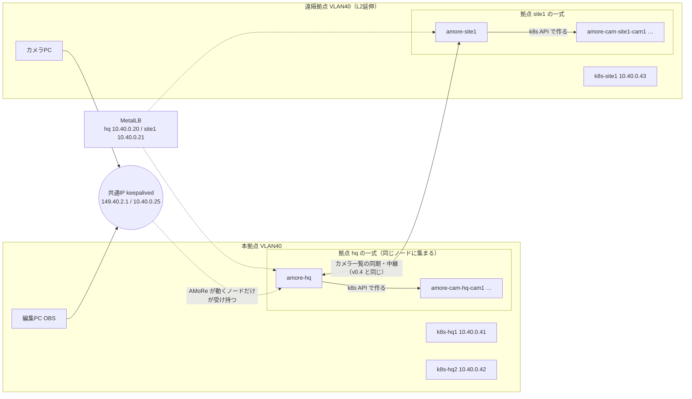

# ■ [AMoRe v0.6 Container（Kubernetes）構築]
([2026/10/27])

# 概要
- **目的**: [AMoRe を Kubernetes（k3s）で動かす。AMoRe の Pod が「ホストのコンテナ」としてカメラごとの Pod を作り、拠点をまたぐ1つのクラスターで拠点ごとに AMoRe 一式を動かす]
- **理由・背景**: [v0.4 までは VM ごとに Docker Compose で動かし、AMoRe が Docker ソケットでカメラのコンテナを作っていた。Kubernetes にすると、ノードの障害時の再配置・権限の分離（Docker ソケット不要）・宣言的な管理ができる]
- **前提条件**:
  - Docker Compose 版（[AMoRe-Server_構築手順書](../Server/AMoRe-Server_構築手順書.md)）と同じ AMoRe 本体を使い、`config/AMoRe.yaml` の **`media.runtime: kubernetes`** で切り替える。画面・同期・中継・dual・入室・録画・連携の動きは Docker 版と同じ
  - 拠点間VPN（[AMoRe-VPN_構築手順書](../VPN/AMoRe-VPN_構築手順書.md)）で VLAN40 を L2 延伸していること
  - ノード（k3s server。制御プレーンとワーカーを兼ねる）

    | ノード | 置き場所 | IP（VLAN40） | ラベル | 備考 |
    | --- | --- | --- | --- | --- |
    | `k8s-hq1` | 本拠点 CoreServer（Proxmox） | `10.40.0.41/16` | `amore.site=hq` | 最初の k3s server |
    | `k8s-hq2` | 本拠点（**CoreServer とは別のホストを推奨**） | `10.40.0.42/16` | `amore.site=hq` | |
    | `k8s-site1` | 遠隔拠点の Proxmox 等 | `10.40.0.43/16` | `amore.site=site1` | |

    - 各 VM：Rocky Linux 9（Minimal）、4 vCPU（`host`）/ メモリ 8GB / ディスク 64GB（Server手順書の手順1〜3と同じ）
    - GW `10.40.0.1`、DNS `1.1.1.1`。IP は台帳で未使用を確認してから使う
  - アドレス

    | 用途 | アドレス | 割り当て |
    | --- | --- | --- |
    | 拠点 hq の接続先IP | `10.40.0.20` | MetalLB（プール `amore-hq`。hq のノードから通知） |
    | 拠点 site1 の接続先IP | `10.40.0.21` | MetalLB（プール `amore-site1`。site1 のノードから通知） |
    | カメラ用の共通IP | `149.40.2.1/24` | keepalived（DaemonSet） |
    | OBS 用の共通IP | `10.40.0.25/16` | keepalived（DaemonSet） |
    | Pod / Service の範囲 | `10.42.0.0/16` / `10.43.0.0/16` | k3s の既定（クラスター内のみ。既存のアドレスと重ならないこと） |

    - **`10.40.0.20` は v0.4 までの Server VM の IP**。Kubernetes へ移す場合は、v0.4 の VM を止めてから MetalLB に割り当てる（OBS・カメラPCの接続先を変えずに済む）。並行して試す場合は別の IP を使う
  - 使用ソフトウェア
    - [k3s](https://k3s.io/)（stable チャネル。取得した版を作業記録に残す）。組み込みの servicelb・Traefik は使わない
    - [MetalLB](https://metallb.io/) v0.14.9（L2 モード）
    - keepalived（Alpine のパッケージ。`Container/keepalived` でイメージを作る）
    - AMoRe v0.6（`Container/Dockerfile` でイメージを作る）、MediaMTX `bluenviron/mediamtx:1.21.1-ffmpeg`（各ノードが Docker Hub から取得）
  - **制約（2拠点の制御プレーン）**
    - etcd は過半数（3台中2台）が動いている必要がある。過半数の2台が本拠点にあるため、**本拠点が丸ごと止まると k8s API が止まる**
    - そのときも、遠隔拠点で動いている AMoRe・カメラの Pod は動き続け、共通IPは keepalived（ノード同士の VRRP）で遠隔拠点へ移り、Service の転送規則（kube-proxy）も残るため、**送受信は続く**。AMoRe はカメラの Pod へ ClusterIP で接続する（DNS が使えなくても届く）
    - ただし k8s API が戻るまで、遠隔拠点でのカメラの追加・削除・Pod の作り直し・設定の変更はできない（管理Webに「Docker / Kubernetes API に接続できません」と表示される）
    - 遠隔拠点が止まった場合・本拠点のノード1台が止まった場合・AMoRe の Pod が止まった場合は、API は使えたまま切り替わる
    - etcd は拠点間VPN越しに同期するため、VPN の遅延が大きいと不安定になる。下の k3s の設定で etcd の待ち時間を長めにしている
    - **VPN が切れた場合**：遠隔拠点のノードは `NotReady` になるが、遠隔拠点の Pod は動き続け、両拠点が独立して動く（共通IPはそれぞれの拠点で持つ）。VPN が戻ると、切れている間に k8s が退避させた遠隔拠点の AMoRe・カメラの Pod が作り直される（数十秒途切れる）

## 構成



| リソース | 作るもの | 内容 |
| --- | --- | --- |
| Namespace `amore`、ServiceAccount・Role・RoleBinding `amore` | `k8s/base` | AMoRe が namespace 内のカメラの Deployment・ConfigMap・Service・Pod を操作する権限だけ（Docker ソケット＝ホストの管理者権限は不要） |
| DaemonSet `amore-keepalived` | `k8s/base` | 共通IP。ノードごとの設定は AMoRe が ConfigMap `amore-keepalived` に生成する。**AMoRe の Pod が動いているノードだけ**が共通IPを持つ |
| Deployment `amore-<拠点>`、ConfigMap `amore-<拠点>-config`、PV/PVC `amore-<拠点>-recordings` | `k8s/sites/<拠点>` | AMoRe（1 Pod）。設定は ConfigMap から読み、`cameras.yaml` は AMoRe が ConfigMap `amore-<拠点>-cameras` に保存する |
| Secret `amore-tls`、`amore-<拠点>-secrets` | 手順7（`amore-k8s.sh secrets`） | 証明書（全拠点共用）、パスワード等の秘密（yaml では `file:/config/secret/<名前>`） |
| カメラごとの ConfigMap・Deployment・Service `amore-cam-<拠点>-<ID>`、Service `…-site` | **AMoRe が作る** | MediaMTX＋FFmpeg の Pod（同じ拠点の AMoRe と同じノード）、AMoRe からの接続用（ClusterIP）、拠点の接続先IPでの WebRTC・SRT（MetalLB） |
| Service `amore-vip-<ID>`・`amore-obs-<ID>`・`amore-vip-https`・`amore-obs-https`・`amore-<拠点>-https` | **AMoRe が作る** | 共通IP（`externalIPs`・`externalTrafficPolicy: Local`。共通IPを持つノード上の Pod だけへ届く）、拠点の接続先IPの HTTPS（MetalLB） |

- カメラ・OBS からの通信の流れ：共通IP（keepalived が受け持ちノードに載せる）→ そのノード上の AMoRe・カメラの Pod（`Local`）。受け持ちノードが替わると、そのノード上の別の拠点の一式が受ける
- 拠点の接続先IP（`10.40.0.20`・`10.40.0.21`）は、dual の2本目の送信・Server 間の同期と中継・管理Webに使う（v0.4 の「Server の実IP」に当たる）

## ファイル構成

| パス | 内容 |
| --- | --- |
| `v0.6/Container/Dockerfile` | AMoRe のイメージ（本体＋送信画面・管理Web・OBSドック、ffmpeg）。ビルドコンテキストは `v0.6/` |
| `v0.6/Container/keepalived/` | keepalived のイメージ（DaemonSet 用の起動スクリプト・確認スクリプト） |
| `v0.6/Container/scripts/prepare-node.sh` | ノードの準備（OS・firewalld・sysctl）と k3s の導入（手順2） |
| `v0.6/Container/scripts/amore-k8s.sh` | 構築・更新をまとめて行う（`images`・`config`・`secrets`・`deploy`・`update`・`status`） |
| `v0.6/Container/scripts/build-image.sh` | 2つのイメージをビルドして tar に書き出す（`amore-k8s.sh images` が使う） |
| `v0.6/Container/k8s/base/` | namespace・権限・keepalived（全拠点共通） |
| `v0.6/Container/k8s/sites/hq/`・`sites/site1/` | 拠点ごとの AMoRe・設定（`config/` に yaml を置く。Git管理外）・録画の保存先 |
| `v0.6/Container/k8s/metallb/pools.yaml` | MetalLB の IP プールと通知するノード |
| `v0.6/Container/k8s/optional/op-connect.yaml` | 1Password Connect（任意） |
| `v0.6/Server/amore/` | AMoRe 本体（Docker 版と共用。`src/k8s.rs`・`src/runtime.rs` が Kubernetes 対応） |
| `v0.6/Server/config.example/` | 設定例（`kubernetes.yaml` を含む） |

# 参考資料
- [k3s - High Availability Embedded etcd](https://docs.k3s.io/datastore/ha-embedded)
- [k3s - Requirements（ポート・firewalld）](https://docs.k3s.io/installation/requirements)
- [MetalLB - Installation / L2 configuration / IP address sharing](https://metallb.io/installation/)
- [Kubernetes - Service（externalIPs・externalTrafficPolicy）](https://kubernetes.io/docs/concepts/services-networking/service/)
- [keepalived](https://www.keepalived.org/manpage.html)

# 構築手順

## 1. VM を作成する（3台）
  [Server手順書](../Server/AMoRe-Server_構築手順書.md) の **手順1〜2（VM作成・Rocky Linux）** を、ノードごとに次の値で行う（OS の設定・Docker は不要。手順2で行う）。

  | 項目 | k8s-hq1 | k8s-hq2 | k8s-site1 |
  | --- | --- | --- | --- |
  | VM Name / ホスト名 | `k8s-hq1` | `k8s-hq2` | `k8s-site1` |
  | IP | `10.40.0.41/16` | `10.40.0.42/16` | `10.40.0.43/16` |
  | 置き場所 | CoreServer | 本拠点の別ホスト（推奨） | 遠隔拠点 |

  - CPU：カメラ4台を1つのノードで受けるため、各ノードに 4 vCPU を割り当てる（VP8→H.264 変換を使う場合は余裕を持たせる）
  - 3台とも時刻同期（`timedatectl` で `System clock synchronized: yes`）。etcd と Server 間の署名に必要
  - k8s-hq2 を CoreServer に置くと、CoreServer の故障で本拠点の2台が同時に止まる（＝本拠点が丸ごと止まった扱い）。可能なら別のホストに置く

## 2. ノードを準備し k3s を導入する（1コマンド/ノード）
  各ノードでリポジトリを取得し、`scripts/prepare-node.sh` で次を行う（何度実行してもよい）。
  - パッケージの更新・ゲストエージェント、UDP受信バッファ（sysctl。`net.core.rmem_max` はノード全体の値のため Pod では設定できない）
  - firewalld：k3s（`6443/tcp`・`2379-2380/tcp`・`10250/tcp`・`8472/udp`）、Pod・Service の範囲（`10.42.0.0/16`・`10.43.0.0/16` を trusted）、AMoRe（HTTPS・`8189-8192/udp`・`8890-8893/udp`）、keepalived の確認用 `18443/tcp`、MetalLB（`7946`）、他のノードとの VRRP（ノードは `kubernetes.yaml` の `nodes`。設定例では `10.40.0.41`〜`43`）
  - `/etc/rancher/k3s/config.yaml`（`node-ip`・VLAN40 の NIC・ラベル `amore.site=<拠点>`・servicelb と Traefik の無効化・etcd の待ち時間）を作り、k3s（stable）を導入する

### [k8s-hq1（最初のノード）]
  ```bash
  sudo dnf -y install git && sudo install -d -o "$USER" /opt/AMoRe && git clone https://github.com/Aketi-Maika/AMoRe.git /opt/AMoRe && sudo sh /opt/AMoRe/v0.6/Container/scripts/prepare-node.sh hq 10.40.0.41
  ```
  - 最後に表示されたトークンを管理台帳で管理する（本書・リポジトリに記載しない）。k3s の版を作業記録に残す
  - SELinux が有効な場合、インストーラーが `k3s-selinux` を導入する

### [k8s-hq2・k8s-site1（参加するノード）]
  3つ目の引数に最初のノードの IP を付ける。トークンの入力を求められる（画面に表示されず、コマンド履歴にも残らない）。
  ```bash
  sudo dnf -y install git && sudo install -d -o "$USER" /opt/AMoRe && git clone https://github.com/Aketi-Maika/AMoRe.git /opt/AMoRe && sudo sh /opt/AMoRe/v0.6/Container/scripts/prepare-node.sh hq 10.40.0.42 10.40.0.41
  ```
  - k8s-site1 では `prepare-node.sh site1 10.40.0.43 10.40.0.41`
  - 3台とも同じ k3s の版にする（揃わない場合は `INSTALL_K3S_VERSION=<記録した版>` を付けて k3s の導入をやり直す）
  - 3台の導入後、パッケージの更新を反映するため1台ずつ `sudo reboot` する（k3s は自動で起動する）

## 3. k3s を確認する（k8s-hq1）
  ```bash
  sudo k3s kubectl get nodes -L amore.site -o wide && sudo k3s etcd-snapshot save --name after-install
  ```
  - 3台が `Ready`、`AMORE.SITE` が `hq`・`hq`・`site1` であること
  - VLAN40 側の NIC 名（例：`ens18`）が3台で同じであること（`ip -br addr`。`cluster.yaml` の `keepalived.interface` に使う）
  - 以降の `kubectl` は k8s-hq1 で `sudo k3s kubectl`（または `/etc/rancher/k3s/k3s.yaml` を管理PCへコピーして `kubectl`）を使う。本書では `kubectl` と書く

## 4. イメージを作るマシンでリポジトリを取得する
  Docker が使えるマシン（例：v0.4 の Server VM `amore01`）で行う（k8s-hq1 では手順2で取得済み）。
  ```bash
  sudo install -d -o "$USER" /opt/AMoRe && git clone https://github.com/Aketi-Maika/AMoRe.git /opt/AMoRe && git -C /opt/AMoRe log --oneline -1
  ```
  - 表示されたコミットIDを作業記録に残す（取得済みのマシンでは `cd /opt/AMoRe && git pull`）

## 5. イメージを作成して各ノードへ取り込む
  イメージを作るマシンで実行する。`images` が、2つのイメージ（`amore:0.6.0`・`amore-keepalived:0.6.0`）をビルドし、全ノード（`kubernetes.yaml` の `nodes` の IP。設定例では `10.40.0.41`〜`43`）へコピーして取り込む。
  ```bash
  cd /opt/AMoRe/v0.6/Container && sh scripts/amore-k8s.sh images
  ```
  - 各ノードへ `amore` ユーザーで ssh し、`sudo k3s ctr images import` を行うため、ノードごとに ssh・sudo のパスワードを聞かれる（鍵認証・sudo のパスワード省略を設定していれば聞かれない）。ノードを指定する場合は `images 10.40.0.41 10.40.0.42 10.40.0.43`
  - 各ノードの表示に `amore:0.6.0`・`amore-keepalived:0.6.0` があること。表示された sha256 を作業記録に残す
  - **v0.6 の Rust コードはこの `docker build` で初めてコンパイルされる**（GitHub Actions で確認済みでない場合）。ビルドエラーが出た場合はエラー全文を記録して開発側へ連絡する
  - カメラのイメージ `bluenviron/mediamtx:1.21.1-ffmpeg` は各ノードが Docker Hub から取得する（ノードからインターネットへ出られない場合は、同じように `docker save` して取り込む）
  - 社内レジストリがある場合は、そこへ push してマニフェストの `image:` を書き換えてもよい

## 6. 拠点の設定ファイルを作る
  Docker 版と同じ yaml を、拠点ごとに `k8s/sites/<拠点>/config/` へ置く（ConfigMap として AMoRe の Pod に渡す。Git管理外）。`config` が設定例をコピーし、下の表の「自動」の項目を書き換える。以降は k8s-hq1 で実行する。
  ```bash
  cd /opt/AMoRe/v0.6/Container && sh scripts/amore-k8s.sh config hq 10.40.0.20 && sh scripts/amore-k8s.sh config site1 10.40.0.21
  ```

  | ファイル | 項目 | hq の値 | site1 の値 | |
  | --- | --- | --- | --- | --- |
  | `AMoRe.yaml` | `server.public_host` | `"10.40.0.20"` | `"10.40.0.21"` | 自動 |
  | `AMoRe.yaml` | `media.runtime` | `kubernetes` | `kubernetes` | 自動 |
  | `AMoRe.yaml` | `media.docker_subnet` | `"10.42.0.0/16"`（Pod の範囲。カメラの Pod が AMoRe からの接続を許可する） | 同じ | 自動 |
  | `cluster.yaml` | `enabled` / `site` | `true` / `hq` | `true` / `site1` | 自動 |
  | `cluster.yaml` | `shared_secret` | `file:/config/secret/cluster-secret` | 同じ | 自動 |
  | `access.yaml` | `admin`・`monitor` の `password_required` / `password` | `true` / `file:/config/secret/admin-password`・`monitor-password` | 同じ | 自動 |
  | `kubernetes.yaml` | `metallb_pool` | `amore-hq` | `amore-site1` | 自動 |
  | `monitoring.yaml` | `loki.labels.site` / `zabbix.host` | `hq` / `amore-hq` | `site1` / `amore-site1` | 自動 |
  | `cluster.yaml` | `peers` | `hq`：`https://10.40.0.20`（100）、`site1`：`https://10.40.0.21`（50） | 同じ | 設定例のまま |
  | `cluster.yaml` | `keepalived.enabled` / `interface` / `camera_vip` / `obs_vip` | `true` / `ens18` / `149.40.2.1/24` / `10.40.0.25/16` | 同じ | 設定例のまま |
  | `kubernetes.yaml` | `nodes` | 3台（`k8s-hq1`・`k8s-hq2`・`k8s-site1`） | 同じ | 設定例のまま |
  | `kubernetes.yaml` | `recordings_claim` | `amore-hq-recordings`（録画する場合） | `amore-site1-recordings` | 手で |

  - 表示された設定例との差を確認する。設定例と異なる環境（ノード名・IP・共通IP・NIC 名）は、両拠点の `config/` を同じように直す（`site`・`server.public_host`・`metallb_pool`・`recordings_claim`・監視のラベル以外は **両拠点で同じ内容** にする。keepalived の設定は両拠点の AMoRe が同じ内容で適用する）
  - 録画する場合は `recordings_claim` と `k8s/sites/<拠点>/recordings.yaml` の `<NASのIP>`・`<共有パス>` を設定する。録画しない場合は `kustomization.yaml` の `resources` から `recordings.yaml` を外す
  - 作り直す場合は `k8s/sites/<拠点>/config/*.yaml` を消してから実行する

## 7. 証明書・秘密を登録する
  `secrets` が次を行う。
  - 証明書 `Server/certs/server.crt` が無ければ、拠点の接続先IP（`10.40.0.20`・`10.40.0.21`）と共通IP（`149.40.2.1`・`10.40.0.25`）を SAN に入れて作り（`Server/scripts/gen-cert.sh`）、Secret `amore-tls` に登録する
  - 拠点ごとの Secret `amore-<拠点>-secrets` に、`cluster-secret`（自動生成。登録済みなら同じ値を使う。全拠点で同じ値）と、入力した管理画面・モニターのパスワード（`admin-password`・`monitor-password`）を登録する
  ```bash
  sh scripts/amore-k8s.sh secrets
  ```
  - パスワードは画面に表示されない。値は管理台帳で管理する（一時ファイルは終了時に消す）
  - v0.4 で同じ IP の証明書を作っていれば、先に `Server/certs/` へ `server.crt`・`server.key` を置いてから実行する（カメラPC・編集PCの信頼登録をやり直さずに済む）。作った場合は、表示された SHA256 を記録し、カメラPC・編集PC・管理PCで信頼登録する（Camera手順書「証明書の信頼登録」）
  - Claude API キー等を加える場合は `kubectl -n amore create secret generic amore-hq-secrets … --dry-run=client -o yaml | kubectl apply -f -` で同じ Secret に加える。1Password Connect を使う場合は `k8s/optional/op-connect.yaml` の手順に従い、`op://…` で参照してもよい

## 8. 適用・起動する
  `deploy` が、MetalLB（無ければ導入）・IP プール（`k8s/metallb/pools.yaml`）・共通の部分（namespace・権限・keepalived の DaemonSet）・各拠点（site1 → hq の順）を適用し、拠点ごとに起動を待って設定を検証（`check`）し、最後に状態を表示する。
  ```bash
  sh scripts/amore-k8s.sh deploy
  ```
  - 各拠点の `check` に `実行方式: kubernetes（拠点 hq / …）`、秘密が `OK …（参照・解決済み）` と表示されること
  - 状態表示で、`amore-hq-…` が hq のノード、`amore-site1-…` が site1 のノードで `Running`・`READY 1/1`
  - Service の `amore-hq-https` の `EXTERNAL-IP` が `10.40.0.20`、`amore-site1-https` が `10.40.0.21`。`amore-vip-https`・`amore-obs-https` の `EXTERNAL-IP` は `<pending>` のままで正常（MetalLB は扱わない。`externalIPs` に共通IPがある）
  - keepalived：hq の AMoRe があるノードが `MASTER`、AMoRe の Pod が無いノードは `FAULT`（正常）
  - v0.4 の Server VM が `10.40.0.20` を使っている間は、`pools.yaml` の `10.40.0.20/32` を使わない（移行は手順13）
  - 冗長構成を使わない（1拠点だけ）場合は、keepalived は不要（`kubectl -n amore delete ds amore-keepalived`）

## 9. 共通IPを確認する
  hq の AMoRe の Pod があるノードで実行する。
  ```bash
  ip -br addr show ens18
  ```
  - `149.40.2.1/24`・`10.40.0.25/16` が載ること。後から状態を見る場合は `sh scripts/amore-k8s.sh status`
  - ログを見る場合：`kubectl -n amore logs deploy/amore-hq --tail 50`（`カメラの Pod を確認しました`、`Server site1 に接続できました` が出ること）

## 10. ネットワークの設定（x530L）
  Server手順書 手順14「ネットワークの設定（x530L・IX2215）」と同じ（`interface vlan40` に `ip address 149.40.2.254/24 secondary`）。

## 11. カメラを追加して確認する
  1. 管理PCで `https://149.40.2.1/admin/` を開き、管理画面のパスワードで入室する
  1. 右上が `k8s v1.xx.x`（緑）、「冗長構成（Server）」に hq・site1 が `稼働中` であること
  1. `＋ カメラを追加` → カードが `稼働中` になること（Pod の作成・イメージの取得に数十秒〜数分）
  1. Pod・Service を確認する
      ```bash
      kubectl -n amore get deploy,pod,svc -l amore.camera=cam1 -o wide
      kubectl -n amore exec deploy/amore-hq -- amore --config /config/AMoRe.yaml render-kubernetes | less
      ```
      - `amore-cam-hq-cam1`（hq の AMoRe と同じノード）・`amore-cam-site1-cam1`（site1）、Service `amore-cam-hq-cam1`・`…-site`・`amore-vip-cam1`・`amore-obs-cam1` があること
  1. カメラPC（Camera手順書）・OBS（OBS手順書「冗長構成で使う場合」）で送受信を確認する。カメラPCは `https://149.40.2.1/`、OBS は `srt://10.40.0.25:<ポート>…`
  1. site1 の管理Web（`https://10.40.0.21/admin/`）で、そのカメラが `Server hq から中継中` になること

## 12. 切替試験
  配信前に行い、途切れた秒数を記録する。

  | # | 操作 | 期待値 |
  | --- | --- | --- |
  | 1 | `kubectl -n amore delete pod -l app.kubernetes.io/name=amore,amore.site=hq` | hq の AMoRe が応答しない間に共通IPが site1 のノードへ移り（`nopreempt`）、送信画面は同じ URL のまま数秒で送信を再開。hq の AMoRe は数秒〜十数秒で戻り、site1 から中継を始める |
  | 2 | 共通IPを持つノードを止める（Proxmox で `Stop`） | 共通IPが約3秒で移る。止めたノードの AMoRe・カメラの Pod は約30〜60秒後に同じ拠点の別のノード（hq なら残りの1台）で作り直される |
  | 3 | 遠隔拠点（k8s-site1）を止める | 本拠点は影響を受けない（共通IPが本拠点にある場合）。API も使える |
  | 4 | **本拠点の2台を止める**（本拠点全停止） | 共通IPが site1 へ移り、送受信は続く。k8s API は止まる（管理Webに「Docker / Kubernetes API に接続できません」）。2台を戻すと API が戻り、hq の一式が作り直される |
  | 5 | dual のカメラで 1・2 | 送信画面の「予備の送信」は止まらず、もう一方の拠点が受け続ける |

  - 試験後、共通IPを hq に戻す場合は、受け持っているノードの keepalived を再起動する（`kubectl -n amore delete pod -l app.kubernetes.io/name=amore-keepalived --field-selector spec.nodeName=<ノード名>`）
  - etcd のスナップショットを取る：`sudo k3s etcd-snapshot save --name amore-v0.6`

## 13. v0.4（Docker Compose）からの移行
  1. 手順6の `config` で `k8s/sites/<拠点>/config/` を作り、v0.4 の `config/` から拠点ごとに変えていた値（ポート・録画・監視・入室など）と、カメラ一覧 `config/cameras.yaml` を移す（ID・ポートは変わらない）
      - カメラIDに `_` を使っている場合は Kubernetes では使えないため、`-` に変えて登録し直す（OBS の `streamid` も変わる）
  1. 配信のない時間に、v0.4 の Server VM（`amore01`・`amore02`）を `docker compose --profile cluster down` で止める（`10.40.0.20`・`10.40.0.21` と共通IPが空く）
  1. Server VM を停止する（IP が重ならないように）。録画ファイルが VM のディスクにある場合は NAS へ移しておく
  1. 手順8の `deploy` で起動する
  1. カメラPC・OBS の接続先は変わらない（同じ証明書を `amore-tls` に登録した場合は信頼登録もそのまま）
  - 切り戻し：`kubectl delete -k k8s/sites/hq -k k8s/sites/site1`（AMoRe が作ったカメラの Pod・Service は `kubectl -n amore delete deploy,svc,cm -l amore.managed=true`）、MetalLB の `pools.yaml` を削除してから、v0.4 の Server VM を起動する

# 運用

### [設定変更の反映]
  ```bash
  cd /opt/AMoRe/v0.6/Container && vi k8s/sites/hq/config/<ファイル>.yaml && sh scripts/amore-k8s.sh deploy hq
  ```
  - `deploy hq` は拠点 hq だけを適用し、AMoRe を再起動して設定を検証する（両拠点の場合は `deploy`。site1 → hq の順）
  - `cameras.yaml` は管理Webの操作で AMoRe が ConfigMap `amore-hq-cameras` に保存する（`config/cameras.yaml` は最初の1回だけ使われる）。手で編集しない
  - AMoRe の再起動中は、その拠点が共通IPを持っていれば別の拠点へ移る（数秒途切れる）。共通IPを持っていない拠点から行う
  - パスワードを変えた場合は `sh scripts/amore-k8s.sh secrets`（変えないものは Enter）の後に `deploy`

### [更新（同じ版の修正を取り込む）]
  イメージを作るマシンで `cd /opt/AMoRe && git pull && sh v0.6/Container/scripts/amore-k8s.sh images`、k8s-hq1 で `cd /opt/AMoRe && git pull && sh v0.6/Container/scripts/amore-k8s.sh deploy`（共通IPを持っていない拠点から順に適用し直す）。

### [v0.5 から v0.6 への更新]
  v0.6 で変わるのは AMoRe のイメージ（本体・送信画面・OBS ドック）だけで、マニフェスト（`k8s/`）は版（`amore:0.6.0`・`amore-keepalived:0.6.0`）以外は v0.5 と同じ。Docker 版と同じく、更新後は送信画面が映像の下端に遅延計測の時刻コードを描く。
  1. **先に OBS で下端をクロップする**（OBS 手順書「遅延計測」）。時刻コードを使わない場合は、両拠点の `config/monitoring.yaml` に `latency: { enabled: false }` を書いておく
  1. イメージを作るマシンで、v0.6 を取得してイメージを作り全ノードへ取り込む
      ```bash
      cd /opt/AMoRe && git fetch origin && git switch v0.6 && git pull && sh v0.6/Container/scripts/amore-k8s.sh images
      ```
  1. k8s-hq1 で、v0.5 の拠点の設定を引き継いで適用する（`update` が設定をコピーし、`deploy` と同じく site1 → hq の順に適用・検証する）
      ```bash
      cd /opt/AMoRe && git fetch origin && git switch v0.6 && git pull && sh v0.6/Container/scripts/amore-k8s.sh update v0.5
      ```
      - 更新した拠点のカメラの Pod は作り直される（変換スクリプトが変わり設定ハッシュが変わるため。Docker 版でカメラのコンテナが作り直されるのと同じ）。その拠点が直接受けているカメラは数十秒途切れる
  1. カメラPCの送信画面・OBS ドックを再読み込み（F5）し、OBS 手順書「遅延計測」でドックを設定する。Grafana のダッシュボードを取り込み直す（下の [監視]）
  - 切り戻し：v0.5 のフォルダで `kubectl apply -k k8s/sites/site1 && kubectl apply -k k8s/sites/hq`（`image: amore:0.5.0` に戻る）。`monitoring.yaml` に `quality`・`latency` を書いた場合は消してから適用する

### [監視（Prometheus・Grafana・遅延計測）]
  Docker 版と同じ（Server手順書 手順11。`/metrics`・Loki・Zabbix・Grafana の注釈、v0.6 の映像品質・接続数・遅延）。違いは次のとおり。
  - Prometheus の取得先は拠点の接続先IP（MetalLB）の `10.40.0.20:443`・`10.40.0.21:443`。両拠点を取得し、Grafana では `max by (camera)` 等でまとめる（送信画面の統計はカメラ用の共通IPを持つ拠点、遅延は OBS 用の共通IPを持つ拠点の AMoRe に届く）
  - `/api/v1/time`（遅延計測の時計の補正）は AMoRe の Pod が動くノードの時計を返す。3台のノードの時刻同期（手順1）が前提
  - OBS（SRT）の接続ごとのメトリクス（`amore_srt_*`）のラベル `remote` は、拠点の接続先IP（MetalLB。`externalTrafficPolicy: Cluster`）経由の接続ではノードの IP になる（送信元のアドレスが変換されるため）。OBS 用の共通IP（`externalTrafficPolicy: Local`）経由では編集PC の IP
  - メトリクス `amore_docker_up`（ダッシュボードの「Docker / k8s API 接続」）は、Kubernetes では k8s API に接続できるかを表す

### [状態・ログ]
  ```bash
  kubectl -n amore get pods -o wide -L amore.site,amore.camera
  kubectl -n amore logs deploy/amore-hq -f                # AMoRe
  kubectl -n amore logs deploy/amore-cam-hq-cam1 -f       # カメラ（管理Webの「ログ」と同じ）
  kubectl -n amore logs ds/amore-keepalived --all-containers --prefix
  kubectl top pods -n amore                               # CPU・メモリ（metrics-server。k3s に同梱）
  ```
  - Loki へのカメラのログの転送（Docker 版の `monitoring.loki.container_logs`）は Kubernetes では行わない。Promtail・Grafana Alloy 等を DaemonSet で動かし、namespace `amore` のログを集める（AMoRe 自身のログ・出来事は従来どおり AMoRe が送る）

# 確認項目（受け入れ試験の前提）

| 確認 | 期待値 |
| --- | --- |
| `kubectl get nodes -L amore.site` | 3台 `Ready`、ラベル hq・hq・site1 |
| `kubectl -n amore get pods -o wide` | `amore-hq`・`amore-site1`・登録したカメラの数×2拠点の `amore-cam-…` が `Running`。カメラの Pod は同じ拠点の AMoRe と同じノード |
| `kubectl -n amore get svc` | `amore-hq-https` 10.40.0.20、`amore-site1-https` 10.40.0.21、共通IP用の Service に `externalIPs` |
| 共通IP | AMoRe の Pod があるノードのうち1台に `149.40.2.1`・`10.40.0.25`（`ip -br addr`） |
| 管理Web | 右上 `k8s v…`、冗長構成欄で両拠点 `稼働中`、カメラが `稼働中` |
| 送受信・中継・dual | Server手順書の確認項目と同じ |
| 遅延計測・監視（v0.6） | Server手順書の確認項目「遅延計測（v0.6）」と同じ（`curl -sk https://10.40.0.20/metrics` と `https://10.40.0.21/metrics` の両方） |
| 切替試験 | 手順12の1〜5が期待どおり（途切れた秒数を記録） |
| 記録 | Rocky Linux・k3s・MetalLB・MediaMTX の版、イメージの sha256、証明書フィンガープリント、カメラIDとポートの対応 |

# 切り戻し手順
1. AMoRe とカメラのリソースを消す（設定のファイル・秘密・証明書は残る）
    ```bash
    cd /opt/AMoRe/v0.6/Container
    kubectl delete -k k8s/sites/hq
    kubectl delete -k k8s/sites/site1
    kubectl -n amore delete deploy,svc,cm -l app.kubernetes.io/part-of=amore
    kubectl delete -k k8s/base
    kubectl delete -f k8s/metallb/pools.yaml
    ```
    - 録画の PV は `Retain` のため NAS のファイルは残る
1. k3s を消す場合は各ノードで `sudo /usr/local/bin/k3s-uninstall.sh`
1. VM が不要なら Proxmox で `Remove`（IP は台帳で解放）。firewalld の許可を戻す
1. Docker 版へ戻す場合は手順13の切り戻しを参照

# トラブルシューティング

| 症状 | 確認・対処 |
| --- | --- |
| ノードが `NotReady`・参加できない | `sudo journalctl -u k3s -e`。firewalld（6443・2379-2380・10250・8472/udp）、`token`、時刻。遠隔拠点は VPN の疎通と MTU（VPN手順書） |
| etcd のログに `took too long`・リーダーの交代が続く | VPN の遅延。手順2の `prepare-node.sh` で `etcd-arg` が入ったか（`/etc/rancher/k3s/config.yaml`）。VPN の帯域が映像で埋まっていないか（Server 間の中継・dual） |
| `amore-hq` が `Pending`（`didn't match Pod's node affinity`） | ノードのラベル `amore.site=hq`（`kubectl label node k8s-hq1 amore.site=hq`） |
| `amore-hq` が `CreateContainerConfigError` | Secret `amore-tls`・ConfigMap `amore-hq-config` があるか（`kubectl -n amore describe pod …`） |
| `amore-hq` が `ErrImageNeverPull`・`ErrImagePull`（amore:0.6.0） | 手順5の取り込みをそのノードで行ったか（`sudo k3s crictl images`） |
| AMoRe のログ・管理Webに「権限がありません」 | `kubectl apply -k k8s/base` を行ったか。namespace が `amore` か（`kubernetes.namespace`） |
| カメラの Pod が `Pending`（`didn't match pod affinity rules`） | 同じ拠点の AMoRe の Pod が動いているか。カメラの Pod は AMoRe と同じノードにしか置けない |
| カメラの Pod が `CrashLoopBackOff` | 管理Webのカードに理由と直近ログ（前回のコンテナのログも）が出る。Server手順書の「不調の理由」と同じ。`unable to set read buffer size` はノードの sysctl |
| 管理Webに「配置できません（Unschedulable）」 | ノードの CPU・メモリ不足（`kubernetes.camera_resources` を下げる、ノードを増やす）、または AMoRe の Pod の無いノード |
| `amore-hq-https` の `EXTERNAL-IP` が `<pending>` | MetalLB の `pools.yaml` を適用したか。`kubernetes.metallb_pool` が `amore-hq` か。IP が他で使われていないか（`kubectl -n metallb-system logs deploy/controller`） |
| 共通IPがどのノードにも載らない | keepalived のログで `待っています`（ConfigMap `amore-keepalived` が無い：`cluster.enabled`・`keepalived.enabled`・`kubernetes.nodes`）、`FAULT`（そのノードに AMoRe の Pod が無い・`18443/tcp` が閉じている）、VRRP の firewalld、`interface` の NIC 名 |
| 共通IPに届くが送信画面が「接続中」から進まない | 共通IPを持つノードに、その拠点のカメラの Pod があるか（`kubectl -n amore get pods -o wide`）。Service `amore-vip-<ID>` の `externalTrafficPolicy` が `Local` か。`kubectl -n amore get endpointslices -l kubernetes.io/service-name=amore-vip-cam1` |
| 共通IPに届かない（`externalIPs` が使えない） | API サーバーで `DenyServiceExternalIPs` を有効にしていないか（k3s の既定では無効） |
| 本拠点全停止後、遠隔拠点で管理Webのカメラが「中継中」のまま | 中継元（hq）が止まったため中継は止まる。カメラPC が共通IPへ張り直すと site1 が直接受ける（数秒） |
| 「静止画を取得できません」（AI の映像解析） | AMoRe のイメージに ffmpeg があるか（`Container/Dockerfile` で作ったイメージか） |
