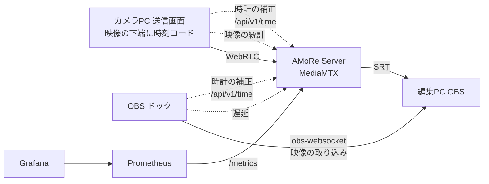
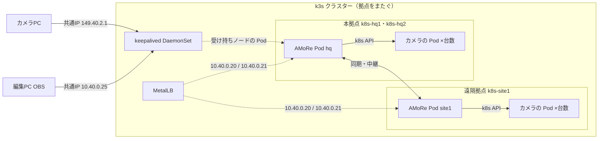
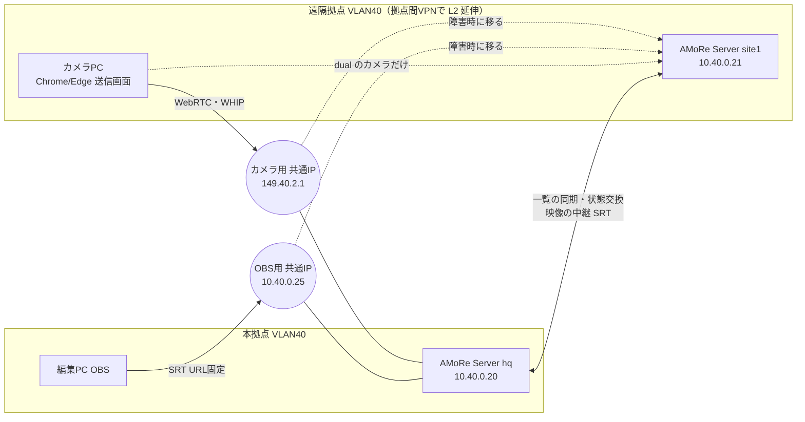
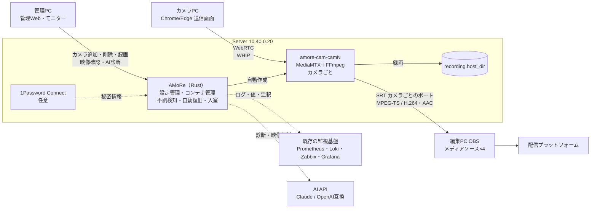

# AMoRe v0.6

Aketi MoIP on Rust engine — 開発段階1（初期版）。要件は [`requirements definition_v2.md`](../requirements%20definition_v2.md) を参照。

カメラPCのブラウザからWebRTCで送った映像・音声を、ServerがカメラごとのSRTストリーム（MPEG-TS / H.264・AAC）に変換し、編集PCのOBSで最大4台同時に受信する。
Serverの管理Webでカメラを追加すると、そのカメラ専用のメディア処理コンテナ（MediaMTX＋FFmpeg）が自動で作成される（**1カメラ＝1コンテナ**）。

## v0.5 からの変更点

| 項目 | 内容 |
| --- | --- |
| 遅延計測（カメラPC → OBS） | 送信画面（Chrome・Edge）が、送る映像の下端（高さの 1/120）に Server の時計で見た時刻を白黒の帯（時刻コード）として描く。OBS ドックが obs-websocket で OBS のメディアソースの映像を取り込み、帯を読んで遅延を測り、Server へ送る。カメラPC・編集PC の時計は Server との往復（`GET /api/v1/time`）で補正するため、PC の時刻合わせは不要。帯は OBS のシーンで下端をクロップして隠す（同梱のシーンコレクションは設定済み） |
| 映像品質・接続数の監視 | 送信画面が解像度・fps・ビットレート・パケット損失・RTT・ジッター・品質低下の理由を Server へ送る。Server はこれと MediaMTX の接続の統計（カメラPCからの送信・OBS（SRT）の RTT・再送）を `/metrics` で公開する |
| Grafana | ダッシュボードに「遅延」「映像品質」「接続数」のパネルを追加 |
| 設定 | `monitoring.yaml` に `quality`・`latency`（どちらも既定で有効。v0.5 の設定のままで動く） |
| 構築・更新のスクリプト | 手順書のコマンドをスクリプトにまとめた。Docker 版：`Server/scripts/prepare-host.sh`（OS・Docker）と `Server/scripts/amore.sh`（`setup`・`join`・`update`・`rollback`・`apply`・`status`）。Kubernetes 版：`Container/scripts/prepare-node.sh`（OS・k3s）と `Container/scripts/amore-k8s.sh`（`images`・`config`・`secrets`・`deploy`・`update`・`status`）。カメラPC・編集PCの証明書の登録も1行 |
| CI | GitHub Actions（`.github/workflows/amore-v0.6.yml`）で Rust（fmt・clippy・test）・イメージのビルド・マニフェスト・シェルを検証する |

v0.5（または v0.4）で稼働中の Server を Docker Compose のまま更新する手順は Server手順書の「[v0.5 から v0.6 への更新](Server/AMoRe-Server_構築手順書.md#v05-から-v06-への更新)」を参照。**更新後は映像の下端に時刻コードが入るため、先に OBS 手順書「遅延計測」のクロップを行う**（使わない場合は `monitoring.latency.enabled: false`）。



## v0.4 → v0.5 の変更点（v0.5 の README より）

| 項目 | 内容 |
| --- | --- |
| Kubernetes での実行 | `AMoRe.yaml` の **`media.runtime: kubernetes`** で、AMoRe を Kubernetes（k3s）で動かせる。AMoRe の Pod が「ホストのコンテナ」としてコントローラーになり、k8s API でカメラごとの Deployment・ConfigMap・Service を作る（Docker ソケットは使わず、権限は namespace `amore` の中だけ）。不調検知・自動復旧・ログ・同期・中継・dual・入室は Docker 版と同じ。`media.runtime: docker`（既定）なら v0.4 と同じく Docker Compose で動く |
| 拠点をまたぐ1つのクラスター | k3s server ×3（本拠点2台・遠隔拠点1台）。拠点ごとに AMoRe 一式（AMoRe とカメラの Pod を同じノードに配置）を置く。拠点の接続先IP（`10.40.0.20`・`10.40.0.21`）は **MetalLB**、共通IP（`149.40.2.1`・`10.40.0.25`）は **keepalived の DaemonSet**（AMoRe が動くノードだけが受け持つ。k8s API が止まっても移る） |
| 構築手順 | 新規 [`Container/`](Container/)（マニフェスト・イメージのビルド・[AMoRe-Container_構築手順書](Container/AMoRe-Container_構築手順書.md)）。設定例に `kubernetes.yaml` を追加 |

Docker Compose から Kubernetes へ移す手順は Container手順書の「v0.4（Docker Compose）からの移行」を参照。



## v0.3 → v0.4 の変更点（v0.4 の README より）

| 項目 | 内容 |
| --- | --- |
| 拠点ごとの Server による冗長化 | 拠点ごとに AMoRe Server を置き（拠点間VPNで VLAN40 を L2 延伸）、どれかが止まっても送受信を続ける。**カメラPCは全 Server 共通の1つの IP**（keepalived / VRRP。既定 `149.40.2.1/24`、`cluster.yaml` で変更可）へ送り、Server が切り替わると同じ IP へ自動で張り直す。`dual` にしたカメラは共通IPに加えて別の Server の実IPへも同時に送り、途切れない。OBS は OBS 用の共通IP（既定 `10.40.0.25`）へ固定の URL で接続する |
| カメラ情報の共有 | カメラの一覧（改訂番号つき）は全 Server で同期し、どの Server の管理Webで変更してもよい。状態は Server 間で常に交換する。各 Server は自分が直接受けていないカメラの映像を、直接受けている Server から常に中継で取り込む（SRT・再エンコードなし）ため、全 Server が全カメラの映像を持つ |
| 画面ごとの入室パスワード | 管理画面・カメラ画面（送信画面）・モニター・OBSドックごとに、パスワードの要否を `access.yaml` で ON/OFF（既定は OFF）。期限付きの入室トークン（HMAC 署名）で API を守る。総当たり対策つき |
| 設定ファイルの分割 | `AMoRe.yaml` の `include` に書いたファイル（`cameras.yaml`・`recording.yaml`・`secrets.yaml`・`access.yaml`・`cluster.yaml`・`monitoring.yaml`・`ai.yaml`）へセクションごとに分ける。同じセクションが2つのファイルにあればエラー。管理Web・同期は `cameras.yaml` だけを書き換える。1ファイルの v0.3 形式もそのまま読める |
| 不具合修正 | AMoRe の HTTP クライアントに TLS が組み込まれておらず、AI 連携（`https://api.anthropic.com`）や `https://` の Loki・Grafana へ接続できなかった |

（v0.3 からの更新手順は v0.4 の Server手順書「v0.3 から v0.4 への更新」を参照）



1台だけで使う場合（`cluster.enabled: false`）の構成は v0.3 と同じ：



## 構成

| フォルダ | 内容 | 構築手順書 |
| --- | --- | --- |
| [`Server/`](Server/) | AMoRe本体（Rust）、管理Web・モニター、Docker Compose、設定例（`config.example/`）、keepalived（`keepalived/`）、監視用テンプレート（`monitoring/`） | [AMoRe-Server_構築手順書.md](Server/AMoRe-Server_構築手順書.md) |
| [`Container/`](Container/) | Kubernetes（k3s）で動かす場合のマニフェスト（`k8s/`）、イメージ（`Dockerfile`・`keepalived/`）、ビルドスクリプト | [AMoRe-Container_構築手順書.md](Container/AMoRe-Container_構築手順書.md) |
| [`Camera/`](Camera/) | ブラウザ送信画面（JavaScript）。Serverが `https://<Server>/` で配信 | [AMoRe-Camera_構築手順書.md](Camera/AMoRe-Camera_構築手順書.md) |
| [`OBS/`](OBS/) | シーンコレクション、状態表示ドック。ドックはServerが `https://<Server>/obs/` で配信 | [AMoRe-OBS_構築手順書.md](OBS/AMoRe-OBS_構築手順書.md) |
| [`VPN/`](VPN/) | 遠隔拠点（IX2215）へ VLAN40 を L2 延伸する SoftEther VPN Server（EtherIP over IPsec）、IX2215 設定例 | [AMoRe-VPN_構築手順書.md](VPN/AMoRe-VPN_構築手順書.md) |

構築順序：**Server（管理Webでカメラ追加まで）→ Camera → OBS**（Kubernetes で動かす場合は Server の代わりに Container）（遠隔拠点のカメラPCを使う場合は Camera の前に VPN）。録画・連携・入室パスワードは Server 手順書の手順8〜13で必要なものだけ設定する。冗長構成は VPN を構築してから Server 手順書の手順14で行う。

## ネットワーク

| 機器 | IP / VLAN | 備考 |
| --- | --- | --- |
| CoreServer（Proxmox） | `10.40.0.10/16` / VLAN40 | Server VMのホスト |
| AMoRe Server VM `amore01` | `10.40.0.20/16` / VLAN40 | Rocky Linux 9 + Docker |
| AMoRe Server VM `amore02` | `10.40.0.21/16` / VLAN40（L2延伸） | 任意（冗長構成。遠隔拠点） |
| カメラ用の共通IP | `149.40.2.1/24`（VLAN40 上。x530L に `149.40.2.254/24 secondary`） | 任意（冗長構成。`cluster.yaml` で変更可）。**プライベートアドレスではない**ため社外へ漏らさない |
| OBS 用の共通IP | `10.40.0.25/16` / VLAN40 | 任意（冗長構成。`cluster.yaml` で変更可） |
| 編集PC（OBS） | `10.30.0.10/16` / VLAN30 | x530LでVLAN間ルーティング |
| SoftEther VPN Server VM `sevpn01` | `10.40.0.30/16` / VLAN40 | 任意（遠隔拠点を使う場合）。UDP 500/4500 を本拠点ルーターから転送 |
| 遠隔拠点 IX2215 `BVI1` | `10.40.0.31/16` / VLAN40（L2延伸） | 任意（遠隔拠点を使う場合） |
| 監視基盤 | 例: `10.20.0.20` / VLAN20 | 任意（既存の Loki・Zabbix・Grafana・Prometheus） |

| ポート | 用途 |
| --- | --- |
| 443/tcp | 送信画面・OBSドック・管理Web・モニター・API・`/metrics`・Server 間の状態交換 |
| 8189-8192/udp | WebRTC（カメラPC→Server、管理Webの映像確認・モニター）。カメラごとに1つ |
| 8890-8893/udp | SRT（Server→OBS、Server 間の中継）。カメラごとに1つ |
| VRRP（IP プロトコル 112） | 共通IP（Server 同士。冗長構成のみ） |

## API（AMoRe）

| メソッド・パス | 内容 |
| --- | --- |
| `GET /healthz` | 稼働確認（keepalived もこれで Server の稼働を確かめる） |
| `GET /api/v1/access` | 画面ごとにパスワードが必要か、送ったトークンが有効か |
| `POST /api/v1/login` | 入室（`{"scope": "admin", "password": "…"}` → 入室トークン） |
| `GET /api/v1/config` | 送信画面向け設定（カメラ一覧・映像/音声・品質制御・再接続・ICE、冗長構成ではカメラごとの single/dual と予備の送り先） |
| `GET /api/v1/status` | カメラごとの受信・出力・コンテナ状態・不調・録画・中継・直接受けている Server・AI解析、OBS接続数、SRT URL、冗長構成の状態 |
| `GET /api/v1/ai` | AIの映像解析・推奨カメラ・直近のエラー |
| `GET /metrics` | Prometheus 形式のメトリクス（`monitoring.prometheus`。v0.6 で映像品質・接続数・遅延を追加） |
| `GET /api/v1/time` | Server の時計（`{"now_ms": …}`。送信画面・OBS ドックが自分の時計との差を補正する） |
| `POST /api/v1/cameras/{id}/stats` | 送信画面：映像の統計（解像度・fps・ビットレート・損失・RTT など。`monitoring.quality`） |
| `POST /api/v1/latency` | OBS ドック：測った遅延（`{"obs": "編集PC", "samples": [{"camera": "cam1", "latency_ms": 320}]}`。`monitoring.latency`） |
| `POST /api/v1/cameras/{id}/whip` | WHIP（SDP offer → answer）。未登録ID=404、他の画面が送信中=409 |
| `PATCH` / `DELETE /api/v1/cameras/{id}/whip/{session}` | WHIPセッションの更新・終了 |
| `GET /api/v1/admin/overview` | 管理Web：Docker・イメージ・全カメラの状態・冗長構成・設定ファイルの構成・最近の出来事 |
| `POST /api/v1/admin/cameras` | 管理Web：カメラ追加（`{"name": "...", "id": "任意"}`）。`cameras.yaml` へ保存しコンテナを作成（冗長構成では全 Server へ配る） |
| `PATCH` / `DELETE /api/v1/admin/cameras/{id}` | 管理Web：表示名の変更 / カメラとコンテナの削除 |
| `POST /api/v1/admin/cameras/{id}/restart` | 管理Web：コンテナの再起動（不調時は作り直し） |
| `POST /api/v1/admin/cameras/{id}/record` | 管理Web：録画の有効・無効（`{"enabled": true}`） |
| `POST /api/v1/admin/cameras/{id}/redundancy` | 管理Web：冗長化の方式（`{"mode": "dual"}`。冗長構成のみ） |
| `POST /api/v1/admin/cameras/{id}/diagnose` | 管理Web：AIによる障害診断 |
| `GET /api/v1/admin/cameras/{id}/logs` | 管理Web：コンテナのログ |
| `POST /api/v1/admin/cameras/{id}/whep` | 管理Web・モニター：映像確認（WHEP。中継中のカメラは映像のみ） |
| `POST /api/v1/admin/reconcile` | 管理Web：カメラ一覧とコンテナをそろえ直す |
| `GET /api/v1/cluster/state` / `POST /api/v1/cluster/cameras` | Server 同士：状態交換・カメラ一覧の配布（`X-AMoRe-Cluster` の署名で認証） |

入室パスワードを ON にした範囲の API は `Authorization: Bearer <入室トークン>` が必要（無い・期限切れは `401`）。

## v0.6 の範囲と制限

- カメラ最大4台、1080p30（帯域不足時720p30）、H.264優先・VP8はServerでH.264へ変換、音声はOpus→AAC-LC。
- 入室パスワードは画面の利用者を絞るためのもの。Docker 版の AMoRe は Docker ソケットを使う（Kubernetes 版は namespace 内の権限だけ）ため、管理画面のパスワードは強固にし、Server（443/tcp）へ到達できる範囲も LAN（VPN 内）に限る。インターネット公開は想定しない。
- Kubernetes 版は制御プレーンの過半数が本拠点にあるため、本拠点が丸ごと止まると k8s API が止まる（送受信は遠隔拠点で続くが、API が戻るまでカメラの追加・削除や Pod の作り直しはできない）。カメラIDに `_` は使えない。Loki へのカメラのログの転送は行わない（クラスターのログ収集を使う）。
- 冗長構成で single のカメラは、Server の切替時に数秒途切れる（共通IPの移動 約3秒＋WebRTC の張り直し＋OBS の再接続）。途切れを避けたいカメラは dual にする（カメラPCの上り帯域・負荷が2倍）。
- Server 間で全カメラの映像を常に中継するため、拠点間VPNに1台あたり約 6〜8Mbps が流れる。VPN 自体の冗長化は範囲外（VPN が切れると拠点ごとに独立して動く）。
- 中継中のカメラの映像確認（WHEP）は映像のみ（OBS 向けの AAC はブラウザで再生できない）。
- カメラの一覧は改訂番号の新しい方を採用する。複数の Server で同時に変更した場合は後の変更が残る（変更は1か所で行う）。
- 全 Server で同じ証明書・`cluster.shared_secret`・`access.yaml` を使う。Server 同士の認証は時刻入りの署名のため、全 Server の時刻を NTP で合わせる。
- HTTPSは自己署名証明書（各PCで信頼登録が必要）。
- 録画の切替はそのカメラのコンテナを作り直すため、送信・受信が数秒途切れる。録画・AI・監視は Server ごとに動く。
- AI 連携は外部の API へログ・静止画を送る（既定で無効）。AI の診断・提案は参考情報であり、OBS は自動で操作しない。
- 遅延計測の時刻コードは放送にも映るため、OBS のシーンで下端（1080p で 12px）をクロップする。時刻コードを描けるのは Chrome・Edge の送信画面だけ。測れるのは「送信画面がカメラの映像を受け取った時点 → OBS が表示した時点」で、カメラ本体の遅延と OBS 以降（配信プラットフォーム）は含まない。測定の誤差は時計の補正（往復時間の半分）と OBS の1フレーム程度。
- OBS ドックの遅延計測には OBS の WebSocket サーバー（OBS 28 以降に標準搭載）を有効にする。パスワードはそのドック（OBS の中のブラウザ）にだけ保存する。
- **v0.4〜v0.6 の Rust コードはまだコンパイル・実機試験をしていない**（開発環境の Windows ではアプリ制御ポリシーにより Rust のビルドができないため）。GitHub Actions（`.github/workflows/amore-v0.6.yml`）か、Server 手順書の `docker compose build`（Kubernetes では Container 手順書の `build-image.sh`）が初回のコンパイルになる。ビルドエラーが出た場合はエラー全文を記録して開発側へ連絡する。

## 開発

```bash
cd v0.6/Server/amore
cargo fmt --check
cargo clippy --all-targets
cargo test
mkdir -p /tmp/amore-config && cp ../config.example/*.yaml /tmp/amore-config/
cargo run -- --config /tmp/amore-config/AMoRe.yaml check
cargo run -- --config /tmp/amore-config/AMoRe.yaml render-mediamtx
cargo run -- --config /tmp/amore-config/AMoRe.yaml render-keepalived   # cluster.yaml の enabled: true が必要
cargo run -- --config /tmp/amore-config/AMoRe.yaml render-kubernetes   # AMoRe.yaml の media.runtime: kubernetes が必要
```
