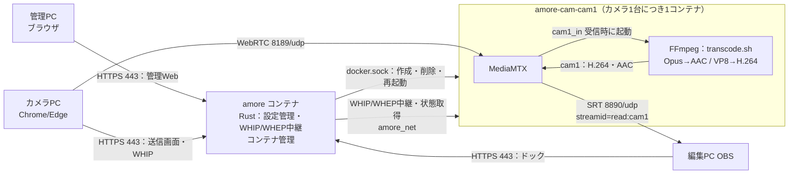
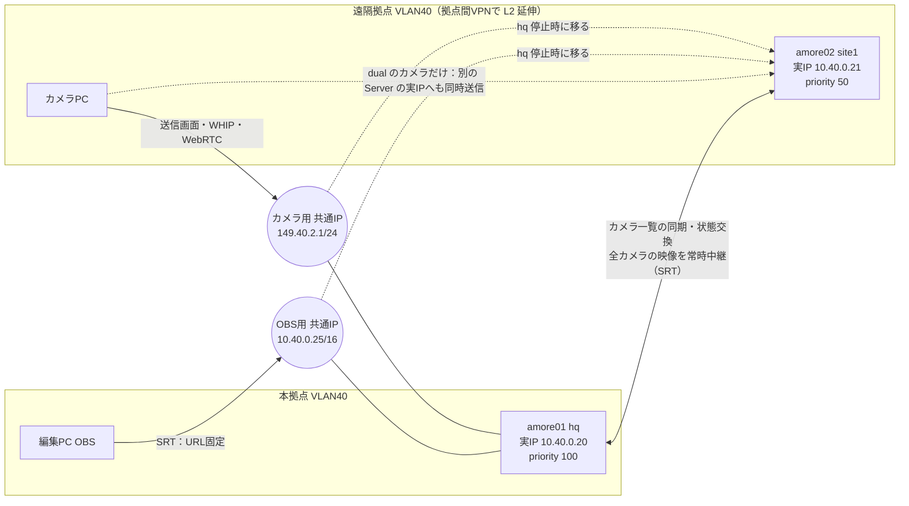

# ■ [AMoRe v0.6 Server 構築]
([2026/10/27])

# 概要
- **目的**: [カメラPCからWebRTCで受信した映像・音声を、カメラごとのSRTストリーム（MPEG-TS / H.264・AAC）としてOBSへ提供するServerを構築する]
- **理由・背景**: [AMoRe要件定義書 v2 の開発段階1（初期版）。カメラ最大4台・1080p30を、編集PC1台のOBSで同時受信する]
- **前提条件**:
  - 構築先
    - CoreServer（PRIMERGY RX100 S8 / Proxmox VE 9.2）`https://10.40.0.10:8006/`
      - Xeon E3-1220v3（4コア4スレッド）、RAM 16GB
      - `vmbr0` は VLAN対応ブリッジ、`bridge-vids 40`（[RX100 S8 セットアップ]・[AT-x530L-28GTX 26ポートルーティング設定] で構築済み）
    - x530L `port1.0.9`：tagged VLAN40
  - 作成するVM
    - Rocky Linux 9（Minimal）
    - 4 vCPU（CPU種別 `host`）/ メモリ 8GB / ディスク 64GB
    - Docker CE ＋ Docker Compose
  - 使用ソフトウェア
    - AMoRe v0.6（本リポジトリ `v0.6/Server`。Rust製、Docker上でビルド。Docker CLI 29 を同梱）
    - [MediaMTX](https://github.com/bluenviron/mediamtx) v1.21.1（FFmpeg同梱イメージ `bluenviron/mediamtx:1.21.1-ffmpeg`）。カメラごとにAMoReが自動で起動する
  - ip
    - AMoRe Server VM：`10.40.0.20/16`（GW `10.40.0.1`、DNS `1.1.1.1`、VLAN40）
    - 編集PC（OBS）：`10.30.0.10/16`（VLAN30）→ x530L のVLAN間ルーティングで到達
    - `10.40.0.20` が未使用であることを台帳等で確認してから使用する。別のIPにする場合は本書と `config/AMoRe.yaml` の `server.public_host` を読み替える
    - Docker内部ネットワーク `amore_net`：`172.30.40.0/24`（VM内のみ。既存のアドレス計画と重ならないこと）
    - 冗長構成（手順14。使う場合のみ）：2台目の Server `amore02` `10.40.0.21/16`（遠隔拠点。VLAN40 を拠点間VPNで L2 延伸）、カメラ用の共通IP `149.40.2.1/24`、OBS 用の共通IP `10.40.0.25/16`（どちらも `config/cluster.yaml` で変更できる）
  - 公開ポート（カメラごとにポートが分かれる。範囲は `AMoRe.yaml` の `media.*_ports`）

    | ポート | 用途 | 接続元 |
    | --- | --- | --- |
    | 443/tcp | 送信画面・OBSドック・管理Web・API（HTTPS） | カメラPC・編集PC・管理PC |
    | 8189-8192/udp | WebRTC（cam1=8189, cam2=8190 … の順に割当） | カメラPC・管理PC（映像確認） |
    | 8890-8893/udp | SRT（cam1=8890, cam2=8891 … の順に割当。Server=Listener） | 編集PC |

  - v0.6 で追加した機能

    | 機能 | 内容 | 手順 |
    | --- | --- | --- |
    | 遅延計測（カメラPC → OBS） | 送信画面が映像の下端に時刻コード（白黒の帯）を描き、OBS ドックが OBS の映像を取り込んで読み取る。カメラPC・編集PC の時計は Server との往復で補正するため、PC の時刻合わせは不要。時刻コードは OBS のシーンで下端をクロップして隠す | 手順11・OBS手順書 |
    | 映像品質の監視 | 送信画面が解像度・fps・ビットレート・パケット損失・RTT・ジッター・品質低下の理由を Server へ送り、`/metrics` で公開する | 手順11 |
    | 接続数・OBS の通信状態 | カメラPCからの送信（WebRTC）・OBS（SRT）・映像確認の接続数と、OBS（SRT）との RTT・再送を `/metrics` で公開する | 手順11 |
    | Grafana ダッシュボード | 上の3つのパネル（遅延・映像品質・接続数）を追加 | 手順11 |

  - v0.5 で追加した機能
    - **Kubernetes での実行**（`AMoRe.yaml` の `media.runtime: kubernetes`）。AMoRe の Pod が k8s API でカメラごとの Pod を作る。本書は Docker Compose（`media.runtime: docker`。既定）で動かす手順。Kubernetes で動かす場合は [AMoRe-Container_構築手順書](../Container/AMoRe-Container_構築手順書.md) を参照する（AMoRe 本体・設定ファイル・画面は共通）

  - v0.4 で追加した機能

    | 機能 | 内容 | 手順 |
    | --- | --- | --- |
    | 設定ファイルの分割 | `config/AMoRe.yaml` の `include` に書いたファイル（`cameras.yaml`・`recording.yaml`・`secrets.yaml`・`access.yaml`・`cluster.yaml`・`monitoring.yaml`・`ai.yaml`）へセクションごとに分ける。1ファイルの v0.3 形式もそのまま読める | 手順5 |
    | 画面ごとの入室パスワード | 管理画面・カメラ画面（送信画面）・モニター・OBSドックごとに、パスワードの要否を `access.yaml` で ON/OFF | 手順13 |
    | 拠点ごとの Server による冗長化 | 拠点ごとに Server を置き、カメラは全 Server 共通の1つの IP（keepalived）へ送る。カメラの一覧・状態・映像は全 Server が常に受け取る。`dual` のカメラは別の Server の実IPへも同時送信 | 手順14 |
    | 修正 | AI 連携・Loki・Grafana の `https://` の宛先へ接続できなかった（HTTP クライアントに TLS が組み込まれていなかった）不具合を修正 | - |

  - v0.3 で追加した機能（設定ファイルは v0.4 の分割後の名前）

    | 機能 | 内容 | 手順 |
    | --- | --- | --- |
    | コンテナの不調検知・自動復旧 | 再起動の繰り返し・停止・ネットワーク未接続を検知し、理由と直近ログを管理Webに表示。自動で作り直す（最大3回） | 手順7・トラブルシューティング |
    | 録画 | 保存先（ホストのディレクトリ・NAS）と形式（fMP4/MPEG-TS で記録し MP4・MKV・MOV へ変換）を指定 | 手順8 |
    | モニター画面 | 1つの画面に全カメラの映像を表示 | 手順9 |
    | パスワードマネージャー連携 | API キー・パスワードを 1Password Connect から取得（yaml に直接書かない） | 手順10 |
    | 監視基盤との連携 | Prometheus（メトリクス）・Loki（ログ）・Zabbix（値・トリガー）・Grafana（ダッシュボード・注釈） | 手順11 |
    | AI 連携 | 障害診断・映像解析・配信操作支援（Claude または OpenAI互換 API） | 手順12 |

  - 外向きの通信（使う機能だけ）

    | 宛先 | 用途 |
    | --- | --- |
    | 監視基盤（例: `10.20.0.20`）の Loki `3100/tcp`・Zabbix `10051/tcp`・Grafana `3000/tcp` | ログ・値・注釈の送信 |
    | Prometheus → Server `443/tcp` | メトリクスの取得（Prometheus から Server へ） |
    | `api.anthropic.com:443` または OpenAI互換 API | AI 連携 |
    | 1Password（インターネット） | Connect サーバーの同期 |

  - **将来性**
    - 開発段階3・4：4K対応、カメラ台数拡張（v0.6の性能目標・構成をそのまま適用しない）

## 構成



- **1カメラ＝1コンテナ**：管理Webでカメラを追加すると、AMoReが `config/cameras.yaml` にカメラを保存し（冗長構成では全 Server へ配り）、専用コンテナ `amore-cam-<カメラID>` を自動で作成・起動する。削除するとコンテナも削除する。
- 各コンテナは `<id>_in`（WebRTC受信）と `<id>`（OBS向け）の2つのパスを持つ。映像がH.264の場合は再エンコードせずにコピーし、VP8の場合はH.264へ変換する（CPU負荷が高い）。音声は常にOpus→AAC-LCへ変換する。
- カメラごとの `mediamtx.yml` と変換スクリプトは、AMoReが共有ボリューム `amore-shared` へ自動生成する。直接編集しない。
- AMoReは起動時と変更時にカメラ一覧（`cameras.yaml`）とコンテナをそろえる（不足を作成、設定が変わったものを再作成、登録外を削除）。AMoReが停止していても、カメラのコンテナは送受信を続ける。
- **注意**：AMoReはDockerソケットを使うため、ホストの管理者権限に相当する操作ができる。管理Webには `access.yaml` で入室パスワードを設定できる（手順13。既定は OFF）。本番では管理画面のパスワードを ON にし、Server（443/tcp）へ到達できる範囲も信頼できる端末に限ること。

## ファイル構成

| パス | 内容 |
| --- | --- |
| `v0.6/Server/config.example/*.yaml` | 設定例（Git管理）。セクションごとのファイルに分かれている（下表） |
| `v0.6/Server/config/*.yaml` | 稼働中の設定（設定例をコピーして作成。管理Web・Server 間の同期が `cameras.yaml` を書き換える。Git管理外） |
| `v0.6/Server/compose.yaml` | Docker Compose 定義（amore、冗長構成の keepalived、1Password Connect。カメラのコンテナはAMoReが作成） |
| `v0.6/Server/keepalived/` | 共通IP（keepalived）のコンテナ（冗長構成のみ。設定ファイルは AMoRe が `cluster.yaml` から生成する） |
| `v0.6/Server/amore/` | AMoRe本体（Rust）、Dockerfile、変換スクリプト `assets/transcode.sh`・録画変換 `assets/convert.sh` |
| `v0.6/Server/admin/` | 管理Web（`/admin/`）・モニター画面（`/admin/monitor.html`） |
| `v0.6/Server/monitoring/` | Zabbix テンプレート・Grafana ダッシュボード |
| `config/op-connect-token`・`config/1password-credentials.json` | 1Password Connect の認証情報（使う場合のみ。Git管理外） |
| `/srv/amore/recordings/<カメラID>/` | 録画ファイル（`recording.host_dir`） |
| `v0.6/Server/scripts/prepare-host.sh` | Server VM の準備（パッケージ・firewalld・sysctl・Docker。手順3） |
| `v0.6/Server/scripts/amore.sh` | 構築・更新・設定の反映をまとめて行う（`setup`・`join`・`update`・`rollback`・`apply`・`status`） |
| `v0.6/Server/scripts/gen-cert.sh` | 自己署名証明書の作成（`amore.sh setup` が使う） |
| `v0.6/Server/certs/` | 証明書・秘密鍵の配置先（Git管理外） |
| `v0.6/Camera/www/` | 送信画面（amore が `/` で配信） |
| `v0.6/OBS/dock/` | OBSドック（amore が `/obs/` で配信） |

設定ファイル（`config/`）の構成：

| ファイル | セクション | 内容 | 書き換え |
| --- | --- | --- | --- |
| `AMoRe.yaml` | `version`・`include`・`server`・`media`・`limits`・`video`・`audio`・`srt`・`quality_control`・`reconnect`・`ice_servers` | 本体。`include` に読み込むファイルを書く | 手動 |
| `cameras.yaml` | `cameras`・`cameras_revision` | カメラの一覧と改訂番号 | **AMoRe が書き換える**（手で編集しない） |
| `recording.yaml` | `recording` | 録画 | 手動 |
| `secrets.yaml` | `secrets` | 1Password Connect | 手動 |
| `access.yaml` | `access` | 画面ごとの入室パスワード | 手動 |
| `cluster.yaml` | `cluster` | 冗長構成（Server の一覧・共通IP） | 手動 |
| `monitoring.yaml` | `monitoring` | Prometheus・Loki・Zabbix・Grafana | 手動 |
| `ai.yaml` | `ai` | AI 連携 | 手動 |
| `kubernetes.yaml` | `kubernetes` | Kubernetes で動かす場合の設定（Docker では使わない。Container 手順書） | 手動 |

- `include` のファイルは `AMoRe.yaml` からの相対パス。各ファイルのトップレベルのキー（セクション）を1つの設定にまとめる。**同じセクションを2つのファイルに書くとエラー**（どのファイルとどのファイルかが表示される）。`include` の入れ子はできない
- 使わない機能のファイルは `include` から外してもよい（既定値で動く）。1つの `AMoRe.yaml` に全部書いても読める
- `check` の出力の「設定ファイル:」で、どのセクションがどのファイルから読まれたかを確認できる

# 参考資料
- [Rocky Linux ダウンロード](https://rockylinux.org/download)
- [Docker Engine install on RHEL](https://docs.docker.com/engine/install/rhel/)
- [MediaMTX README](https://github.com/bluenviron/mediamtx)
- [Proxmox VE Administration Guide – Qemu/KVM Virtual Machines](https://pve.proxmox.com/pve-docs/chapter-qm.html)
- [OBS SRT Protocol Streaming Guide](https://obsproject.com/kb/srt-protocol-streaming-guide)

# 構築手順

## 1. VMを作成する（Proxmox）

### [isoダウンロード]
  - Proxmox WebGUI `https://10.40.0.10:8006/` へrootでログインする（認証情報は管理台帳を参照。本書には記載しない）
  - `Datacenter` → `CoreServer` → `local` → `ISO Images` → `Download from URL`
    ```text
    URL       : https://download.rockylinux.org/pub/rocky/9/isos/x86_64/Rocky-9-latest-x86_64-minimal.iso
    File name : Rocky-9-latest-x86_64-minimal.iso
    Hash algorithm : SHA-256
    Checksum  : 同じディレクトリの CHECKSUM ファイルに記載された minimal.iso の値
    ```
  - `Query URL` → `Download`。タスクログに `OK` とチェックサム一致が表示されることを確認する
    - 取得時点で9系の最新版を使う。ダウンロードしたファイル名（版数）を作業記録に残す

### [VM作成]
  `Create VM` で以下を設定する。記載のない項目は既定値。

  | タブ | 項目 | 設定値 |
  | --- | --- | --- |
  | General | VM ID / Name | `140` / `amore01`（VM IDは空き番号でよい） |
  | OS | ISO image | `Rocky-9-latest-x86_64-minimal.iso`、Guest OS: Linux 6.x - 2.6 Kernel |
  | System | Machine / Qemu Agent | `q35` / ✔ |
  | Disks | Bus / Size / Storage | `SCSI`（VirtIO SCSI single）/ `64` GiB / インストール時に作成した `local-lvm` または `local-zfs`、Discard ✔ |
  | CPU | Sockets / Cores / Type | `1` / `4` / **`host`** |
  | Memory | Memory | `8192` MiB |
  | Network | Bridge / VLAN Tag / Model | `vmbr0` / **`40`** / `VirtIO (paravirtualized)` |

  - CPU種別を`host`にし、映像変換（FFmpeg）でCPUの拡張命令を使えるようにする
  - ホストは4コアのため、4 vCPUを割り当てると他VMとCPUを取り合う。v0.6の試験中は他の負荷の高いVMを同時に動かさない
  - `Confirm` で内容を確認し、`Start after created` は外して `Finish`
  - 新規VMのため、この段階の切り戻しはVM削除で行う。スナップショットはDocker導入後（手順4）に取得する

## 2. Rocky Linux をインストールする

### [インストーラーの実行]
  1. `amore01` → `Start` → `Console`
  1. `Install Rocky Linux 9.x`
  1. 言語：日本語
  1. `ネットワークとホスト名`
      ```text
      ホスト名     : amore01
      イーサネット : ens18（オン）→ 設定 → IPv4設定
      方式         : 手動
      アドレス     : 10.40.0.20
      ネットマスク : 16（255.255.0.0）
      ゲートウェイ : 10.40.0.1
      DNSサーバー  : 1.1.1.1
      IPv6設定     : 無視する（v0.6はIPv4のみ）
      ```
      - VLANタグはProxmox側（VLAN Tag 40）で付与するため、OS側ではVLANを設定しない
  1. `時刻と日付`：アジア/東京、ネットワーク時刻 オン
  1. `インストール先`：64GBのディスク、ストレージの構成は自動
  1. `ソフトウェアの選択`：最小限のインストール
  1. `rootパスワード`：設定する（**SSHでのrootログインは許可しない**）。値は管理台帳で管理し、本書・リポジトリに記載しない
  1. `ユーザーの作成`
      ```text
      ユーザー名 : amore
      このユーザーを管理者にする : ✔（wheel）
      パスワード : 管理台帳で管理する値
      ```
  1. `インストールの開始` → 完了後 `システムの再起動`

### [再起動後の確認]
  Proxmoxのコンソールで `amore` でログインし、確認する。
  ```bash
  ip -br addr
  ip route
  ping -c 3 10.40.0.1
  ping -c 3 1.1.1.1
  ```
  - `ens18` に `10.40.0.20/16`、デフォルト経路が `10.40.0.1` であること
  - 編集PC（VLAN30）のPowerShellから到達を確認する
    ```powershell
    Test-NetConnection 10.40.0.20 -Port 22
    ```
  - 以降はSSH（`ssh amore@10.40.0.20`）で作業してよい

## 3. OSの初期設定・Docker の導入（1コマンド）

### [リポジトリ取得・準備]
  リポジトリを取得し、`scripts/prepare-host.sh` で次を行ってから再起動する（何度実行してもよい）。
  - パッケージの更新、ゲストエージェント（qemu-guest-agent）・git
  - firewalld：`443/tcp`・`8189-8192/udp`（WebRTC）・`8890-8893/udp`（SRT）。範囲は `AMoRe.yaml` の `media.webrtc_udp_ports`・`media.srt_ports`
  - UDP受信バッファ（`/etc/sysctl.d/90-amore.conf`：`net.core.rmem_max=16777216`、`net.core.rmem_default=8388608`）。1080pのキーフレームは短時間に多数のUDPパケットで届くため、OS既定（約208KB）では溢れて映像が欠ける
  - Docker CE・Compose の導入と、`amore` ユーザーの `docker` グループへの追加
  ```bash
  sudo dnf -y install git && sudo install -d -o amore /opt/AMoRe && git clone https://github.com/Aketi-Maika/AMoRe.git /opt/AMoRe && sudo sh /opt/AMoRe/v0.6/Server/scripts/prepare-host.sh && sudo reboot
  ```
  - 最後の「確認」の表示（Docker・Compose のバージョン、`SELinux: Enforcing`、`時刻同期: yes`）と、`git -C /opt/AMoRe log --oneline -1` のコミットIDを作業記録に残す（要件：採用OSSのバージョン記録）
  - `Enforcing` のまま運用する。amore コンテナだけは Dockerソケットへ接続するため `compose.yaml` で `label=disable`（SELinuxのラベル分離を無効）にしている。カメラのコンテナは通常どおり分離される
  - 時刻同期が `no` の場合は `timedatectl set-ntp true` 等で合わせる（遅延測定・ログ照合・冗長構成の認証のため）
  - カメラのコンテナは `AMoRe.yaml` の `media.udp_read_buffer_bytes`（既定 8MB）で受信バッファを要求する。`net.core.rmem_max` より大きい値は上限で切り詰められるため、変更する場合は両方を合わせる
  - Dockerは公開ポートの通信規則を自身で追加するため、firewalldの許可を外してもコンテナの公開ポートは閉じない場合がある。公開範囲の制限は要確定事項（認証・アクセス制御）と併せて設計する
  - 冗長構成の2台目以降は、相手の Server との VRRP の許可も同時に行える（手順14：`prepare-host.sh --vrrp-peer 10.40.0.20`）

## 4. 再起動後の確認・スナップショット

### [確認]
  `amore` で再ログインする。
  - Proxmox の `amore01` → `Summary` にIPアドレスが表示されること（ゲストエージェント動作確認）
  - `docker run --rm hello-world` が `sudo` なしで実行できること

### [スナップショット取得]
  Proxmoxで `amore01` → `Snapshots` → `Take Snapshot`
  ```text
  Name        : os-docker-ready
  Description : Rocky Linux 9 + Docker 導入直後（AMoRe未導入）
  ```

## 5. AMoRe を配置する

### [構築・起動（1コマンド）]
  `scripts/amore.sh setup` が、次を順に行う（既にあるものは作り直さずに使う）。
  1. 設定ファイル `config/*.yaml` を設定例から作り、`server.public_host` を指定した IP にする
  1. AMoRe とカメラのコンテナをつなぐ Docker ネットワーク `amore_net`（`media.docker_subnet` の `172.30.40.0/24`）を作る
  1. 自己署名のTLS証明書 `certs/server.crt`（配布用）・`certs/server.key`（Server外へ出さない）を作る（`scripts/gen-cert.sh`。ブラウザはHTTPSでなければカメラ・マイクを利用できないため）
  1. ビルド → 設定の検証（`check`）→ 起動 → `healthy` になるまで待ち、状態を表示する
  ```bash
  cd /opt/AMoRe/v0.6/Server && sh scripts/amore.sh setup 10.40.0.20
  ```
  - 初回ビルドはRustのコンパイルに数分～十数分かかる。**v0.6のRustコードは本手順で初めてコンパイルされる**（GitHub Actions で確認済みでない場合）ため、ビルドエラーが出た場合はエラー全文を記録して開発側へ連絡する（ビルド・検証に失敗した場合は起動せずに止まる）
  - 表示された証明書の **SHA256フィンガープリント** を記録する。カメラPC・編集PCへ配布した証明書と照合する。有効期限は825日（期限前に作り直し、配布先も入れ替える）
  - 設定の検証で `OK: /config/AMoRe.yaml（カメラ 0 台 / 上限 4 台）`、`設定ファイル:` の下に各ファイルとセクション、`冗長構成: 無効（cluster.enabled: false）`、`入室パスワード: なし` と表示されること
  - 最後の状態表示で、`amore` が `healthy`、`healthz: ok`、`"docker_version":"29.…"`・`"image_ready":true`・`"docker_error":null`、`amore_info{version="0.6.0"} 1` であること
  - 初回はカメラ用イメージ `bluenviron/mediamtx:1.21.1-ffmpeg` の取得が行われる（`docker compose logs amore` に `イメージを取得しました`）。`image_ready` が `false` の場合は数分後に `sh scripts/amore.sh status` で確認し直す
  - `restart: unless-stopped` のため、VM再起動後も自動で起動する。カメラのコンテナも同じ設定で作成される
  - 証明書に他の IP・DNS名も入れる場合は並べて指定する（例：`sh scripts/amore.sh setup 10.40.0.20 amore01.example.local`）

### [設定の確認・変更]
  設定例のままで1台の基準試験ができる。変える場合は `config/` のファイルを編集し、`sh scripts/amore.sh apply` で反映する（検証してから AMoRe を作り直す。検証に失敗した場合は反映しない）。`config/` はGit管理外のため、`git pull` で上書きされない。

  | ファイル | 項目 | 確認内容 |
  | --- | --- | --- |
  | `AMoRe.yaml` | `server.public_host` | VMのIP `10.40.0.20`（setup で指定した値） |
  | `AMoRe.yaml` | `media.image` | `bluenviron/mediamtx:1.21.1-ffmpeg`（カメラのコンテナのイメージ） |
  | `AMoRe.yaml` | `media.docker_subnet` | `amore_net` のサブネット `172.30.40.0/24`（変える場合は setup の前に変える。ネットワークはこの値で作られる） |
  | `AMoRe.yaml` | `media.webrtc_udp_ports` / `media.srt_ports` | `8189-8192` / `8890-8893`（firewalldで開けた範囲） |
  | `AMoRe.yaml` | `media.udp_read_buffer_bytes` | `8388608`（sysctlの `net.core.rmem_max` 以下） |
  | `AMoRe.yaml` | `srt.latency_ms` | LAN：`120` / WAN試験：`200`（暫定） |
  | `AMoRe.yaml` | `ice_servers` | LAN内では `[]`。NAT越えが必要な場合のみSTUN/TURNを指定 |
  | `cameras.yaml` | `cameras` | `[]` のままでよい（管理Webで追加する） |
  | `recording.yaml` | `recording.enabled` | `false`（基準試験は録画無効） |
  | `access.yaml` | `access.*.password_required` | 最初は `false` のままでよい（手順13で設定する） |
  | `cluster.yaml` | `cluster.enabled` | 1台で使う場合は `false` のまま（手順14で設定する） |
  | `monitoring.yaml` | `quality` / `latency` | `true`（v0.6 の映像品質・遅延計測。手順11） |

  - 構成は「ファイル構成」を参照。`AMoRe.yaml`・`cameras.yaml`・`recording.yaml`・`secrets.yaml`・`access.yaml`・`cluster.yaml`・`monitoring.yaml`・`ai.yaml`・`kubernetes.yaml` がある

## 6. 起動を確認する

### [Server内での確認]
  手順5の setup で起動・確認まで済んでいる。後から確認する場合：
  ```bash
  sh scripts/amore.sh status
  ```

### [編集PC・カメラPCからの確認]
  PowerShellで実行する。
  ```powershell
  Test-NetConnection 10.40.0.20 -Port 443
  ```
  - `TcpTestSucceeded : True` であること。`SourceAddress` が有線（例：`10.30.0.10`）であること
  - UDP（WebRTC・SRT）は `Test-NetConnection` で確認できないため、管理Webの映像確認、Camera・OBSの手順書で実際の送受信により確認する
  - 証明書の信頼設定は Camera 手順書の「証明書の信頼登録」と同じ手順で、管理に使うPCにも行う

## 7. 管理Webでカメラを追加する

### [管理Webを開く]
  管理PC（例：編集PC）のブラウザで次を開く。
  ```text
  https://10.40.0.20/admin/
  ```
  - 右上が `Docker 29.x.x`（緑）であること
  - 「カメラが登録されていません」と表示されること

### [カメラの追加]
  1. `＋ カメラを追加`
  1. 入力する

      | 項目 | 入力例 | 備考 |
      | --- | --- | --- |
      | カメラID | （空欄） | 空欄なら `cam1`、`cam2` … を自動で割り当てる。後から変更できない |
      | 表示名 | `ステージ正面` | 後から変更できる |

  1. `追加` → `コンテナ作成中…` の後、カードが表示される
  1. カードを確認する

      | 表示 | 期待値 |
      | --- | --- |
      | 右上のバッジ | `稼働中`（緑） |
      | 見出しの下 | `cam1　/　amore-cam-cam1` |
      | ポート | `WebRTC 8189/udp　SRT 8890/udp`（追加順に割当） |
      | SRT URL | `srt://10.40.0.20:8890?streamid=read:cam1&latency=120000`（OBSに入力する値） |
      | 受信 | `未送信` |

  1. Serverでコンテナと設定を確認する
      ```bash
      docker ps --filter label=amore.managed=true
      grep -A4 '^cameras:' config/cameras.yaml
      ```
      - `amore-cam-cam1` が `Up` で、`0.0.0.0:8189->8189/udp` と `0.0.0.0:8890->8890/udp` が公開されていること
      - `config/cameras.yaml` の `cameras:` に追加したカメラが保存され、`cameras_revision:` が更新されていること（直前の内容は `config/cameras.yaml.bak`。他の設定ファイルは書き換えない）
  1. 使用する台数（最大4台）まで繰り返す

### [映像の確認]
  1. カメラPCで送信を開始する（Camera手順書）。カードの `送信画面` リンクを開くと、そのカメラIDが選択された状態で送信画面が開く
  1. カードの `受信` が `受信中　H264 / Opus → H264 / AAC（再エンコードなし）` になること
  1. `映像確認` を押すと、カードに映像が表示され、右下に解像度（例：`1920×1080`）が出ること
      - 音声は初期状態でミュート。`音声をオン` で確認できる
      - 映像確認はServerからWebRTCで受信するため、管理PCからそのカメラのWebRTCポート（例：`8189/udp`）へ到達できる必要がある
      - 映像確認中はServerの送信帯域を使う。確認が終わったら `停止` を押す
  1. 送信されていないカメラで `映像確認` を押すと「このカメラは送信されていないため表示できません」と表示される

### [その他の操作]

| 操作 | 内容 |
| --- | --- |
| 名前変更 | 表示名だけを変更する。コンテナは再作成しない |
| 再起動 | そのカメラのコンテナだけを再起動する。送信・OBS受信は一時的に切断され、自動で再接続する |
| ログ | そのカメラのコンテナ（MediaMTX・FFmpeg）のログ直近300行を表示する |
| 削除 | カメラを `cameras.yaml` から削除し、コンテナも削除する。割り当てていたポートは次の追加で再利用される |
| 再適用 | カメラ一覧（`cameras.yaml`）とコンテナをそろえ直す（手動で消したコンテナの再作成、登録外のコンテナの削除）。自動復旧の記録も消す |
| 録画する／録画を止める | そのカメラの録画を切り替える（手順8）。コンテナを作り直すため数秒途切れる |
| AIで診断 | AI 連携が有効な場合に表示。コンテナの状態・ログを AI に送り、原因と対処を表示する（手順12） |
| 不調の表示 | コンテナが不調になるとカードが赤枠になり、理由・自動復旧の状況・直近ログが表示される。画面下の「最近の出来事」にも残る |

## 8. 録画を設定する

録画はカメラのコンテナが OBS 向けの出力（H.264・AAC）を区切りごとに保存し、区切りが閉じるたびに再エンコードなしで MP4 等へ変換する。

### [保存先の用意]
  1080p・6Mbps で **1台あたり約2.7GB/時**（4台で約11GB/時）。VM のディスク（64GB）では足りないため、録画用のディスクか NAS を用意する。

  **(a) VM に録画用ディスクを追加する場合**（例: 500GB）
  1. Proxmox で `amore01` → `Hardware` → `Add` → `Hard Disk`（SCSI / 500 GiB / Discard ✔）
  1. VM でフォーマットしてマウントする（`/dev/sdb` は `lsblk` で確認した名前に読み替える）
      ```bash
      lsblk
      sudo mkfs.xfs /dev/sdb
      sudo mkdir -p /srv/amore/recordings
      echo "UUID=$(sudo blkid -s UUID -o value /dev/sdb) /srv/amore/recordings xfs defaults 0 0" | sudo tee -a /etc/fstab
      sudo systemctl daemon-reload
      sudo mount -a
      df -h /srv/amore/recordings
      ```

  **(b) NAS（NFS）を使う場合**
  ```bash
  sudo dnf -y install nfs-utils
  sudo mkdir -p /srv/amore/recordings
  echo '<NASのIP>:/<共有パス> /srv/amore/recordings nfs defaults,_netdev 0 0' | sudo tee -a /etc/fstab
  sudo mount -a
  sudo setsebool -P virt_use_nfs 1
  df -h /srv/amore/recordings
  ```
  - NFS は SELinux のラベル付けができないため、`recording.yaml` の `recording.selinux_relabel` を `false` にする（代わりに `virt_use_nfs` でコンテナからの書き込みを許可する）

### [recording.yaml の設定]
  ```bash
  vi /opt/AMoRe/v0.6/Server/config/recording.yaml
  ```

  | 項目 | 設定値の例 | 内容 |
  | --- | --- | --- |
  | `recording.enabled` | `false` | 全カメラの既定。カメラごとの有効・無効は管理Webで切り替える |
  | `recording.host_dir` | `/srv/amore/recordings` | 保存先（ホスト上の絶対パス）。`<カメラID>/` の下に保存される |
  | `recording.selinux_relabel` | `true`（NFS は `false`） | SELinux のラベル付け |
  | `recording.segment_format` | `fmp4` | 録画中の形式（`fmp4` / `mpegts`）。停電・異常終了でも途中まで再生できる |
  | `recording.segment_duration` | `1h` | 1ファイルの長さ（60s 以上） |
  | `recording.output_format` | `mp4` | 区切りごとの変換先（`none` / `mp4` / `mkv` / `mov`） |
  | `recording.keep_segments` | `false` | 変換後に録画中の形式のファイルも残すか |
  | `recording.retention` | `7d` | 保存期間（`0` で自動削除しない） |

  変更後は検証して反映する（全カメラのコンテナが作り直され、送信・受信が数秒途切れる）。
  ```bash
  cd /opt/AMoRe/v0.6/Server
  docker compose run --rm --no-deps amore check
  docker compose up -d --force-recreate amore
  ```
  - `check` の出力に `録画: 保存先 /srv/amore/recordings / fmp4 で記録し mp4 へ変換 / 保存期間 7d` と表示される

### [録画の開始・停止]
  管理Webのカメラのカードで `録画する` / `録画を止める` を押す。
  - そのカメラのコンテナだけを作り直す（送信・受信が数秒途切れ、自動で再接続する）。配信中に切り替える場合は注意する
  - 録画中はカードに `● 録画`、モニター画面に `● REC`、OBSドックに `● 録画` が表示される
  - 設定は `config/cameras.yaml` の `cameras[].record` に保存される

### [確認]
  ```bash
  ls -lh /srv/amore/recordings/cam1/
  docker logs amore-cam-cam1 2>&1 | grep 'convert'
  ```
  - 録画中のファイル（`2026-10-14_10-00-00-000000.mp4` 等）が増えていくこと
  - 区切り（`segment_duration`）ごとに `[amore] convert: 変換しました: …` が出て、変換後のファイルができること
  - 動作確認だけなら `segment_duration` を一時的に `1m` にすると早く確認できる

## 9. モニター画面（全カメラを1画面に表示）

### [開く]
  ```text
  https://10.40.0.20/admin/monitor.html
  ```
  管理Webの見出しの `モニター` からも開ける。

| 操作・表示 | 内容 |
| --- | --- |
| 自動表示 | 送信が始まったカメラは自動で表示され、途切れると自動で再接続する |
| レイアウト | 1台：全面、2台：左右、3〜4台：2×2（縦長の画面では上下） |
| 拡大 | 映像をクリックするとそのカメラだけを大きく表示、もう一度クリックで戻る |
| 音声 | 右下の 🔇 を押したカメラの音声だけを鳴らす（同時に鳴らすのは1台） |
| 全画面 | 右上の `全画面`（Esc で戻る） |
| 枠の色 | 緑：AIの推奨カメラ、橙：AIが映像の異常を検知、赤：コンテナが不調 |

- モニター画面は全カメラの映像を Server から受信する（最大 約4×6Mbps）。モニターを開くPCから各カメラの WebRTC ポート（`8189-8192/udp`）へ到達できること
- 証明書の信頼設定は Camera 手順書と同じ手順で行う

## 10. パスワードマネージャー連携（1Password Connect）

設定ファイルには API キー・パスワードを直接書かず、`op://保管庫/アイテム/項目` で参照し、Server 内の 1Password Connect サーバーから取得する。

### [1Password 側の準備]
  1. 1Password で保管庫 `AMoRe` を作成し、使う秘密情報をアイテムとして登録する（例）

      | アイテム | 項目 | 用途 | yaml での参照 |
      | --- | --- | --- | --- |
      | `Claude API` | `credential` | ai.anthropic.api_key | `op://AMoRe/Claude API/credential` |
      | `Grafana` | `credential` | monitoring.grafana.api_token | `op://AMoRe/Grafana/credential` |
      | `Loki` | `password` | monitoring.loki.password | `op://AMoRe/Loki/password` |
      | `AMoRe cluster` | `password` | cluster.shared_secret（冗長構成。全 Server で同じ値） | `op://AMoRe/AMoRe cluster/password` |
      | `AMoRe admin` | `password` | access.admin.password（管理画面の入室） | `op://AMoRe/AMoRe admin/password` |
      | `AMoRe monitor` | `password` | access.monitor.password（モニターの入室） | `op://AMoRe/AMoRe monitor/password` |

  1. 1Password の管理画面で Connect サーバーを作成し、保管庫 `AMoRe` への読み取りを許可する
  1. `1password-credentials.json` をダウンロードし、アクセストークンを発行する（どちらも管理台帳で管理し、リポジトリに入れない）

### [Server への配置]
  `1password-credentials.json` を scp 等で Server の `config/` へ置き、トークンをファイルに書く。
  ```bash
  cd /opt/AMoRe/v0.6/Server
  ls -l config/1password-credentials.json
  chmod 644 config/1password-credentials.json
  vi config/op-connect-token
  chmod 600 config/op-connect-token
  ```
  - `chmod 644` は Connect のコンテナ（一般ユーザーで動く）が読めるようにするため。VM に他の利用者がいない前提
  - トークンはコマンドラインに書かず、エディターで貼り付ける（シェルの履歴に残さない）
  - `config/` は Git 管理外

### [secrets.yaml の設定・起動]
  `config/secrets.yaml` の `secrets.onepassword_connect.enabled` を `true` にし、各ファイルの秘密情報の項目を `op://…` で書く。
  ```bash
  cd /opt/AMoRe/v0.6/Server
  docker compose --profile op-connect up -d
  docker compose --profile op-connect ps
  docker compose run --rm --no-deps amore check
  docker compose up -d --force-recreate amore
  ```
  - `op-connect-api`・`op-connect-sync` が `running` であること
  - `check` の出力が `OK ai.anthropic.api_key（参照・解決済み）` のようになること（値は表示されない）
  - 以降 `docker compose up` するときは `--profile op-connect` を付ける
  - 1Password 側で値を変えた場合、AMoRe は `cache_ttl`（既定5分）以内に新しい値を使う

## 11. 監視基盤との連携（Zabbix / Grafana / Loki）

既存の監視基盤（例: VLAN20 `10.20.0.20`）へ送る。Server（`10.40.0.20`）から各監視サーバーへ到達できること（x530L のVLAN間ルーティング）。

### [Prometheus（Grafana でメトリクスを表示）]
  AMoRe は `https://10.40.0.20/metrics` でメトリクスを公開する（`monitoring.prometheus`）。既存の Prometheus の `prometheus.yml` に追加する。
  ```yaml
  scrape_configs:
    - job_name: amore
      scheme: https
      tls_config:
        insecure_skip_verify: true   # 自己署名証明書のため（ca_file に server.crt を指定してもよい）
      static_configs:
        - targets: ['10.40.0.20:443']
  ```
  - Prometheus を再読み込みし、Targets で `amore` が `UP` であること

### [Loki（ログ・出来事）]
  `config/monitoring.yaml` の `monitoring.loki` を `enabled: true`、`url: http://<Loki>:3100` にして AMoRe を再作成する（`docker compose up -d --force-recreate amore`）。
  - Grafana の Explore で `{app="amore"}` を検索し、AMoRe（`source="amore"`）・カメラのコンテナ（`source="camera"`）・出来事（`source="event"`）のログが出ること
  - 認証がある場合は `username` と `password`（`op://…`）、マルチテナントの場合は `tenant` を指定する

### [Zabbix（値・トリガー）]
  1. Zabbix の `データ収集` → `テンプレート` → `インポート` で `v0.6/Server/monitoring/zabbix_template_amore.yaml` を取り込む（Zabbix 7.0 形式）
  1. `データ収集` → `ホスト` → `ホストの作成`：ホスト名 `amore01`（`monitoring.zabbix.host` と同じ）、テンプレート `AMoRe` をリンク（インターフェースは不要）
  1. `config/monitoring.yaml` の `monitoring.zabbix` を `enabled: true`、`server: <Zabbix Server の IP>` にして AMoRe を再作成する
  1. Zabbix Server 側のファイアウォールで `10051/tcp` を `10.40.0.20` から受け付けること
  - 30秒以内に `最新データ` に `AMoRe: Docker 接続` 等の値が入り、カメラが「AMoRe: カメラの検出」で自動登録されること
  - トリガー：Docker 接続不可、値が5分届かない、コンテナ停止・再起動・不調、AIの映像異常

### [Grafana（ダッシュボード・注釈）]
  1. Grafana の `Administration` → `Service accounts` でサービスアカウントを作成し（ロール `Editor`）、トークンを発行して 1Password の `Grafana` アイテムに保存する
  1. `config/monitoring.yaml` の `monitoring.grafana` を `enabled: true`、`url`・`api_token: op://AMoRe/Grafana/credential` にして AMoRe を再作成する
  1. `Dashboards` → `New` → `Import` で `v0.6/Server/monitoring/grafana_dashboard_amore.json` を取り込み、Prometheus・Loki のデータソースを選ぶ（v0.5 以前のダッシュボードを取り込み済みの場合は同じ UID のため上書きする）
  - カメラの追加・削除・不調・復旧・録画切替・AIの異常検知が、グラフ上の注釈（タグ `amore`）として表示されること

### [映像品質・接続数・遅延（v0.6）]
  `config/monitoring.yaml` の `monitoring.quality`・`monitoring.latency` で設定する（設定例ではどちらも有効。書かない場合も有効）。
  ```yaml
  monitoring:
    quality:
      enabled: true
      interval_sec: 5       # 送信画面が統計を送る間隔（秒）
    latency:
      enabled: true
      interval_sec: 2       # OBS ドックが測る間隔（秒。カメラごと）
  ```
  - **遅延の測り方**：送信画面は、送る映像の下端（高さの 1/120。1080p で 9px）に、Server の時計で見た現在時刻を白黒の帯（時刻コード）として描く。OBS ドックは OBS のメディアソースの映像を obs-websocket で取り込み、帯を読んで「取り込んだ時刻 − 帯の時刻」を遅延とする。カメラPC・編集PC の時計は `GET /api/v1/time` との往復で補正する（誤差は往復時間の半分。LAN では数 ms）
  - 測れる範囲は「送信画面がカメラの映像を受け取った時点 → OBS がその映像を表示した時点」。カメラ本体の遅延と、OBS から配信プラットフォームまでは含まない
  - 時刻コードは放送にも映るため、OBS のシーンで下端をクロップする（同梱のシーンコレクションは設定済み。OBS 手順書「遅延計測」）。時刻コードを入れたくない場合は `latency.enabled: false` にする（遅延は測れなくなる）
  - 時刻コードを描けるのは Chrome・Edge の送信画面だけ（他のブラウザでは時刻コードなしで送り、遅延は測らない）
  - 冗長構成では、送信画面の統計はカメラ用の共通IPを受け持つ Server に、遅延は OBS 用の共通IPを受け持つ Server に届く。Prometheus で全 Server を取得し、Grafana では `max by (camera)` 等でまとめる
  - Kubernetes 版（`media.runtime: kubernetes`）でも機能・設定・メトリクスは同じ（違いは Container手順書「運用」の [監視（Prometheus・Grafana・遅延計測）]）

  追加したメトリクス（ラベル `camera`・`name`。遅延は `obs`、OBS の接続は `remote` も付く）

  | メトリクス | 内容 | 出どころ |
  | --- | --- | --- |
  | `amore_camera_latency_ms` / `_avg_ms` / `_max_ms` | カメラPC → OBS の遅延（最新 / 直近60秒の平均 / 最大） | OBS ドック |
  | `amore_camera_video_width` / `_height` / `_fps` | 送信している映像の解像度・フレームレート | 送信画面 |
  | `amore_camera_video_bitrate_kbps` / `amore_camera_audio_bitrate_kbps` / `amore_camera_available_bitrate_kbps` | 送信ビットレート・推定利用可能帯域 | 送信画面 |
  | `amore_camera_packet_loss_percent` / `amore_camera_packets_lost` / `amore_camera_nack` / `amore_camera_retransmitted_packets` | パケット損失率・損失数・再送要求・再送（カメラPC → Server） | 送信画面 |
  | `amore_camera_rtt_ms` / `amore_camera_jitter_ms` | カメラPC ⇔ Server の往復時間・ジッター | 送信画面 |
  | `amore_camera_fallback` / `amore_camera_quality_limited{reason}` / `amore_camera_timecode` | 720p で送信中 / ブラウザが品質を下げている理由（`cpu`・`bandwidth`・`other`）/ 時刻コード付きで送信中 | 送信画面 |
  | `amore_camera_publishers` / `amore_camera_webrtc_packets_lost` | カメラPCからの送信（WebRTC）の接続数 / Server で受信できなかった RTP パケット | MediaMTX |
  | `amore_srt_rtt_ms` / `amore_srt_send_mbps` / `amore_srt_packets_lost` / `amore_srt_packets_retrans` | OBS（SRT）との往復時間・送信レート・損失・再送（接続ごと） | MediaMTX |

  - 送信画面の統計は 15 秒、遅延は 30 秒届かないとメトリクスから外れる（送信停止・OBS 終了）
  - 確認：カメラPCで送信を始め、OBS ドックで遅延を測っている状態で `curl -sk https://10.40.0.20/metrics | grep -E 'latency|video_fps|publishers'` に値が出ること。Grafana のダッシュボードの「遅延」「映像品質」「接続数」のパネルに線が出ること

## 12. AI 連携（障害診断・映像解析・配信操作支援）

| 機能 | 内容 | 設定 |
| --- | --- | --- |
| 障害診断 | 管理Webのカードの `AIで診断` で、そのカメラのコンテナの状態・直近ログ・出来事を AI に送り、原因と対処を表示する | `ai.diagnosis` |
| 映像解析 | 受信中のカメラの静止画を定期的に AI に送り、映っている内容と異常（真っ暗・覆われている・傾き・ピンぼけ等）を判定する。異常は Loki・Zabbix・Grafana へも送る | `ai.vision` |
| 配信操作支援 | 映像解析の結果から「今使うと良いカメラ」と理由をモニター画面・OBSドックに表示する（OBS は操作しない） | `ai.director`（vision が必要） |

- **外部の API を使う場合、ログ（IPアドレス等を含む）とカメラの静止画が送信される。** 社内規程・出演者の同意を確認してから有効にする
- Server から AI API（`https://api.anthropic.com` 等）へ HTTPS で到達できること

### [Claude（Anthropic）を使う]
  1. Anthropic Console で API キーを発行し、1Password の `Claude API` アイテムに保存する
  1. `config/ai.yaml` を設定する
      ```yaml
      ai:
        enabled: true
        provider: anthropic
        anthropic:
          api_key: op://AMoRe/Claude API/credential
          model: claude-opus-5-5
          vision_model: claude-opus-5-5
        vision:
          enabled: true
          interval_sec: 120
        director:
          enabled: true
      ```
  1. `docker compose run --rm --no-deps amore check` → `docker compose up -d --force-recreate amore`
  - 映像解析は `interval_sec` ごと・受信中のカメラごとに AI を呼ぶため費用がかかる。費用を抑える場合は `vision_model` を安価なモデル（例: `claude-haiku-5-5`）に変える、`interval_sec` を長くする
  - `effort`（low〜max）は AI の思考の深さ。障害診断は `high`、映像解析・配信操作支援は `low` を既定にしている

### [OpenAI互換 API（ローカルLLM等）を使う]
  ```yaml
  ai:
    enabled: true
    provider: openai_compatible
    openai_compatible:
      base_url: http://<LLMサーバー>:8000/v1
      api_key: ""                # 不要なら空
      model: <モデル名>
      vision_model: <画像入力に対応したモデル名>
  ```
  - 映像解析には画像入力に対応したモデルが必要。応答の JSON 形式（`response_format: json_schema`）に対応していないサーバーでは、映像解析・配信操作支援が失敗することがある（管理Web・`/api/v1/ai` の `last_error` に表示）

### [確認]
  - 管理Webのカードに `AIで診断` ボタンが表示され、押すと数十秒で診断結果が表示されること
  - 映像解析を有効にした場合、カードの `AI解析` に内容と品質が表示されること。モニター画面の推奨カメラが緑の枠になること
  - 失敗する場合は `curl -sk https://127.0.0.1/api/v1/ai; echo` の `last_error` を確認する

## 13. 画面ごとの入室パスワード

管理画面・カメラ画面（送信画面）・モニター・OBSドックごとに、入室パスワードの要否を `config/access.yaml` で設定する。既定はすべて OFF（v0.3 と同じく誰でも使える）。

| 範囲 | 画面 | パスワードで守る API |
| --- | --- | --- |
| `admin` | 管理画面 `/admin/` | カメラの追加・削除・録画・冗長化・再起動・ログ・AI診断（`/api/v1/admin/*`）。admin で入室すれば他の画面の操作もできる |
| `camera` | 送信画面 `/` | 設定の取得・送信（WHIP） |
| `monitor` | モニター `/admin/monitor.html` | 映像確認（WHEP）。状態の取得 |
| `dock` | OBSドック `/obs/` | 状態の取得（OBS 内のブラウザで入力が必要になるため既定は OFF を推奨） |

- 画面（HTML・JS）自体は誰でも開けるが、データ・映像・操作の API が `401` になり、画面に入力欄が出る。正しいパスワードを入れると期限付きの入室トークン（`session_ttl`。既定 12時間）が発行され、タブを閉じるまで有効
- 1つの API を複数の画面が使う場合（例：状態の取得はモニターと OBS ドック）、そのどれかが OFF なら誰でも使える（その画面が動かなくならないように）
- パスワードを誤ると1秒待たされ、同じ PC から5回続けて誤ると5分間受け付けない
- パスワードを変えると、それまでの入室トークンは使えなくなる（入り直す）
- 冗長構成（手順14）では全 Server で同じ `access.yaml` にする。どの Server で入室しても全 Server で有効（共通IPが移った後も入り直し不要）。冗長構成でない場合は AMoRe を再起動すると入り直しになる
- `/healthz`・`/metrics`（Prometheus）は対象外

### [パスワードの用意]
  1. 1Password の保管庫 `AMoRe` に `AMoRe admin`・`AMoRe monitor` 等のアイテムを作り、項目 `password` に強いパスワード（16文字以上を推奨）を保存する（手順10）
      - 1Password Connect を使わない場合は `file:/config/admin-password` のようにファイルで参照する（`config/admin-password` に1行で書き、`chmod 600`）。yaml に直接書くことは避ける
  1. パスワードは管理台帳で管理し、本書・リポジトリに記載しない

### [access.yaml の設定]
  ```bash
  cd /opt/AMoRe/v0.6/Server
  vi config/access.yaml
  ```
  ```yaml
  access:
    admin:
      password_required: true
      password: op://AMoRe/AMoRe admin/password
    camera:
      password_required: false
      password: ""
    monitor:
      password_required: true
      password: op://AMoRe/AMoRe monitor/password
    dock:
      password_required: false
      password: ""
    session_ttl: 12h
  ```
  ```bash
  docker compose run --rm --no-deps amore check
  docker compose up -d --force-recreate amore
  ```
  - `check` の出力に `入室パスワード: admin, monitor` と `OK access.admin.password（参照・解決済み）` が表示されること

### [確認]
  - 管理Web `https://10.40.0.20/admin/` を開くと入力欄が出て、誤ったパスワードでは「パスワードが違います」、正しいパスワードで管理Webが表示されること
  - 入室せずに API を呼ぶと `401` になること
    ```bash
    curl -sk -o /dev/null -w '%{http_code}\n' https://127.0.0.1/api/v1/admin/overview
    ```
  - モニターは、同じブラウザのタブで管理Webに入室済みなら入力なしで開ける（admin のトークンを使う）

## 14. 冗長構成（拠点ごとの Server・共通IP）

拠点ごとに AMoRe Server を置き、どれかが止まってもカメラの送信と OBS の受信を続ける。使う場合だけ行う。



| 仕組み | 内容 |
| --- | --- |
| 共通IP | keepalived（VRRP）で、稼働中の Server のうち1台がカメラ用・OBS 用の共通IPを受け持つ。受け持っている Server の AMoRe（`https://127.0.0.1/healthz`）が応答しなくなる・VM が止まると、約3秒で別の Server へ移る。keepalived の設定は AMoRe が `cluster.yaml` から生成する |
| single（既定） | カメラPCは共通IPだけへ送る。Server が切り替わると送信画面が同じ共通IPへ自動で張り直す（数秒途切れる） |
| dual | 共通IPに加え、共通IPを持っていない別の Server の実IPへも同時に送る。どちらかの Server が止まっても途切れない（カメラPCの上り帯域・負荷が2倍）。カメラごとに管理Webで切り替える |
| カメラ一覧の同期 | 管理Webでの追加・削除・名前変更・録画・冗長化の切替はどの Server で行ってもよく、全 Server へ配られる（停止中だった Server は復帰時に取り込む）。カメラID・ポートは全 Server で同じ |
| 映像の中継 | 各 Server は、自分が直接受けていないカメラの映像を、直接受けている Server から常に取り込む（SRT。再エンコードなし）。OBS 用の共通IPがどの Server へ移っても、移った先はすでに全カメラの映像を持っている |

- **前提**：拠点間VPN（VPN手順書）で VLAN40 を L2 延伸していること。VPN 自体の冗長化は範囲外（VPN が切れると拠点ごとに独立して動く）
- **帯域**：Server 間の中継で、カメラ1台あたり約 6〜8Mbps が VPN を流れる（Server ごと）。dual のカメラはカメラPCの上りが約2倍。VPN の帯域を確認する
- **時刻**：Server 同士の通信は時刻入りの署名で認証する。全 Server の時刻を NTP で合わせる（`timedatectl` で `System clock synchronized: yes`）
- **`149.40.2.0/24` はプライベートアドレスではなく、インターネット上で使われているアドレス範囲**。社内（VPN内）だけで使う限り動くが、社内からインターネット上の同じアドレスの相手へは届かなくなる。また IX3015 等でインターネットへ漏れないようにする。問題がある場合は `cluster.yaml` の `camera_vip` をプライベートアドレス（例 `10.40.2.1/24`）に変える
- 録画・AI・監視は Server ごとに動く（各 Server が全カメラの映像を持つため、録画も Server ごとに残る）

### [アドレスの用意]
  台帳で次のアドレスが未使用であることを確認する。

  | 用途 | アドレス | 設定先 |
  | --- | --- | --- |
  | 2台目の Server `amore02`（遠隔拠点） | `10.40.0.21/16` | VM |
  | カメラ用の共通IP | `149.40.2.1/24` | `cluster.yaml` の `keepalived.camera_vip` |
  | OBS 用の共通IP | `10.40.0.25/16` | `cluster.yaml` の `keepalived.obs_vip` |
  | x530L の `149.40.2.0/24` 側のアドレス | `149.40.2.254/24` | x530L `interface vlan40` |
  | VRRP の識別番号 | `51`・`52` | `cluster.yaml` の `camera_vrid`・`obs_vrid`（同じ VLAN の他の VRRP と重ねない） |

### [ネットワークの設定（x530L・IX2215）]
  共通IPは VM の NIC（VLAN40 側）に追加の IP として載る。他の VLAN・遠隔拠点のカメラPCから届くよう、`149.40.2.0/24` を VLAN40 につなぐ。
  1. x530L（本拠点のコア）の `interface vlan40` に `149.40.2.0/24` のアドレスを追加する
      ```text
      awplus# configure terminal
      awplus(config)# interface vlan40
      awplus(config-if)# ip address 149.40.2.254/24 secondary
      awplus(config-if)# end
      awplus# show ip interface brief
      awplus# write memory
      ```
      - `vlan40` に `149.40.2.254/24` が追加されたこと。VLAN30 等のカメラPC・編集PCは x530L 経由で共通IPへ届く
      - OBS 用の共通IP `10.40.0.25` は VLAN40 の既存のアドレス範囲のため、追加の設定は不要
  1. 遠隔拠点のカメラPCは、VPN手順書のとおりゲートウェイを本拠点の x530L（`10.40.0.1`）にしていれば追加の設定は不要（L2 延伸した VLAN40 から x530L 経由で共通IPへ届く）。拠点側のルーターをゲートウェイにしている場合は、そのルーターに `149.40.2.0/24` → `10.40.0.1` の経路を追加する
  1. IX3015（インターネット側）で `149.40.2.0/24` 宛てを社外へ送らないことを確認する（社内の経路が優先されるため通常は送られないが、NAT・フィルターの設定を確認する）
  - 切り戻し：x530L で `no ip address 149.40.2.254/24 secondary`

### [共通の証明書の作成（本拠点 amore01）]
  全 Server で1枚の証明書を共用する（カメラPC・編集PCは1枚を信頼すればよい。Server 同士の通信もこの証明書で相手を確かめる）。全 Server の実IPと共通IPを SAN に入れて作り直す。
  ```bash
  cd /opt/AMoRe/v0.6/Server
  mkdir -p ~/certs-old && mv certs/server.crt certs/server.key ~/certs-old/
  sh scripts/gen-cert.sh 10.40.0.20 10.40.0.21 149.40.2.1 10.40.0.25
  ```
  - 表示された `subjectAltName` に4つの IP があること。SHA256フィンガープリントを記録する
  - 証明書を作り直したため、カメラPC・編集PC・管理PCへ新しい `certs/server.crt` を配布し、信頼し直す（Camera手順書「証明書の信頼登録」と同じ手順。古い証明書は削除してよい）
  - `server.key` は scp で `amore02` へ渡す（次の手順）。それ以外の場所へ置かない

### [共通の秘密（shared_secret）の用意]
  Server 同士の認証と、入室トークンの署名に使う。全 Server で同じ値にする。
  1. 1Password の保管庫 `AMoRe` にアイテム `AMoRe cluster` を作り、項目 `password` にランダムな文字列（32文字以上）を保存する
      - 1Password Connect を使わない場合は、`openssl rand -base64 48 > config/cluster-secret` で作り（`chmod 600`）、同じファイルを全 Server の `config/` に置いて `file:/config/cluster-secret` で参照する
  1. 値は管理台帳で管理し、本書・リポジトリに記載しない

### [cluster.yaml の設定（本拠点 amore01）]
  ```bash
  cd /opt/AMoRe/v0.6/Server
  vi config/cluster.yaml
  ```
  ```yaml
  cluster:
    enabled: true
    site: hq                        # この Server の名前
    peers:
      - name: hq
        url: https://10.40.0.20
        priority: 100
      - name: site1
        url: https://10.40.0.21
        priority: 50
    keepalived:
      enabled: true
      interface: ens18              # ip -br addr で VLAN40 側の NIC 名を確認する
      camera_vip: 149.40.2.1/24
      obs_vip: 10.40.0.25/16
      camera_vrid: 51
      obs_vrid: 52
      advert_int: 1
      nopreempt: true
    shared_secret: op://AMoRe/AMoRe cluster/password
    heartbeat_sec: 2
    down_after_sec: 6
    default_redundancy: single
  ```
  - `site` 以外（`peers`・`keepalived`・`shared_secret` 等）は全 Server で同じにする
  - `nopreempt: true` は、優先度の高い Server（hq）が復旧しても共通IPを取り戻さない設定（余計な切替で映像を途切れさせない）。hq へ戻す場合は、受け持っている Server の keepalived を再起動する

### [firewalld（全 Server）]
  Server 同士の VRRP（プロトコル番号 112）を許可する。相手の Server の実IPを指定する（amore01 では `10.40.0.21`、amore02 では `10.40.0.20`）。
  ```bash
  sudo firewall-cmd --permanent --add-rich-rule='rule family="ipv4" source address="10.40.0.21" protocol value="vrrp" accept' && sudo firewall-cmd --reload && sudo firewall-cmd --list-rich-rules
  ```
  - 443/tcp・WebRTC・SRT のポートは手順3で開けたもの（Server 間の中継も SRT のポートを使う）

### [起動（本拠点 amore01）]
  `cluster.enabled: true` にしたため、`apply` が keepalived（プロファイル `cluster`）も起動する。
  ```bash
  cd /opt/AMoRe/v0.6/Server && sh scripts/amore.sh apply && docker compose run --rm --no-deps amore render-keepalived && ip -br addr show ens18
  ```
  - `check` に `冗長構成: この Server hq / カメラ用の共通IP 149.40.2.1/24 / OBS 用の共通IP 10.40.0.25/16 / keepalived 有効` と、`OK cluster.shared_secret（参照・解決済み）` が表示されること
  - `render-keepalived` に `virtual_ipaddress` として `149.40.2.1/24 dev ens18`・`10.40.0.25/16 dev ens18`、`unicast_peer` に `10.40.0.21` があること
  - 1Password Connect（`secrets.onepassword_connect.enabled: true`）も使う場合は、`amore.sh` が `--profile op-connect` も自動で付ける
  - 2台目がまだ無いため、数秒後に hq が共通IPを受け持つ（keepalived のログに `AMORE_CAMERA -> MASTER`）。`ip -br addr show ens18` に `10.40.0.20/16 149.40.2.1/24 10.40.0.25/16` が表示されること
  - 管理Webに「冗長構成（Server）」欄が表示され、`site1` は「停止・接続不可」と表示される（2台目の構築後に稼働中になる）

### [2台目の Server（遠隔拠点 amore02）を構築する]
  遠隔拠点の Proxmox（または本拠点の別のホスト）に VM を作り、**手順1〜4** を次の値に読み替えて行い、手順5（setup）の代わりに下の `join` を行う。

  | 項目 | amore01（本拠点） | amore02（遠隔拠点） |
  | --- | --- | --- |
  | VM Name | `amore01` | `amore02` |
  | IP | `10.40.0.20/16` | `10.40.0.21/16`（VLAN40。GW・DNS は拠点の構成に合わせる） |
  | 手順5「構築・起動」の証明書 | 上の「共通の証明書」 | **作らない**。amore01 の `certs/server.crt`・`server.key` をコピーする（setup はある証明書を使う） |
  | 手順5「構築・起動」の設定 | - | amore01 の `config/` をコピーし、下の3か所だけ変える（setup はある設定を使う） |

  1. amore02 で手順1〜4を行う。手順3の `prepare-host.sh` には VRRP の相手を付ける（`sudo sh /opt/AMoRe/v0.6/Server/scripts/prepare-host.sh --vrrp-peer 10.40.0.20`）
  1. amore01 から証明書と設定を渡す
      ```bash
      # amore01 で実行
      cd /opt/AMoRe/v0.6/Server && scp certs/server.crt certs/server.key amore@10.40.0.21:/opt/AMoRe/v0.6/Server/certs/ && scp config/*.yaml amore@10.40.0.21:/opt/AMoRe/v0.6/Server/config/
      ```
      - 1Password Connect を使う場合は `config/1password-credentials.json`・`config/op-connect-token` も渡す（amore02 でも Connect を動かす）。`file:` で参照している秘密のファイルも同じように渡す
  1. amore02 で、この Server 固有の値（`server.public_host: "10.40.0.21"`・`cluster.site: site1`・`loki.labels.site: site1`・`zabbix.host: amore02`）に変えて構築・起動する（`join` が値を書き換えてから setup と同じことを行う）
      ```bash
      cd /opt/AMoRe/v0.6/Server && sh scripts/amore.sh join site1 10.40.0.21
      ```
      - 状態表示の後、`docker compose logs --tail 30 amore` で次を確認する
      - ログに `Server hq に接続できました`、`Server hq からカメラの一覧を受け取りました` が出ること（hq に登録済みのカメラが amore02 にも作られる）
      - amore02 は共通IPを持たない（keepalived のログに `AMORE_CAMERA -> BACKUP`。`ip -br addr show ens18` に共通IPが無い）

### [確認]
  1. どちらの Server の管理Web（`https://10.40.0.20/admin/`・`https://10.40.0.21/admin/`・`https://149.40.2.1/admin/`）でも「冗長構成（Server）」欄に hq・site1 が「稼働中」、hq の「カメラ用 共通IP」「OBS用 共通IP」が「受け持ち中」と表示されること
  1. 片方の管理Webでカメラを追加すると、数秒でもう片方にも表示されること（`config/cameras.yaml` の `cameras_revision` が両方で同じ値になる）
  1. Server 同士の通信を確認する（失敗する場合は理由が表示される）
      ```bash
      docker compose logs amore | grep -E 'Server .* に接続|証明書|署名|時刻'
      ```

### [カメラPC・OBS の接続先]
  | 機器 | 接続先 |
  | --- | --- |
  | カメラPC（送信画面） | `https://149.40.2.1/`（カメラ用の共通IP。管理Webの「送信画面」リンクも共通IPになる） |
  | OBS のメディアソース | `srt://10.40.0.25:<カメラのSRTポート>?streamid=read:<カメラID>&latency=120000`（OBS 用の共通IP。管理Web・ドックの SRT URL も共通IPになる） |
  | OBS ドック | `https://10.40.0.25/obs/` |
  | 管理Web・モニター | `https://149.40.2.1/admin/`（どの Server の実IPでも開ける） |
  - 送信画面を Server の実IPで開くと「冗長構成では https://149.40.2.1/ で開いてください」と表示される（その Server が止まると送信が止まるため）
  - 途切れを避けたいカメラは、管理Webのカードの `dual にする` で二重送信にする。送信画面で送信をやり直す（停止→送信開始）と反映され、「予備の送信」に `site1 へ送信中` と表示される
  - OBS 側の手順は OBS手順書「冗長構成で使う場合」を参照

### [切替試験]
  配信前に次を行い、結果（途切れた秒数）を記録する。

  | # | 操作 | 期待値 |
  | --- | --- | --- |
  | 1 | カメラが共通IPへ送信中に、site1 の管理Webでそのカメラを見る | `受信` が `Server hq から中継中`。site1 のモニター・映像確認で映像が見える（中継は映像のみ。音声は OBS 向けの AAC のためブラウザでは鳴らない） |
  | 2 | **single**：送信中に hq の AMoRe を止める（`docker compose stop amore`） | 約3秒で共通IPが site1 へ移り（site1 の keepalived が `MASTER`）、送信画面は同じ URL のまま数秒で `送信中` に戻る。OBS は自動で再接続し映像が戻る |
  | 3 | hq を戻す（`docker compose --profile cluster up -d`） | hq は `稼働中` に戻るが、共通IPは site1 のまま（`nopreempt`）。hq は site1 から中継を始める |
  | 4 | **dual**：dual のカメラを送信中に、共通IPを持っている Server の VM を止める（Proxmox で `Stop`） | 送信画面の「予備の送信」は止まらず、もう一方の Server は直接受け続ける。OBS は共通IPの移動後（数秒）に映像が戻る |
  | 5 | VPN を一時的に切る | 両拠点が独立して動く（それぞれの拠点で共通IPを持つ）。VPN を戻すと一方が手放す |

  - 試験後、共通IPを hq に戻す場合は、受け持っている Server で `docker compose --profile cluster restart keepalived` を実行する

### [スナップショット取得]
  全 Server で取得する。
  ```text
  Name        : amore-v0.6
  Description : AMoRe v0.6 起動確認済み（コミットID: <記録した値>、カメラ: <登録したID>、入室・冗長構成・録画・連携の設定）
  ```

# v0.5 から v0.6 への更新

v0.5（または v0.4）を構築済みの Server を、Docker Compose のまま v0.6 へ更新する手順。新規に構築する場合は不要。以下の `v0.5` は、v0.4 から更新する場合は `v0.4` に読み替える（v0.4・v0.5 の設定はそのまま読める）。v0.3 から更新する場合は、先に v0.4 の手順書の「v0.3 から v0.4 への更新」を行う。Kubernetes で動かしている場合は Container手順書の「更新」を行う。

- **変わるもの**：AMoRe本体（`amore:0.6.0`）、送信画面（時刻コード・映像の統計の送信）、OBS ドック（遅延計測）、Grafana ダッシュボード、OBS のシーンコレクション（下端のクロップ）。
- **設定**：`monitoring.yaml` に `quality`・`latency` が加わる。書かない場合はどちらも有効（設定例と同じ）。
- **影響**：
  - 更新中、送信と OBS の受信が数十秒途切れる。冗長構成では共通IPを持っていない Server から1台ずつ行う。
  - **更新後、送信画面（Chrome・Edge）は映像の下端に時刻コード（白黒の帯）を描く。OBS のシーンで下端をクロップするまでは放送に映る**ため、更新の前に OBS 手順書「遅延計測」のクロップを済ませるか、時刻コードを使わない場合は `config/monitoring.yaml` に `latency: { enabled: false }` を書いておく。

### [事前準備]
  1. Proxmox で `amore01`（冗長構成では全 Server）のスナップショット `before-v0.6` を取得する
  1. 編集PC の OBS で、各メディアソースの下端をクロップしておく（OBS 手順書「遅延計測」。クロップしても今の映像は下端 12px が切れるだけ）

### [取得・切り替え（1コマンド）]
  `update` が、作業記録用に現在のコミットIDとカメラ一覧を表示し、v0.5 の `config/`・証明書を引き継ぎ、ビルド・設定の検証が通ってから v0.5 を止めて v0.6 を起動し、`healthy` になるまで待って状態を表示する（ビルド・検証に失敗した場合は v0.5 を止めずに終わる）。冗長構成・1Password Connect のプロファイルは設定から自動で付く。
  ```bash
  cd /opt/AMoRe && git fetch origin && git switch v0.6 && git pull && cd v0.6/Server && sh scripts/amore.sh update v0.5
  ```
  - `main` へ取り込み済みの場合は `git switch main`
  - 設定例にあって `config/` に無いファイル（v0.4 からの場合の `kubernetes.yaml`）は表示だけされる（書かなくてよい）。`monitoring.yaml` の `quality`・`latency` も書かなくてよい（既定で有効）
  - ビルドエラーが出た場合は、エラー全文を記録して開発側へ連絡する

### [確認・後片付け]
  - 管理Webで全カメラが `稼働中`、右上が `Docker 29.x.x` であること。カメラPCの送信画面・OBS ドックは再読み込み（F5）する
  - 送信画面の「送信状態」の `遅延計測` が `時刻コードを付けて送信（…時計の補正 ±… ms）` になること
  - OBS ドックの「遅延計測」を設定し（OBS 手順書「遅延計測」）、各カメラに `遅延 … ms（カメラPC → OBS）` が出ること
  - Grafana のダッシュボードを取り込み直す（手順11の [Grafana] と [映像品質・接続数・遅延（v0.6）]）
  - `docker image rm amore:0.5.0 amore-keepalived:0.5.0`、スナップショット `amore-v0.6` を取得する

### [切り戻し]
  ```bash
  cd /opt/AMoRe/v0.6/Server && sh scripts/amore.sh rollback v0.5
  ```
  - v0.6 で `monitoring.yaml` に `quality`・`latency` を書いた場合、v0.5 は読めないため消してから起動する
  - 送信画面・OBS ドックを再読み込みする（時刻コードは描かれなくなる。OBS のクロップはそのままでよい）
  - 戻らない場合は Proxmox のスナップショット `before-v0.6` へ `Rollback` する

# 運用

### [設定変更の反映]
  カメラの追加・削除・名前変更・録画・冗長化の切替は管理Webで行う（再起動不要。冗長構成では全 Server へ配られる）。それ以外の項目は該当するファイルを変更して反映する（検証してから AMoRe を作り直す。冗長構成・1Password Connect のプロファイルは自動で付く）:
  ```bash
  cd /opt/AMoRe/v0.6/Server && vi config/<ファイル>.yaml && sh scripts/amore.sh apply
  ```
  - AMoReの再起動時、カメラのコンテナの設定（映像・音声・SRT・ポート等）が変わっていれば、そのコンテナを自動で作り直す（送信中のカメラ・OBSの接続は一度切断され、自動再接続する）
  - `cameras.yaml` は AMoRe が書き換えるため手で編集しない。他のファイルは AMoRe が書き換えない
  - 冗長構成では、`site`・`server.public_host`・監視のラベル以外の変更を全 Server に行い、1台ずつ反映する（共通IPを受け持っていない Server から）
  - `cluster.yaml` の `keepalived` を変えた場合、AMoRe が keepalived の設定を書き直して読み直させる（`docker compose logs keepalived` で確認）

### [更新（同じ版の修正を取り込む）]
  ```bash
  cd /opt/AMoRe && git pull && cd v0.6/Server && sh scripts/amore.sh update v0.6
  ```
  - 同じ版を指定すると、設定はそのまま使い、ビルド・検証が通ってから作り直す（冗長構成では1台ずつ行う）

### [状態の確認]
  ```bash
  cd /opt/AMoRe/v0.6/Server && sh scripts/amore.sh status
  ```

### [停止・ログ]
  ```bash
  docker compose stop                                  # AMoRe（管理Web・送信画面）を停止。カメラのコンテナは動き続ける
  docker stop $(docker ps -q --filter label=amore.managed=true)   # カメラのコンテナも停止する
  docker compose logs -f amore                         # 接続・WHIP・コンテナ管理のログ
  docker logs -f amore-cam-cam1                        # カメラ1の受信・SRT・FFmpegのログ（管理Webの「ログ」と同じ）
  docker stats                                         # コンテナごとのCPU・メモリ使用量（試験時の記録に使う）
  ```
  - 停止したカメラのコンテナは、管理Webの `再起動` または `再適用`、AMoReの再起動で起動する

# 確認項目（受け入れ試験の前提）

| 確認 | 期待値 |
| --- | --- |
| `docker compose ps` | amore healthy |
| `docker ps --filter label=amore.managed=true` | 登録したカメラの数だけ `amore-cam-<ID>` が `Up` |
| 管理Web | 各カメラのバッジが `稼働中` |
| カメラ送信後 | 該当カメラの `受信` が `受信中`、入力に `H264` |
| 映像確認 | 管理Webで各カメラの映像・音声が表示される |
| OBS受信後 | `OBS接続` が1以上 |
| カメラ4台 | 4台まで追加して全カメラが `稼働中`（不調の表示なし）。`docker ps` で4つとも `Up` |
| 不調検知 | 設定を壊す等でコンテナを停止させると、カードに理由・直近ログが出て自動で作り直される（最大3回） |
| 録画（使う場合） | `recording.host_dir/<カメラID>/` に区切りごとのファイルが作られ、`output_format` へ変換される |
| モニター画面 | 送信中の全カメラが1画面に表示される |
| 連携（使う場合） | `check` で秘密情報が「解決済み」。Prometheus の Target が UP、Loki にログ、Zabbix に値、Grafana に注釈 |
| 設定ファイル | `check` の「設定ファイル:」に各ファイルとセクション。管理Webの操作で `cameras.yaml` だけが書き換わる |
| 入室（使う場合） | パスワードを ON にした画面で入力欄が出る。誤ったパスワードで入れず、入室前の API は `401` |
| 冗長構成（使う場合） | 管理Webの「冗長構成（Server）」で全 Server が `稼働中`。カメラ一覧が全 Server で同じ。手順14「切替試験」の1〜4が期待どおり（途切れた秒数を記録） |
| 遅延計測（v0.6） | OBS ドックの各カメラに `遅延 … ms`。`/metrics` に `amore_camera_latency_ms`・`amore_camera_video_fps`・`amore_camera_publishers`。OBS の映像の下端に時刻コード（白黒の帯）が映っていない（クロップ済み） |
| 記録 | Rocky Linux・Docker・MediaMTXのバージョン、AMoReのコミットID、証明書フィンガープリント、カメラIDとポートの対応 |

- 性能目標（遅延・同期・連続稼働など）の測定方法は要件定義書 v2「性能測定・受け入れ条件」に従う。v0.6 の遅延計測（時刻コード）の値は、送信画面がカメラの映像を受け取ってから OBS が表示するまでで、カメラ本体の遅延を含まない（目安として記録し、要件の測定方法と並べて比べる）。基準試験中は管理Webの映像確認を停止する（Serverの負荷・帯域に影響するため）。

# 切り戻し手順

1. カメラを個別に外す場合は、管理Webで `削除`（コンテナも削除される）。
1. AMoReとカメラのコンテナをすべて停止・削除する（設定・証明書は残る）。
    ```bash
    cd /opt/AMoRe/v0.6/Server
    docker rm -f $(docker ps -aq --filter label=amore.managed=true)
    docker compose --profile cluster --profile op-connect down
    docker network rm amore_net
    docker volume rm amore-shared
    ```
    - 録画ファイル（`recording.host_dir`）は削除しない。不要なら確認してから削除する
    - 1Password Connect のデータボリュームも消す場合は `docker volume rm amore_op-connect-data`
1. OS・Dockerの状態まで戻す場合は、Proxmoxで `amore01` → `Snapshots` → `os-docker-ready` → `Rollback`。
1. VMごと不要な場合は `amore01` を停止して `Remove`（`10.40.0.20` は台帳上で解放する）。
1. firewalldの許可を戻す場合
    ```bash
    sudo firewall-cmd --permanent --remove-service=https
    sudo firewall-cmd --permanent --remove-port=8189-8192/udp
    sudo firewall-cmd --permanent --remove-port=8890-8893/udp
    sudo firewall-cmd --permanent --remove-rich-rule='rule family="ipv4" source address="10.40.0.21" protocol value="vrrp" accept'   # 冗長構成の場合（相手の実IP）
    sudo firewall-cmd --reload
    ```
1. 冗長構成をやめる場合は、全 Server で `config/cluster.yaml` の `enabled: false` にして `docker compose --profile cluster down` → `docker compose up -d`（共通IPは keepalived の停止で外れる）。カメラPC・OBS の接続先を `10.40.0.20` に戻す。x530L の `149.40.2.254/24 secondary` を外す（手順14「ネットワークの設定」）。
- x530L・Proxmoxホストのネットワーク設定は手順14（冗長構成）以外では変更しない。

# トラブルシューティング

| 症状 | 確認・対処 |
| --- | --- |
| VMから `10.40.0.1` へpingできない | ProxmoxのVM NICの VLAN Tag が `40` か。ホストの `vmbr0` が `bridge-vids 40` を含むか。x530L `port1.0.9` が VLAN40 tagged か（[AT-x530L-28GTX 26ポートルーティング設定] 参照） |
| `docker compose up` で `network amore_net declared as external, but could not be found` | 手順5「Dockerネットワークの作成」を実施する |
| `check` で検証エラー | 表示された項目名を修正する。未知のキーは誤記としてエラーになる |
| amore が起動しない（`TLS証明書を読み込めません`） | `certs/server.crt`・`server.key` があるか。`gen-cert.sh` を実行したか |
| amore が起動しない（`設定ファイルを読み込めません: /config/AMoRe.yaml`） | `config/AMoRe.yaml` を作成したか（手順5）。`include` のファイルが読めない場合は、そのファイル名が表示される |
| 管理Webに「Dockerに接続できません」 | `compose.yaml` の `/var/run/docker.sock` のマウントと `label=disable` を外していないか。`sudo ausearch -m avc -ts recent` でSELinuxの拒否を確認 |
| 管理Webに「イメージを取得できません」 | VMからインターネット（Docker Hub）へ到達できるか。`docker pull bluenviron/mediamtx:1.21.1-ffmpeg` を手動で実行して結果を確認。取得後は30秒以内に自動で再試行される |
| カメラ追加でエラー「…の cameras を正しく書き換えられませんでした」 | `config/cameras.yaml`（1ファイルの設定では `AMoRe.yaml`）の `cameras:` を手で編集している場合、行頭（字下げなし）のコメントを `cameras:` の中に入れない |
| カメラ追加でエラー（書き込めません） | `config/` ディレクトリの権限。`ls -la config/` |
| カードのバッジが `停止` / `異常終了` | `ログ` で原因を確認（設定エラー・ポート使用中など）。`再起動` を押す |
| カードに **不調**（赤枠）と理由が表示される | AMoRe がコンテナの状態から判定した理由と直近ログが表示される。AMoRe は自動で作り直しを最大3回試み、直らなければ止めて警告する。下の「不調の理由」を参照し、原因を取り除いてから `再起動`（作り直し）を押す。AI 連携が有効なら `AIで診断` も使える |
| 不調の理由「起動直後に終了し、再起動を繰り返しています」 | 直近ログを確認する。`unable to set read buffer size`・`read buffer` が出る場合は、手順3「UDP受信バッファ（sysctl）」が未設定か、`media.udp_read_buffer_bytes` が `net.core.rmem_max` を超えている。設定エラー（`ERR`）の場合は `docker compose exec amore amore render-mediamtx` で生成された設定を確認する |
| 不調の理由「ネットワーク amore_net に接続されていません」 | AMoRe が自動で接続し直す。直らない場合は `docker network inspect amore_net` でサブネット・接続中のコンテナを確認し、`再適用` を押す |
| 不調の理由「起動できません: …port is already allocated」 | そのカメラのUDPポートを他のプロセス・コンテナが使用中。`sudo ss -lunp \| grep -E ':(819[0-9]\|889[0-9])'` で確認する |
| 不調の理由に「メモリ不足で強制終了」 | VM のメモリ不足。`free -h`・`docker stats` を確認し、VM のメモリを増やす |
| v0.2 で「3台目のカメラを追加すると `dns error: failed to lookup address information` と表示されコンテナが起動しない」 | 原因は、MediaMTX v1.21 の MoQ（Media over QUIC）が既定で有効で、コンテナ内で `8892`・`8893` を使っていたこと。cam3（SRT 8892）・cam4（SRT 8893）の SRT と重なり、起動直後に終了して再起動を繰り返していた（再起動中は AMoRe から名前で接続できずこの表示になる）。v0.3 以降はカメラのコンテナで MoQ を無効にしている（`docker compose exec amore amore render-mediamtx` の出力に `moq: false`） |
| 録画ファイルができない | 管理Webで `● 録画` になっているか。カメラが送信中か（送信していない間は録画しない）。保存先の権限・容量（`df -h`）。SELinux の拒否（`sudo ausearch -m avc -ts recent`）。NFS の場合は `recording.selinux_relabel: false` と `sudo setsebool -P virt_use_nfs 1` |
| 録画が MP4 に変換されない | カメラの `ログ` で `[amore] convert:` の行を確認する。変換は区切り（`segment_duration`）が閉じたときに行われる |
| `check` で「NG …: 1Password Connect に接続できません」 | `docker compose --profile op-connect ps` で Connect が `running` か。`secrets.onepassword_connect.url` |
| `check` で「NG …: 保管庫…が見つかりません」「…にありません」 | 保管庫名・アイテム名・項目名が `op://` の参照と完全に一致しているか。Connect サーバーにその保管庫へのアクセス権があるか |
| Loki・Zabbix・Grafana に届かない | `docker compose logs amore` で「送信できません」の行を確認する。Server から監視サーバーへ到達できるか（`curl -v http://<Loki>:3100/ready` 等）。Zabbix はホスト名とテンプレートのリンク |
| AI 診断・映像解析が失敗する | 管理Webの表示、または `curl -sk https://127.0.0.1/api/v1/ai; echo` の `last_error` を確認する。`HTTP 401` は API キーの誤り、`拒否` は AI が応答を断った場合 |
| コンテナ作成で `port is already allocated` | 割り当てたUDPポートを他のプロセス・コンテナが使用中。`sudo ss -lunp` で確認する |
| 送信画面で「Server に接続できません」 | `curl -sk https://127.0.0.1/healthz`。firewalldの `https` 許可 |
| 送信画面で「カメラが登録されていません」 | 管理Webでカメラを追加してから送信画面を再読み込みする |
| 送信画面が「接続中」から進まない（ICE失敗） | `server.public_host` がVMの実IPか。カメラPCから、そのカメラのWebRTCポート（例：`8189/udp`）が通るか。カメラPCがVPN・別経路を使っていないか |
| 409「別の送信画面から送信中」 | 同じカメラIDを別の画面で使っている。別IDを選ぶか、もう一方を停止する。直前に閉じた画面の場合は約15秒～30秒待つ |
| 管理Webで受信中なのに映像確認が表示されない | 管理PCからそのカメラのWebRTCポートへ到達できるか。ブラウザが証明書を信頼しているか |
| OBSで映らない | 管理Webで `受信中` と `再エンコードなし`/`H.264へ変換中` の表示を確認。`受信中・変換準備中` のままなら `ログ` でFFmpegのエラーを確認。OBSのURLのポート（カメラごとに異なる）を確認 |
| ログに `RTP packets lost`・`invalid FU-A packet`・`non-existing PPS referenced` が多い／OBSで映像が出るまで長い・出ない | カメラPC→Serverでパケットが失われている。次の順に切り分ける。<br>① **経路**：カメラPCで `tracert -d 10.40.0.20` と `route print -4`。Wi-Fi経由、または `192.168.10.1`（IX3015）経由の折り返し経路なら、有線でVLAN30（GW `10.30.0.1`）に接続する<br>② **Serverの受信バッファ**：送信中にVMで `nstat -az UdpRcvbufErrors UdpInErrors` を30秒空けて2回実行し、値が増えていれば「UDP受信バッファ（sysctl）」の設定と `media.udp_read_buffer_bytes` を確認する（設定後は `docker compose up -d --force-recreate` でカメラのコンテナを作り直す）<br>③ **送信画面**の「パケット損失」が2%を超えていないか。Chromeの `chrome://webrtc-internals` で `remote-inbound-rtp` の `fractionLost` も確認できる |
| `check` で「セクション … が … と … の両方に書かれています」 | 表示された2つのファイルのどちらかからそのセクションを消す（例：`AMoRe.yaml` に残した `recording:` と `recording.yaml`） |
| `check` で「include のファイルを読み込めません」 | `config/` にそのファイルがあるか。使わない場合は `AMoRe.yaml` の `include` から外す |
| 画面に入力欄が出てパスワードが通らない | `check` で `access.<範囲>.password` が「解決済み」か。5回続けて誤ると5分間受け付けない（`docker compose logs amore` に「入室のパスワードが違います」）。パスワードを変えた場合は全 Server で同じにする |
| 入室後も API が `401`（入室の期限が切れました） | `session_ttl` が過ぎた、またはパスワードを変えた。再読み込みして入り直す。冗長構成で Server ごとに `cluster.shared_secret` が違うと、別の Server で入室したトークンが使えない |
| 管理Webの冗長構成欄で相手が「停止・接続不可（証明書を検証できません…）」 | 全 Server で同じ `certs/server.crt` を使っているか。証明書の SAN に全 Server の実IPが入っているか（`openssl x509 -in certs/server.crt -noout -ext subjectAltName`） |
| 相手が「停止・接続不可（HTTP 401 …署名が一致しません／時刻がずれています）」 | `cluster.shared_secret` が全 Server で同じ値か（`check` で解決済みか）。全 Server の時刻（`timedatectl`）。`cluster.peers` の `name` が全 Server で同じか |
| 相手が「停止・接続不可（operation timed out 等）」 | 拠点間VPN。相手の実IPの `443/tcp` へ届くか（`curl -sk https://10.40.0.21/healthz`） |
| 共通IPがどの Server にも載らない／両方に載る | `docker compose --profile cluster ps` で keepalived が動いているか。`docker compose logs keepalived`。`cluster.keepalived.interface` が実際の NIC 名か。VRRP（プロトコル112）を firewalld で許可したか。両方に載る場合は VRRP が届いていない（VPN・firewalld・`unicast_peer` の IP） |
| keepalived のログに「AMoRe が … を作成するのを待っています」 | `cluster.enabled`・`cluster.keepalived.enabled` が `true` か。AMoRe が起動しているか（設定ファイルは AMoRe が書き出す） |
| 共通IP `149.40.2.1` へ届かない（同じ VLAN40 からは届く） | x530L の `interface vlan40` に `149.40.2.254/24 secondary` があるか。遠隔拠点で IX2215 がゲートウェイの場合は `149.40.2.0/24` の経路（VPN手順書） |
| カメラ一覧が Server 間でそろわない | 両方の管理Webの冗長構成欄で相手が `稼働中` か。「最近の出来事」に「カメラ一覧を反映できません」があれば理由を確認する（`media.*_ports`・`limits` が Server ごとに違う等）。`AMoRe.yaml` の `media`・`limits` を全 Server で同じにする |
| 直接受けていない Server で「中継を準備中」のまま | 中継元の Server の SRT ポート（例：`8890/udp`）へ届くか。中継元で OBS 向けの出力ができているか（`受信中` かつ変換済み）。カメラのコンテナの `ログ` を確認する |
| dual のカメラで「予備の送信」が再接続を繰り返す | カメラPCから相手の Server の実IP（`https://10.40.0.21/`）を開き、証明書の警告が出ないか。そのカメラの WebRTC ポートへ届くか |
| VP8受信時に映像が遅れる・止まる | `docker stats` で該当コンテナのCPU使用率を確認。VP8→H.264変換は1台あたりの負荷が大きい。カメラPCのブラウザでH.264が使えるか（Camera手順書）を確認する |
